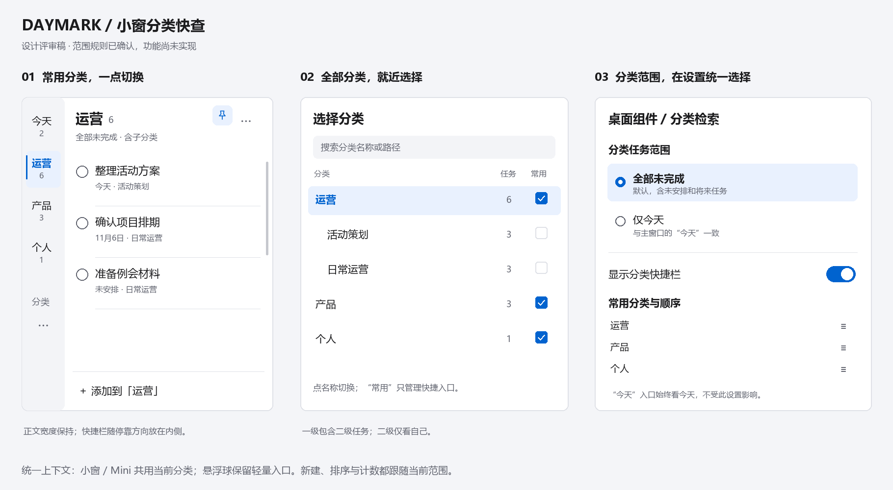

# 小窗分类快查 · 设计评审

范围规则已确认，功能尚未实现。完整交互、数据、接口、异常及测试见[UX-72](../../../docs/design/widget-category-quick-find.md)。

preview.svg为可编辑矢量，preview.png为含sRGB的评审预览；build_preview.py是Windows作者源，使用本机微软雅黑及Pillow/CairoSVG，不分发字体、不进入客户端运行时。图钉沿现有原创IconPaths；其他数据均为虚构设计示例。参考仅为用户给出的分类快捷入口机制，没有拷贝原产品图形。
