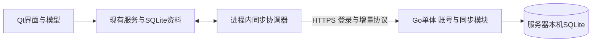

# 账号与服务器同步设计（Go + SQLite）

日期：2026-10-28。用户已确认“未登录本地存储、登录后同步服务器”和“服务端单体Go + SQLite、以后按需升级”，见[FR-042](../01_PRODUCT_SPEC.md#fr-042-账号与存储模式2026-10-28用户确认)及[ADR-026](../ADR/026-go-sqlite-sync-service.md)。其他细节仍为建议，不因本次方向确认视为全部接受或已实现。当前实施及验证状态只维护于[PROGRESS](../PROGRESS.md)。

本页维护需求和产品取舍；工程细化以[服务端架构](server-architecture.md)为准，网络路径/字段/错误语义以[v1协议草案](../api/sync-v1.md)为准。细化文档是可审阅设计，不表示服务已交付。

## 1. 已确认方向与设计前提

按用户决定，客户端继续使用Qt 6.10.2/C++20和SQLite，服务器采用一个Go单体进程及嵌入式SQLite，不部署独立数据库服务器。首期低并发、小数据量，优先可靠性与易部署，不为预期增长引入重型基础设施。

| 账号/网络状态 | 存储与同步行为 |
|---|---|
| 未登录 | 所有操作只保存本地，不上传任务或请求账号同步 |
| 已登录且联网 | 操作先提交本地SQLite，随后自动上传、拉取服务器增量；首次登录即启用安全合并 |
| 已登录但断网/服务器暂不可达 | 本地照常使用，变更持久化待传；恢复网络后自动补齐 |
| 认证失效 | 暂停网络同步、保留本地和待传数据；重新认证同一账号后继续 |
| 主动退出登录 | 立即停止同步并清除登录凭据；本地数据仍可访问和编辑，不删除云端资料 |

登录后本地SQLite仍是界面读写来源，不改成每次编辑都等服务器的在线应用。用户已指定登录即同步；首次正常合并不再要求第二次“启用上传”确认，只有覆盖、清除或跨账号迁移等危险选择才需要明确确认。

这里的后台服务包含两个部分：部署在服务器的身份/同步API，以及Daymark进程内的同步协调器。首期不安装Windows Service、macOS LaunchDaemon或另一个常驻客户端进程。Daymark在托盘运行时继续同步；完全退出后停止同步，服务器继续保存数据。若要求应用退出后仍同步、发送通知，必须另定客户端守护进程及系统权限需求。

用户明确授权设计账号和服务器同步，已通过FR-042及ADR-026追加其确认的行为和选型；历史V1范围保留用于追溯，离线核心能力继续有效。这次方向确认不代表已授权部署、真实账号登录、上传私人任务或自动推送源码。

以下规模是设计假设，供评审和压测使用，并非当前容量承诺：每人2～5台设备、10k任务及关联数据、初期1～100个邀请账号、单地域部署。部署地域、实际人数、运维预算和是否公开注册尚需确认。

## 2. 仓库现状及接入影响

| 已核查事实 | 对本方案的影响 |
|---|---|
| `SqliteDatabase.cpp`当前迁移上限为9，保留001～009历史 | 同步元数据只能新增迁移；升级前必须一致快照，不能上传或替换整个SQLite库 |
| `Task.h`统一任务、真实子任务、时间安排、循环、标签、关联任务、树完成/删除分组 | 同步范围必须覆盖完整业务关系；日历不再建立另一套可写事件 |
| 分类主要持久化在历史`projects`表，兼容旧领域/项目/事件/清单数据 | 线上协议使用当前分类/任务概念；通过映射层处理旧列，不能照搬旧SQL表名作为产品API |
| `TaskRepository::update`使用本机`rowVersion`做CAS | 另设服务器实体版本和拉取游标，本机版本不能直接充当多设备版本 |
| `TaskComponents.cpp::fromSeed`为循环实例生成随机UUID | 两台设备可能为同一循环周期生成不同ID；接入前需固定实例身份与旧ID兼容规则 |
| `RecurrenceService::generate`的AFTER_DAYS使用本机完成记录及本地日期决定后继 | 两台设备并发完成可能产生不同后继；需要明确系列时区及后继身份/冲突规则 |
| `claimDueReminders`会更新提醒下次触发时间并增加任务版本 | 必须区分用户配置和本机投递进度，避免设备A提醒后取消设备B的提醒 |
| 分类删除、排序、循环生成、导入等均可能直接批量修改数据库 | 不能只监听TaskService的单条编辑信号；所有写入路径必须进入事务级变更记录 |
| 现有DB worker持有SQLite连接，QML消费模型和命令 | 网络异步独立运行；远端数据仍经worker和Repository落库，不在QML联网写库 |

事实入口：[模块契约](contracts.md)、[统一任务系统](unified-task-system.md)、[当前产品哲学](../product-philosophy.md)及上述源码。历史架构文档中的目标/旧状态不能替代当前代码和PROGRESS。

## 3. 建议首期需求

| 提案ID | 用户能力或系统保证 | 优先级 |
|---|---|---|
| SYNC-R01 | 未登录只保存本地；登录后自动双向同步，断网/认证失效保留本地及待传修改（FR-042） | P0 |
| SYNC-R02 | 登录、退出、重新认证、账号恢复；首期邀请/管理员建号，公开注册另确认 | P0 |
| SYNC-R03 | 首次登录自动安全合并，过程/结果可查看；覆盖、清空、跨账号搬运才另行确认 | P0 |
| SYNC-R04 | 自动上传本地已提交变更，拉取其他设备变更；提供手动同步、暂停和重试 | P0 |
| SYNC-R05 | 同步任务、分类、标签、父子关系、时间安排、循环、关联、状态、软删除及恢复语义 | P0 |
| SYNC-R06 | 离线队列持久化、幂等重试、断点恢复；崩溃/超时不能丢数据或重复创建 | P0 |
| SYNC-R07 | 并发修改保留双方内容，用户可比较并解决；不默认按设备时间覆盖 | P0 |
| SYNC-R08 | 账号、服务器及本地资料隔离；切换账号不会把前一个账号的数据上传到新账号 | P0 |
| SYNC-R09 | 查看登录设备/会话、撤销访问；失窃设备不能继续获取新增数据 | P0 |
| SYNC-R10 | 可操作同步状态和错误；本地保存、服务器接收、其他设备已拉取分别表述 | P0 |
| SYNC-R11 | TLS、服务器鉴权/隔离、令牌安全保存、隐私日志、备份和恢复演练 | P0 |
| SYNC-R12 | 协议协商、旧客户端限制、游标失效后的安全重建 | P0 |
| SYNC-R13 | 导出个人数据、申请删除账号/云端数据；说明本地副本和备份保留边界 | P0（邀请试用完整交付前） |
| SYNC-R14 | 跨设备保持用户主动调整的排序；窗口位置、DPI等设备配置继续本地保存 | P1（完整同步前） |
| SYNC-R15 | 服务器变更提示以缩短等待，客户端仍以持久化游标补齐 | P1，首期轮询即可 |

账号恢复的交付方式随使用范围确定：个人/邀请试用可由管理员在核实身份后重置；公开注册必须补齐邮件验证、找回密码、发送频率控制和SMTP可靠性，不能只开放注册接口。

同步业务事实；下列范围单独处理：

- 提醒配置同步，每台设备按自己的开关调度；投递记录/已展示状态和系统通知凭据留在本机。首期允许多台设备分别提醒，不承诺“全设备只提醒一次”。
- 业务排序同步；窗口几何、穿透、置顶、主题/字号、当前滚动位置及其他设备偏好首期不同步。
- 当前任务编辑历史首期仍是设备记录；跨设备完整编辑审计需另定保留期限和隐私范围，不把同步变更日志直接当作永久编辑历史。
- 历史兼容数据先保留在本地备份及导出中；首次合并结果必须报告不能映射的遗留对象，不能声称上传后等同整库备份。
- 草稿尚未本地提交时不同步；服务器数据到达不得覆盖当前编辑文本。

首期不包含多人共享、团队权限、附件、第三方日历双向同步、Web任务客户端、计费、AI、服务端代发桌面通知。端到端加密另见第10节，其取舍须在实际上传之前确定。

## 4. 服务端选型与SQLite边界

### 4.1 已确定的最小运行组合

| 组成 | 选择 | 说明 |
|---|---|---|
| 业务运行时 | Go单体，标准库`net/http` | 一个服务包含账号、设备、同步和备份编排，模块内保持边界 |
| 数据访问 | `database/sql` + SQLite驱动 | 显式SQL/事务，避免引入通用ORM |
| SQLite驱动候选 | `modernc.org/sqlite` | 无CGo，便于独立构建/跨平台交付；具体版本和传递依赖在首片依赖ADR锁定 |
| 数据持久化 | 一个服务端SQLite文件 | 账号、会话、全部用户业务及同步日志同库事务；客户端各自保留独立本地SQLite |
| 登录候选 | Go内的账号/会话模块 | 使用成熟密码哈希库及随机令牌，不单独部署Keycloak；细节见第6节，仍待评审 |
| 入口 | HTTPS，由已有网关或Caddy/Nginx终止 | Go可独立运行；有既有网关时不额外增加一套代理 |

不预装PostgreSQL、Keycloak、Redis、消息队列、Kubernetes或完整BaaS平台。早先提案中的这些默认依赖已被本次轻量方向取代；第三方登录/OIDC、公开注册和邮件服务按后续明确需求加入。

SQLite官方将低到中等流量网站列为适用场景；本方案接受其单写者及单实例边界，选择依据是当前需求，不把官方例子换算成本项目容量承诺。[SQLite适用场景](https://sqlite.org/whentouse.html)、[modernc驱动文档及BSD-3-Clause许可](https://pkg.go.dev/modernc.org/sqlite)。

Go采用受支持稳定补丁版。选定驱动后，在真实构建中查询`sqlite_version()`并核验补丁，不将驱动版本号当作SQLite引擎版本；服务端候选必须覆盖官方已修复的WAL-reset问题（3.51.3及以后，或官方对应回补版本）。这只是服务器依赖选择，不擅自升级客户端Qt固定Kit。[Go发布记录](https://go.dev/doc/devel/release)、[SQLite WAL修复说明](https://sqlite.org/wal.html#walreset)。

### 4.2 SQLite运行约束

首期单机、单Go实例、单服务端数据库文件，账号/资料按ID隔离，不按用户拆成许多数据库。数据库位于服务器本机持久磁盘/本机块存储，不放NFS/SMB共享盘；容器部署使用持久卷，更新镜像不删除数据卷。[SQLite WAL并发及文件系统限制](https://sqlite.org/wal.html)。

建议WAL、`synchronous=FULL`、每连接`foreign_keys=ON`和有限`busy_timeout`。使用一个串行写连接执行短事务；只读查询用小型只读连接池，具体大小由压测确定。`BEGIN IMMEDIATE`在读取版本前获取写事务，避免读后升级竞态；获取连接/锁与SQL执行均受请求超时约束。禁止在持写锁期间等待网络、做密码哈希或生成大型导出。SQLite仍可能返回BUSY，须映射成可重试错误，而非吞掉或无限等待。[SQLite事务说明](https://sqlite.org/lang_transaction.html)。

业务表、日志、回执在同一个文件内提交，避免依赖多个ATTACH文件的跨库原子性。读事务保持短小；首次快照固定基线并生成不可变分块，避免长时间读事务导致WAL增长。只在有数据证据时调整checkpoint参数，不先建立额外数据库维护进程。

### 4.3 后续升级条件与迁移路线

只有持续写锁等待/BUSY、同步延迟、备份恢复窗口或多实例部署需求超出实际预算时，才评估PostgreSQL；数据库文件变大本身不触发自动升级。先检查事务长度、索引及查询计划，不能用换库掩盖错误用法。

服务层依赖窄Repository/事务接口，HTTP协议不暴露SQLite行号或SQL方言。后续新增PostgreSQL实现时保留用户/任务ID、实体版本、删除凭据、循环身份及幂等回执语义。采用短维护窗口暂停写入→一致备份→迁移到新库→核对数量/内容摘要/外键与版本→切换并保留原库；失败回到原库，不覆盖源文件。停机切换并验证前不开放新写入；切换后已有新写入时，回滚需同步这些变更，不能直接换回旧文件。游标格式有变则轮换epoch并走安全重建，不承诺仅修改连接串即可升级。

## 5. 系统边界

- **客户端SQLite**：本机业务事实和交互读写来源；保存离线变更队列、服务器基线和冲突记录。
- **同步协调器**：认证状态、触发/退避/重试、推拉和协议转换。应用生命周期管理在AppRuntime；不能继续向AppRuntime或TaskWorkspace堆入全部同步实现。
- **同步API模块**：验证账号和设备权限、输入与关系不变量、幂等、版本CAS、原子批次、变更日志和快照。它保存各设备已提交的共享状态，不参与本机UI绘制。
- **账号模块**：同一Go进程内处理口令校验、会话、撤销和恢复；稳定user_id标识身份，登录名/邮箱变更不改业务归属。第三方身份映射以后另加。
- **服务器SQLite**：保存全部用户及同步状态，同文件事务；不开放客户端直接访问文件，业务协议与客户端SQLite的历史表结构解耦。

Today/Upcoming等视图判定仍集中在C++ QueryService；服务器不新增一套“今天”筛选。服务端必须验证日期、任务树、分类归属、状态及循环写入合法性；用共享契约样本对齐两种语言的不变量，不能信任上传者已经通过客户端验证。

建议同仓`server/`使用独立Go构建、迁移及测试；`docs/api/`保存协议与跨语言样本。客户端新增职责明确的认证/同步模块，平台安全存储留在`src/platform`，SQLite同步元数据访问留在`src/persistence`。具体类名/目录由第一片设计确定，不先创建空框架。

## 6. 登录、退出和账号隔离

### 6.1 登录机制

为保持单Go服务，首期建议第一方账号/密码通过HTTPS登录，Qt使用已有Network模块。密码仅用于当次认证，不持久保存在客户端；服务端使用`golang.org/x/crypto/argon2`的Argon2id、独立随机盐和带版本参数的哈希编码，使用常量时间比较。参数在目标服务器校准，限制同时进行的哈希数量、登录请求频率和口令长度，防止小内存机器被认证请求耗尽；不得使用普通SHA哈希存口令。[Go Argon2文档](https://pkg.go.dev/golang.org/x/crypto/argon2)、[RFC 9106](https://www.rfc-editor.org/rfc/rfc9106.html)。

建议用`crypto/rand`生成256-bit随机access/refresh token，服务端只保存随机token的SHA-256摘要、会话/设备归属、有效期及撤销状态；随机令牌摘要与口令哈希用途不同。API每次验证实际会话及账号状态，不以device_id充当凭证。首期无需JWT、JWKS或单独OIDC服务；账号/会话同业务库备份恢复。[Go安全随机数](https://pkg.go.dev/crypto/rand)。

access token建议15分钟、refresh会话最长30天，作为待评审初值；刷新串行化并在SQLite事务内轮换，检测旧refresh重放后撤销该会话族，改密/恢复同时撤销相关会话。刷新响应丢失可能需要重新登录；若新token不能安全落盘也转重新认证，不明文降级。设备撤销后拒绝该会话后续请求；已受理事务在提交前复查撤销状态/版本，不宣称可以撤回已下载的数据。

Windows优先使用系统凭据保护能力，macOS使用Keychain，统一为平台端口。实现前验证真实令牌长度、系统存储限制及锁定/损坏场景，必要时采用系统保护的密文存储；token不进入QSettings、业务导出、备份元数据或日志。系统安全存储不可用时允许仅本次会话登录，不能静默明文持久化。[Windows CredWriteW](https://learn.microsoft.com/en-us/windows/win32/api/wincred/nf-wincred-credwritew)、[Apple Keychain](https://developer.apple.com/documentation/security/keychain-services)。

账号恢复首期可由同一可执行文件的管理员子命令在核实身份后发起，避免公网管理后台；使用同一服务的受控数据库写路径或停服维护，不让CLI与运行实例竞相写库。公开注册、邮件找回和MFA是独立需求，不能未经实现就在界面承诺。以后接入第三方账号时再设计OIDC授权码/PKCE与相应许可，不把OAuth口令授权混同本节第一方认证。以上认证细节为新的轻量候选，仍需评审及真实安全测试。

### 6.2 首次接入

1. 登录入口明确“登录后同步此资料”；登录成功自动开始首次安全合并，不再增加独立的开启同步确认。界面显示所连接服务器/账号、同步进度和结果；异常冲突/遗留对象提供处理入口。
2. 本地有未绑定资料、云端空：先创建本地一致快照和持久化导入计划，再自动把此资料绑定该账号并上传。
3. 本地空、云端有数据：下载一致快照到新的临时资料库，校验后切换。
4. 未绑定本地资料与云端双方有数据：自动合并保留双方；保留ID，按ID/版本及循环身份识别同一对象，不按标题去重。重名分类保留独立项，真实同ID冲突进入冲突中心，不因一个冲突停止所有任务同步。
5. 用户主动选择只使用服务器资料时，明确确认、先保存本地一致快照并保留原资料，再启用独立账号资料；不直接覆盖当前库。

首次大批导入采用服务器暂存区与导入ID：允许分块传输和重试，验证完整关系、配额和预期服务器版本后原子发布；失败前不暴露半套可见资料。客户端也在新库验证，成功切换前保留原库。与登录后持续同步的“本地先保存、网络稍后重试”区分。

### 6.3 账号资料隔离

本地资料由`server_instance_id + user_id + dataset_id`绑定，切换账号使用独立资料数据库/目录，不在原库上更换owner。只有未绑定的纯本地资料可在首次登录时自动接入；已经属于账号A的资料不自动传给账号B，跨账号搬运需显式导出/导入和预览。

退出登录即停止网络、清除本机令牌，保留该资料和待传队列；可继续离线编辑。重新登录同一身份后继续同步。主动选择另一个账号时打开其独立资料或空资料，不继承前一个账号的任务。清除本机账号资料是单独的危险操作：显示未同步数量、要求备份/明确确认，不能随退出登录附带执行。

请求/回调携带profile generation。切换资料或退出后到达的旧响应必须丢弃，不能写进新库。凭据和游标按服务器实例而非只有URL隔离；更改服务器地址需要显式重新连接。

设备ID只用于标识，设备撤销绑定服务端实际session；更换device_id不能重新激活已撤销会话。退出先使客户端进入不再联网的状态，尝试撤销服务端会话并清本机凭据；离线退出时无法声称远端已撤销，只能保证本机停止使用凭据。重新登录建立新会话后再恢复该账号待传队列。

## 7. 增量同步协议

### 7.1 数据单位和元数据

以业务聚合传输，首期不暴露任意SQL行写接口。任务聚合包含任务字段、schedule、标签ID、关联任务及业务提醒配置；循环规则是独立共享实体。任务树联动、分类删除/移动、循环修改和排序使用带依赖的原子命令组。

| 位置 | 建议元数据/表 | 目的 |
|---|---|---|
| 本地 | `sync_profile` | 服务器/身份/资料绑定、protocol version、epoch、已应用游标 |
| 本地 | `sync_base` | 各实体最后确认的server revision及规范基线，用于冲突比较 |
| 本地 | `sync_outbox` | mutation/group ID、单调本地序号、命令意图、base revision、已提交payload、状态 |
| 本地 | `sync_conflicts` | base/local/remote三份必要内容、关联命令和解决状态；属于私有业务数据 |
| 服务器 | 用户、资料、设备会话映射 | 身份和访问边界 |
| 服务器 | 任务、分类、标签、循环、关联、排序及删除记录 | 类型明确的业务表、组合外键和实体revision |
| 服务器 | `dataset_heads`、`change_batches` | 每个资料的epoch/提交序号、事务批次及可重放payload |
| 服务器 | `mutation_receipts` | mutation ID、请求哈希和已确认结果，支持超时重放 |

不直接复用导入JSON或Qt的`Task`内存结构作为网络协议：后者包含查询投影、命令上下文和本机状态。定义版本化DTO，保留FieldPatch的未指定/清空/设值语义；未知写字段和不支持的协议版本应明确拒绝。日期为`YYYY-MM-DD`，UTC瞬间统一Z，定时时间保留IANA时区，全天结束日保持排他语义；客户端时间不决定同步先后。

### 7.2 本地写入和推送

1. 用户命令按现有服务验证，在同一SQLite事务提交业务写入与outbox；持久化成功即可完成本地交互。
2. 事务级变更收集必须覆盖普通编辑、父子批操作、分类/标签、排序、规则修改/停止、循环物化、导入与恢复；禁止只依赖`updated_at_utc`扫描。正式接入前列出全部写入者并做回滚/漏记测试。
3. 同一个资料首期只有一个推送在途；冻结其payload，重试沿用mutation ID和内容。后续编辑写入新记录，不修改已发送记录；可合并的未发送编辑也必须保留服务器基线及依赖关系。
4. 服务端鉴权后先检查幂等回执，同ID同内容返回既有结果，同ID不同内容拒绝；再校验base revisions、引用关系和命令组不变量，业务修改、日志及回执在同一SQLite事务提交。
5. 客户端收到确认后在SQLite事务内更新服务器基线、确认对应outbox。若发送后又发生本地编辑，确认不能覆盖新值；只推进对应基线并重新计算后继待发变更。

推送返回的服务器head仅用于通知，不可直接充当“本机已经拉取到这里”的游标：它可能包含本机尚未获取的其他设备事务。客户端必须实际拉取并成功应用全部批次后，才推进applied cursor。

网络超时不等于服务端未提交；本地outbox已提交但响应丢失也不等于可以生成一个新mutation。幂等回执至少覆盖仍可被接受的重试周期；清理后旧epoch/超期操作须显式重建基线，不能把旧请求重新当作新命令。

### 7.3 游标、分页和原子拉取

游标包含服务器实例、资料、epoch和提交序号，服务端校验作用域。服务端使用同库串行写连接及`BEGIN IMMEDIATE`：取得写事务后读取当前状态、验证、增加该资料的普通事务计数列，写数据/日志/回执再提交。不同账号的写入也会串行化，符合当前低并发目标；不得照搬PostgreSQL的`SELECT FOR UPDATE`或行级锁假设。

事务计数与数据同提交、同回滚，失败不发布head。应用协议不使用SQLite ROWID作为持久同步游标；后续更换数据库时仍须保证提交有序，不能直接换成独立sequence。SQLite并发与事务依据见[官方说明](https://sqlite.org/lang_transaction.html)，资料游标的定义为本项目设计。

拉取返回完整命令组/事务批次，包含当时的变更payload和tombstone，不用“日志ID + 当前可变行”拼接历史分页。分页不能拆开一个树操作或关联事务；大组使用有总大小上限的分块暂存，完整校验后一次应用。客户端在同一SQLite事务应用批次、记录必要冲突并推进游标，失败均不推进。远端应用不会再次生成outbox，也不重复执行本机完成/提醒副作用。

首次快照使用一致数据库快照及对应cutoff生成不可变分块，分块不能分别读取不断变化的当前表。其后从cutoff拉增量。快照期间新增写入不会丢失；快照令牌过期则重新开始，仍保留原资料和待传修改。

变更日志初期可按90天窗口保留并结合活跃设备进度清理。过期设备收到`cursor_expired`，先保存本地待传修改、下载新快照，再对新基线重放/提交待解决冲突，不能直接覆盖本地。业务删除记录在首期邀请规模下不按日志窗口自动清除；只有明确永久清除流程才压缩为足以拒绝复活的删除凭据。账号删除另行处理。

服务器从旧备份恢复必须轮换dataset/server epoch，强制客户端重新校准：仅“恢复备份后继续从旧序号运行”可能让客户端永远跳过已丢失的写入。

### 7.4 冲突策略

首期建议实体/命令组CAS + 持久化冲突中心，不直接上CRDT，也不使用`updated_at`最后写入者胜出。

| 场景 | 推荐处理 |
|---|---|
| 修改发生在不同任务 | 各自提交、自动收敛 |
| 同一任务被双方编辑 | 保存base/local/remote，提示用户比较；首期整个任务聚合冲突，不承诺字段自动合并 |
| 一端删除、另一端修改 | 主视图保持删除，保留另一端修改于冲突记录；用户可恢复或另存，不能悄悄复活 |
| 父任务批量完成与子任务新增/移动并发 | 检查树成员版本及依赖；整个命令组冲突，不能只应用部分子任务 |
| 分类删除与任务移入并发 | 验证当前关系集合，安全重放或整组冲突；任务保留，引用不能悬空 |
| 双方调整同一排序范围 | 独立排序集合版本冲突，不把整组排序更新当作每条任务内容冲突 |
| 拉取时该任务有尚未保存草稿 | 保留草稿和原版本；延期应用或进入现有版本冲突流程，不替换输入 |

关系集合的并发保护必须包含“原来没有、现在新出现”的成员：仅逐行检查上传ID的版本不足以发现另一设备新增的子项。建议为任务树/分类树/循环系列/排序集合维护结构版本，命令同时携带read set和结构版本；在取得SQLite写事务后验证。具体字段在协议切片冻结并以竞争测试证明。

冲突只暂停有关实体及依赖命令，无关任务继续同步。解决时用户选择保留本地、远端或编辑合并结果，再以最新server revision提交；若远端再次变化，继续冲突，不强制覆盖。冲突记录安全落库后可继续消费变更游标，不让单个冲突永远堵住整个账号。

## 8. 循环与提醒的专项设计

### 8.1 固定循环

新生成实例使用稳定身份：固定namespace、系列/规则代次ID与不可变occurrence key导出UUIDv5；相同周期跨设备得到同一ID，服务端再以`dataset + recurrence + occurrence`唯一约束防重。改期不改变occurrence key，修改循环规则创建新代次，保留历史和已覆盖实例。

历史实例不批量重写主键。首次接入建立occurrence到已有Task ID的映射；服务器对同周期不同旧ID给出canonical ID及显式别名映射，客户端在事务内重写外键、关系、outbox和提醒引用。若两份实例都有用户编辑，合并前建立冲突，不能简单丢弃一个。此兼容切片是全量同步上线前的独立门禁。

### 8.2 完成后N天循环

为系列明确持久化的IANA时区，后继日期按被确认的完成瞬间转该时区计算，而非各设备当前时区。新后继身份由`规则代次 + 前驱实例ID`确定，避免两端创建两个后继；服务端约束每个前驱最多一个后继。

两端离线完成同一前驱时，完成状态、完成瞬间及后继形成原子组。并发完成时间不同或重新打开与完成并发时，产生系列冲突；保留另一端暂存后继的内容，选择完成记录后重算同一后继日期。原有“最多一个OPEN后继”约束仍需校验；本机可离线暂存，恢复网络后经CAS收敛。

### 8.3 提醒

拆分可同步的提醒规则/锚点与设备本地`next_due / last_fired / delivery_history`。现有`remind_at_utc`兼有下次触发含义，不能原样当作跨设备配置传输。迁移必须从已有anchor、repeat和history保持本机进度，不制造提醒重放。

每台设备独立启停通知，远端完成/删除生效后本机重新调度；设备长时间离线时可能对已在别处完成的任务提醒，需要如实说明。若用户要求全设备仅一次、应用退出后由服务器提醒，需另设在线协调及系统推送通道，并接受离线时无法保证全局恰好一次。

## 9. API及错误草案

按集成式账号候选，同一Go服务提供第一方认证和同步API；不冒充通用OAuth/OIDC提供方，不要求其他业务接入这套登录协议。

接口职责、dataset作用域路径、请求/回执/分页JSON样本、幂等摘要、RFC 9457错误及恢复规则统一维护于[v1协议草案](../api/sync-v1.md)。账号/设备是会话端点；push/pull/快照/导入均显式属于某个dataset；健康检查是独立运维端点。本页不保留第二张容易偏离的路径表。OpenAPI/schema在对应切片冻结，不先生成空端点。

网络与5xx指数退避并加抖动；429遵守Retry-After；401最多一次串行刷新，失败转重新登录；冲突和校验错误不盲目重试。初始化/激活/恢复联网及写入后触发同步，建议写入后1～2秒合并、前台空闲每30秒拉取、托盘每2分钟兜底；这些是可调目标，不是已测时延。以后可加SSE/WebSocket提示，提示丢失仍靠游标补齐。

## 10. 安全、运维与费用边界

- 通过TLS终止入口访问Go API；SQLite文件及备份只允许服务运行身份访问，不从静态文件目录公开。客户端正常校验证书，不提供忽略TLS错误的生产开关；管理员能力不作为普通用户接口开放。
- 所有业务主键/外键带owner/资料作用域，owner从已验证会话推导，不采信上传的user_id。Repository方法必须要求账号/资料上下文，SQL显式限定归属；组合外键阻止跨账号引用。SQLite没有PostgreSQL RLS，不能承诺数据库自动行隔离，必须用跨账号越权集成测试覆盖查改删、游标、快照及导出入口。
- 校验body大小、实体/关系数量、字符串长度、递归深度、快照空间和账号配额；邀请试用也需要有限资源预算，不能让单账号大包耗尽服务。
- 不记录任务标题/备注、完整payload、口令或token。日志保留请求ID、错误类别、耗时和批次数；标识脱敏，诊断上传单独征得用户授权。服务运行指标不扩展为客户端行为遥测。
- 同步会传播误删，不能替代备份。服务器按[工程架构](server-architecture.md)第12节的调度和验收，通过SQLite Online Backup API或经驱动验证的`VACUUM INTO`创建一致快照，包含同库账号/会话/业务/回执；禁止运行中只复制主`.db`文件。备份加密并存到故障域之外，定期做完整性、外键及恢复后epoch演练；首期不承诺PITR或复制能力。参见[SQLite备份文档](https://sqlite.org/backup.html)。
- 初期一个Go可执行文件即可运行账号和同步，优先复用已有HTTPS入口；无现成入口时增加Caddy/Nginx。可选systemd或单容器部署，不要求Docker Compose；1 vCPU/1GB RAM可作为包含口令哈希预算的小规模测量起点，不是已测最低配置或容量保证。数据库和备份路径由配置指定，代码不包含本机绝对路径。
- 实际费用由服务器/地域、磁盘、外部备份、域名、SMTP及监控组成；公开注册另含邮件送达、防滥用与值守成本。用户确认已有基础设施后再列真实报价，本轮不虚报固定月费或购买服务。
- 私人自托管可先接受维护窗口；公开运营需另定可用性、灾难恢复和隐私/账号删除政策。异机备份年龄/RTO目标及演练以[工程架构](server-architecture.md)第2/12节为准，不能以单机在线代表高可用。

**隐私关键取舍**：TLS和磁盘/备份加密仍允许服务器运营者读取任务正文；它们不等于端到端加密。推荐首期采用这一普通自托管信任模型，但必须由用户接受。若要求运营者也无法读取，须在上传前改为客户端加密设计，重新评估密钥恢复、多设备入网、冲突比较、元数据暴露和服务端关系校验；不能把E2EE当作上线后无代价可加的开关。

账号删除需要重新认证、列出受影响资料并明确确认；同库事务先撤销会话、禁止继续同步，再按可重试流程处理资料及导出文件。建议备份自然轮换上限30天，恢复时重放删除凭据，避免已删除账号因灾备复活。已下载到离线设备的数据不能远程保证擦除；本地清除由对应设备单独完成。

## 11. 界面目标及HIG映射

本轮不改UI。后续在现有两栏设置中增加“账号与同步”目的地，沿用UX-56/UX-60、P-13/14/17/21及[UI基准](ui-baseline.md)/[验收](ui-acceptance.md)，不把登录放在应用启动必经路径。

| HIG原则/现有UX目标 | 后续具体交互及验收 |
|---|---|
| Agency；UX-03快速录入、UX-05详情上下文和UX-07恢复与信任 | 登录入口明确会同步资料，登录后自动合并；可取消登录/暂停同步；冲突保留双方与草稿，退出不清库 |
| Responsibility；UX-07恢复与信任、UX-10对比与状态 | 显示服务器/账号、上次成功同步、待传/冲突数量和可执行修复动作；本地保存不冒充全设备已同步 |
| Simplicity/Familiarity；UX-56设置导航 | 同步日常安静运行；忙碌/错误就地反馈，连接/设备/冲突从设置进入，不常驻多套工具栏 |
| Flexibility/Craft；UX-09～12字体布局、状态、键盘及动效，UX-14平台融入 | 浅深/高对比、100/200%文字、键盘Tab/Enter/Esc、焦点返回及可访问名称；状态不用颜色单独表达 |

原则来源沿用[官方研究及映射](ui-research.md)和[Apple Design principles](https://developer.apple.com/design/human-interface-guidelines/design-principles)，具体行距/文案由Daymark定义；后续实施必须补正常、空态、登录等待、首次合并、同步中、离线、需登录、错误、冲突的完整视觉关系与真实截图。

同步状态与认证状态分别建模：`local_only / idle / syncing / paused / offline / error`加`logged_out / authorizing / authenticated / reauth_required`；冲突数量是独立维度，不能用一个“同步失败”覆盖所有情况。只有所有待传变更获确认且已拉到观察到的服务器head，才显示本设备与服务器一致；其他设备是否拉取另以其已应用进度表述。

## 12. 分片实施及验收门禁

| 切片 | 可审阅交付 | 必须证明 |
|---|---|---|
| S0 范围/契约 | 已确认方向记录于FR-042/ADR-026；其余评审后冻结OpenAPI、DTO、依赖及故障清单 | 未接受的假设不伪装为需求，平台/安全/资源条件清楚 |
| S1 本地同步准备 | 追加迁移、资料隔离、事务变更收集、提醒拆分、循环身份设计 | 所有写路径可追踪；本地原功能回归；失败回滚、备份恢复 |
| S2 认证与最小服务 | 可本地启动的Go+SQLite单体，集成账号/会话与平台凭据端口 | 真实登录/刷新/过期/撤销及账号隔离、单实例持久化；不接入真实任务库 |
| S3 最小双端纵片 | 两份临时资料完成“新建普通任务→推送→拉取→修改/完成→另一端收敛” | 超时后重放不重复；响应确认不覆盖后续编辑；重启可恢复 |
| S4 完整业务与冲突 | 分类/标签/树/循环/提醒/排序、首次合并、快照/冲突恢复 | 关系事务、并发删除/恢复、循环不分叉、离线编辑不被覆盖 |
| S5 私人试用/交付 | 测试部署、真实Windows/macOS两台设备、恢复演练及使用说明 | 发布门禁、真实登录/凭据/通知验证、隐私检查和运维步骤 |

S1内部仍按一次一个最小可运行子切片推进；S3只同步普通任务时限定测试fixture，不允许真实资料“部分上云”却显示全量已同步。部署、开放注册、登录真实账号、上传真实任务及Git推送不包含在本轮设计授权中。

核心测试清单：

1. 未登录/网络不可用时原CRUD、日历、循环及本地提醒可用；网络超时不阻塞GUI/DB worker。
2. SQLite在业务写/outbox之间故障、服务器在数据/日志/回执之间故障，均无半提交；发送后失联和确认前退出可重试。
3. 两客户端并发同任务编辑、删除vs修改、父子完成vs新增、分类删除vs移入、排序及冲突解决再次竞争。
4. 用屏障控制两个服务器事务的提交时序，证明游标不漏；分页与大树组原子应用，push head不能跳过pull。
5. 固定循环同周期跨设备仅一个实例；历史不同ID映射保留全部引用；AFTER_DAYS并发完成、跨时区、DST及重新打开不生成两个后继。
6. 本机提醒触发不会改写别端配置，服务器完成/删除后重调度；离线过期提醒边界明确。
7. 未登录零同步请求，登录后无需重复启用即开始合并；第一次双方有数据、ID冲突/重名分类、导入中断、磁盘满、遗留对象、无效引用均可恢复；失败原资料不被覆盖。
8. 账号A→B切换、旧响应晚到、伪造owner/跨账号外键、游标/快照令牌越权、刷新重放及被撤销会话。
9. 日志压缩、游标过期、长离线后待传重放、服务端旧备份恢复/epoch变化，不复活已删除数据。
10. 使用所选Go驱动的真实文件SQLite验证WAL、BUSY/超时、崩溃恢复、事务顺序、账号隔离和在线备份，不用纯内存库或Mock替代；Qt自动测试全部用QTemporaryDir，Go使用测试临时目录。数据库迁移及恢复保留完整用户/实体ID、版本、回执和删除凭据。
11. 10k任务及关系、初次快照、1k离线变更、重连风暴及慢网：记录CPU/内存、吞吐、P95延迟/锁等待和界面响应，基于明确硬件再确定预算。
12. Windows/macOS真实登录、安全存储、休眠恢复和退出/托盘行为；浅深/200%/键盘/读屏及真实通知单列，不用offscreen证明OS能力。

以上为验收目标，不能仅由现有桌面fast测试证明。实现包含真实Go/SQLite/HTTP测试、Qt临时库及双端TLS联调，运行方式见[server](../../server/README.md)，逐项实际范围及未验证平台见PROGRESS。

## 13. 已确认方向与剩余取舍

| 决策 | 当前结论 | 剩余边界 |
|---|---|---|
| 账号与存储 | 用户已确认：未登录本地存储，登录后同步服务器 | 登录后仍本地先保存；不改变离线能力，正常首次同步自动开始 |
| 服务端 | 用户已确认：单体Go + SQLite，低性能需求、以后按需升级 | 单实例/本机磁盘；后续按写锁、备份窗口或扩实例需求迁移，不预先搭两套数据库 |
| 登录实现 | 首期账号/会话集成Go，第一方密码登录 | 管理员建号/恢复口令；不提供公开注册或邮件找回 |
| 使用范围 | 建议个人/小规模邀请账号，Windows/macOS多设备 | 公开注册需要邮件、反滥用、隐私/删除和持续值守范围 |
| 数据可信边界 | 自己控制服务器，首期TLS及存储/备份保护，运营者可读正文 | 若要求E2EE，先改设计后上传 |
| 首次数据与冲突 | 登录后自动合并保留双方；同任务冲突显式处理 | 用户主动覆盖/清除及跨账号搬运再确认，不把重复许可作为正常同步前置 |
| 提醒与运行 | 每台设备独立提醒；托盘驻留同步，完全退出后停止 | 全设备只提醒一次或退出后继续需新增协调/守护进程/推送设计 |

确认时还需补充已有服务器的OS/CPU/内存、域名/HTTPS、部署地域及预计账号数；这些信息决定运维规格和后续真实费用估算，不影响当前离线与增量同步原则。
