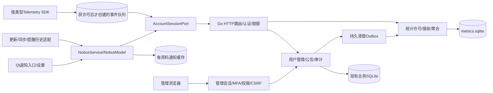

# BIZ-01 Daymark业务系统、安静通知中心与可选择的使用统计

2026-11-12。本文按[新增能力标准](new-capability-standard.md)完成系统设计，供用户评审；不是实现或验收通过声明。当前状态唯一见[PROGRESS](../PROGRESS.md)。沿用[产品哲学](../product-philosophy.md)、[账号架构](server-architecture.md)、[诊断体系](diagnostic-codes.md)及P-01/03/05/10/13/14/22。

## 1 功能定义与实例

### 1.1 三项能力与产品边界

| ID | 用户结果 | 默认行为 |
|---|---|---|
| NC-01 通知中心 | 主动查看公告、更新状态和需要处理的运行问题 | 几乎无感：不弹窗、不抢焦点、不响铃、不自动展开、不显示红色数字角标 |
| BIZ-01 业务后台 | 通过浏览器管理用户、会话、公告、权限及审计 | 独立管理员身份；普通注册账号永远不能自动成为管理员 |
| TEL-01 使用统计 | 在获得许可后衡量功能使用、稳定性和性能，看板呈现聚合结果 | 客户端使用统计默认关闭，设置中明确选择；不采集任务内容 |

Daymark仍是本地优先的任务工具。主窗整理安排、小窗执行、Mini扫读、球停靠的职责不变；不把通知变成第五种常驻工作区，不让后台与统计拖慢核心操作。未登录继续本地使用，不新增公告或统计网络请求；登录只连接用户选定的服务，禁止自定义服务器账号的埋点另传官方服务器。

### 1.2 “几乎无感”是可验证的行为

1. 普通公告、维护说明、发布说明即使被后台标为“重要”，也不能触发弹窗、置顶、闪烁、声音、任务栏闪动或抢焦点。
2. 主窗固定入口可发现；未读只用克制的图标状态，并可关闭未读提示。没有催读、重复提醒、倒计时、营销横幅或强制已读。
3. 用户主动打开时才显示紧凑内容；列表阅读不改变任务选择、草稿、滚动和小窗形态。
4. 已有任务到点提醒仍由用户明确设置的提醒系统负责；通知中心只提供历史入口，不改变提醒的时间、延后或完成语义。
5. 保存失败、认证失效、破坏性操作确认和数据完整性错误仍在发生位置及时显示可操作反馈。通知中心可以记录摘要，不能替代这些反馈。
6. 已有“更新完成”自动提示收敛为底部更新状态；重启由用户选择。明确手动发起的检查、安装或重启保留操作结果反馈。

### 1.3 完整实例

- 管理员发布维护公告→已登录设备在下次合适的同步时机得到修订提示→后台获取并缓存→主窗入口状态轻微改变，正在输入的任务不受影响→用户点击入口并打开公告→已读本地生效，联网后幂等确认到账号其他设备。
- 同步暂时断网→原账号入口显示实际失败→连续同类失败在中心合并为一项，不每30秒增加一条→恢复后标为已解决。自动备份成功、普通同步成功不生成通知。
- 用户从未开启使用统计→无统计ID、无事件队列、无统计网络请求。开启后展示采集范围及当前目的地→只记录白名单事件→关闭立即停止采集/发送、清空未发送事件并撤回服务端许可；离线时撤回意图保留，恢复连接后优先完成。

非目标：站内聊天、广告推送、远程执行脚本、强制公告弹窗、第三方营销SDK、管理员查看任务内容、微服务平台、公开游客追踪、实时用户行为回放。账号找回、邮箱验证、支付和组织协作不是本轮顺带增加的能力。

## 2 现状与技术选型

现状：Qt6.10.2/C++20/QML；任务事实/同步日志在本地SQLite；Go单体已有账号、会话、同步、能力发现、备份恢复和结构化错误；Windows更新有独立原生SDK和GitHub签名发行链。没有通知后台、管理员体系或客户端遥测。不能把设计写成已有功能。

| 项目 | 推荐 | 取舍与扩展边界 |
|---|---|---|
| 服务部署 | 继续一个Go进程、现有HTTPS入口 | 初期无新服务器/守护服务；模块独立，未来按实际容量拆分 |
| 业务存储 | 现有SQLite增加业务表 | 用户/公告/审计有事务关系；沿用单写者、有限读池、WAL、一致备份 |
| 统计存储 | 独立`metrics.sqlite`、独立有界写队列 | 统计写入不争用同步写者；不假装跨两个SQLite有原子事务 |
| 后台页面 | Go `html/template` + `embed` CSS/原生ES modules | 无Node运行时、CDN或SPA框架；表单与分页为主，图表SVG附数据表 |
| 客户端模型 | C++服务/仓储 + QAbstractListModel +按需QML | 不在QML轮询全表；不预建新窗口、全局隐藏大面板 |
| 下行通知 | HTTPS增量拉取，借现有同步响应头提示修订 | 不引入WebSocket、消息队列或新高频定时器 |
| 管理认证 | 独立密码会话+TOTP，恢复码 | 不复用普通用户权限，不提供管理员免密URL；公网管理要求MFA |
| 埋点SDK | 项目内轻量C++模块，强类型事件 | 无第三方采集SDK、设备指纹、主线程磁盘写入 |

Qt、Go、SQLite沿既有固定版本/许可。TOTP候选`github.com/pquerna/otp v1.5.0`，Apache-2.0，官方仓库有对应tag；实施前补ADR、锁定校验和、审查传递依赖及漏洞，未批准不添加依赖。相比自写密码算法，采用标准TOTP库；二维码不是必要依赖，可先提供本机保护的设置密钥/otpauth链接。图标与字体沿Daymark自有资源，不复制Apple资产。

## 3 架构与调用数据流



任务同步契约和新增业务契约分开。通知不是Task、不是同步command；统计不是任务outbox。现有任务schema11不因引入通知或统计缓存再次升级。业务服务器migration接续现有编号；本地通知缓存和统计队列各自管理版本，损坏时可重建，不能重建任务库。

事实归属：服务端决定公告发布、可见范围和撤销；账号已读服务端归并，本机可离线乐观记录；本地更新状态来自原生SDK，提醒历史来自现有Repository；统计许可和事件接收原子性归统计库，用户身份/授权归业务库。跨库账号删除通过持久Outbox完成，而不是先删身份后遗留无法关联的数据。

## 4 模块和生命周期

| 模块 | 输入→输出/责任 | 线程、取消与验证边界 |
|---|---|---|
| `NoticeService` | 本地Provider/远端delta→去重、排序、未读、已解决 | C++裁决；时钟/仓储/传输可注入，绑定资料generation |
| `NoticeRepository` | delta/读回执→缓存与游标同事务 | 现有工作线程串行；I/O失败不推进游标 |
| `NoticeModel` | 服务投影→稳定ID增量行 | UI线程仅发模型通知；最多100条在内存 |
| `LocalNoticeProviders` | 更新/同步/备份失败/提醒历史→统一展示项 | 只引用源状态，不复制第二套任务或更新状态机 |
| `NoticeFetcher` | 账号+修订/ETag→分页delta | 一个进行中请求；退出/换账号/换URL取消并丢弃旧回调 |
| `AccountSessionPort` | 指定profile的请求→鉴权HTTPS响应 | 从现有同步网络层提取复用；单飞刷新令牌、TLS/代理/诊断统一，令牌不进QML |
| `AdminService` | 授权命令→用户/会话/公告/CAS/审计 | 复用业务写者；操作、审计、修订/outbox同事务 |
| `AdminWeb` | HTTP表单→Service→模板 | 表单验证失败保留非敏感草稿；不直接SQL，不信客户端角色 |
| `TelemetryClient` | 已许可的类型事件→有界队列 | 关闭时No-op；不分配队列/ID/工作线程 |
| `TelemetryIngest` | 许可epoch+批次→回执 | 独立写者事务内验许可/去重/落库；过载拒绝统计请求 |
| `RollupWorker` | 接收记录→小时/日聚合 | 小批次事务及检查点，遇业务压力延后；可幂等重跑 |
| `DashboardQuery` | 日期/白名单维度→聚合与分母 | 有限时间范围/分页；不用任意SQL，不返回个人原始事件 |
| `BusinessOutboxWorker` | 账号删除/撤权任务→跨库清理回执 | 幂等、持久重试；崩溃后继续，未完成不得宣称清理结束 |

通知Loader只在用户首次打开时创建，关闭释放视图；后台只持有小模型/缓存连接。统计关闭和账号退出优先于尚未发送事件。shutdown不为统计阻塞退出；未发送数据按保留规则处理。任何异步操作携带`profile_id/origin_binding/generation`，统计再带`consent_epoch`。

## 5 协议及兼容

### 5.1 版本、发现与限额

- 继续HTTP JSON；不引入RPC。新增`/business/v1`、`/telemetry/v1`和`/admin`独立契约，字段严格校验、显式版本。管理员接口不能被桌面token调用。
- 现有`/v1/capabilities`的`features`是闭合对象，`Metadata`仅非业务诊断；**均不塞入公告事实或修订**。新增可忽略响应头`X-Daymark-Business: notices-v1`、`X-Daymark-Notices-Revision: <uint64>`提示支持和失效；真正可见公告仍由鉴权业务接口返回。无头/404=未支持，不报错、不不断探测。旧客户端忽略头，新客户端不依赖其正确性保证拉取完整。
- 30分钟最小后台检查间隔，借现有成功同步触发；头部修订未变不拉内容。用户打开中心允许一次条件请求；无头的新服务也可通过一次业务发现缓存结果。隐藏/纯球模式可延后，恢复主窗再刷新；不是30分钟必唤醒定时器。不承诺即时公告送达。
- `GET /business/v1/capabilities`返回模块版本、分页上限、保留窗；会话期缓存。所有游标绑定用户、服务实例/data epoch、筛选条件及协议版本，过期410要求重建通知缓存；不影响任务同步游标。
- 公告每页≤50，标题≤80 Unicode码点、正文≤4000，单响应≤256KiB；纯文本，禁止HTML/Markdown远程图片。请求ID/错误头沿现有体系。

### 5.2 接口清单

| 方法/路径 | 输入/前置条件 | 成功/幂等/失败 |
|---|---|---|
| GET `/business/v1/notices?cursor=&limit=` | 用户Bearer、条件ETag | 200 delta+next_cursor+has_more；304无变化；410重取 |
| PUT `/business/v1/notices/{id}/read` | `{read_revision, operation_id}`，仅可见项 | 最大已读revision单调合并；重复204，不因旧回执降级 |
| POST `/business/v1/notices/read-batch` | operation_id、至多500组id/read_revision，绑定同一资料快照 | 原子逐项验证/单调归并；同key同内容原回执，不隐式覆盖后来消息 |
| POST `/admin/api/v1/notices` | 发布权限、CSRF、草稿、operation_id | 201草稿ID/revision；重复返回原结果 |
| PATCH `/admin/api/v1/notices/{id}` | `If-Match`版本、完整字段白名单 | 200新版本；412保留草稿供重新载入 |
| POST `/admin/api/v1/notices/{id}/publish` | 发布权限、If-Match、operation_id、确认受众 | 200发布/定时状态；同key不同内容409 |
| POST `/admin/api/v1/notices/{id}/revoke` | 发布权限、If-Match、operation_id | 原子撤销+delta；重发原回执 |
| GET `/admin/api/v1/users` | 用户管理权限、分页/状态过滤 | 基础账号信息；不返回密码/令牌/任务正文 |
| POST `/admin/api/v1/users/{id}/status` | 管理权限、If-Match、原因、operation_id | 禁用/恢复；禁用同事务撤销会话 |
| POST `/admin/api/v1/users/{id}/revoke-sessions` | 管理权限、operation_id | 幂等撤销，不冒充用户登录 |
| PUT `/telemetry/v1/consent` | 用户Bearer、随机subject、epoch、enabled、policy_version | 串行开启/撤回；旧epoch拒绝；撤回幂等 |
| GET `/telemetry/v1/consent` | 用户Bearer、属于本设备的subject绑定 | 当前epoch/许可/策略版本；无许可不创建采集队列 |
| POST `/telemetry/v1/batches` | 有效同意、批次ID、epoch、白名单事件 | 202持久回执；重复原结果；422坏批次，429限流，503过载 |
| GET `/admin/api/v1/metrics` | analyst权限、白名单指标/时间桶 | 聚合、参与口径、缺失/抑制标识；不返回原始事件 |

管理员会话登录/MFA/退出只走`/admin/session/*`的同源表单，使用Cookie而非桌面Bearer。服务端分页、索引和速率限制不能由UI代替。业务提交超时按operation_id查询/重试，不把未知结果视为失败；只读请求可退避重试。统计丢失允许，业务公告提交/读回执不以丢弃代替可靠性。

### 5.3 公告delta与事件示例（合成资料）

```json
{"items":[{"id":"00000000-0000-4000-8000-000000000001","revision":2,
"unread_revision":2,"read_revision":1,"state":"published","title":"维护说明","body":"今晚有短时维护。",
"published_at":"2026-11-12T12:00:00Z","expires_at":"2026-11-14T12:00:00Z",
"action":{"kind":"open_account"}}],"removed_ids":[],"next_cursor":"opaque","has_more":false}
```

```json
{"batch_id":"00000000-0000-4000-8000-000000000002","consent_epoch":3,
"schema_version":1,"events":[{"id":"00000000-0000-4000-8000-000000000003",
"name":"app.startup","version":1,"occurred_at":"2026-11-12T12:00:00Z",
"properties":{"app_version":"3.0.0","os":"windows","duration_bucket":"500_1000ms"}}]}
```

`subject_id`在鉴权会话/请求绑定中传递，不允许任意指定其他账号subject。UUID示例不是实际用户资料。未知action按不可执行纯文本展示；未知协议主版本禁用该模块，不阻止任务功能。

许可epoch由服务器分配。修改许可使用`{operation_id, expected_epoch, enabled, policy_version}`，CAS成功后epoch递增；重放相同operation_id只返回原回执，不重复改变当前状态。首次开启须等服务端确认再开始采集；离线开启显示待连接，不提前囤积行为。撤回本机立即执行，服务端回执丢失按同一operation_id重试；重新开启须先完成待撤回再用新epoch提交。409重新读取状态并保持停止，不能用陈旧开启请求覆盖较新的撤回。

## 6 类型与接口契约

```cpp
enum class NoticeSource { Announcement, Update, SyncIssue, BackupIssue, ReminderHistory };
enum class NoticeAction { None, OpenAccount, OpenBackupSettings, CheckUpdate, ReleaseNotes };
struct NoticeKey { NoticeSource source; QString stableId; };
struct NoticeItem {
    NoticeKey key;
    quint64 revision, unreadRevision, readRevision;
    QString title, body; // 纯文本；业务服务已校验长度
    QDateTime occurredAtUtc;
    std::optional<QDateTime> expiresAtUtc;
    NoticeAction action;
    bool resolved;
};
struct NoticeContext { ProfileId profile; OriginBinding origin; quint64 generation; };
// 接口类型为设计符号，落地复用项目Result和现有强类型ID。
Result<NoticePage> NoticeService::list(const NoticeContext&, const NoticeQuery&);
Result<void> NoticeService::markRead(const NoticeContext&, NoticeKey, quint64 revision);
Result<void> NoticeService::markAllRead(const NoticeContext&, const NoticeSnapshot&);
Result<void> NoticeService::dismissLocal(const NoticeContext&, NoticeKey);
void NoticeService::refresh(const NoticeContext&, RefreshReason, CancellationToken);
void TelemetryClient::record(const StartupEvent&); // 每类事件独立类型/固定字段
void TelemetryClient::setConsent(const ConsentChange&);
```

- `list`成功空列表是明确空态，不能表示读库失败；`readRevision < unreadRevision`才判未读，普通内容编辑不重置已读。网络DTO同时返回三个revision；`markRead`先本地事务保存，再异步回执；失败保留未提交意图/可重试状态。
- `stableId`：公告用服务端ID，更新用版本/渠道/安装绑定，同步问题用资料+模块+稳定错误key合并，提醒历史引用现有记录ID。不用标题或时间字符串做身份。
- `NoticeQuery`只允许全部/未读与分页；首期不增加复杂多条件搜索。排序为发生时间降序+稳定ID；后台新数据不能在用户正在读某条时跳动内容，保留锚点。
- `dismissLocal`仅隐藏本机普通记录；没有“从服务器删除公告”的桌面动作。账号已读可同步，本机隐藏状态按设备；撤销/过期不是未读项。
- 遥测事件不接受QML任意Map、任意字符串维度或动态SQL。`StartupEvent/SurfaceUsedEvent/UpdateOutcomeEvent/PerformanceSampleEvent`各自声明封闭字段；服务端使用同一事件schema目录生成/验证。首期不采任务创建次数等不必要的细粒度活动。
- action只跳既有本机页面或固定签名更新流程；公告不能提供更新二进制URL、脚本、文件路径或任意可执行deep link。发布说明从既有固定GitHub项目与合法版本生成。
- 继续`Sxxx-Cxxx`、request ID和底层模块诊断。拟新增服务端5xx段为管理/公告、6xx段为统计；客户端5xx通知、6xx统计；实施时先检查注册表空位再唯一登记，不在设计中虚占编号。认证/传输/SQLite沿既有码，附`business.notices/admin/telemetry`模块。安静后台失败进入脱敏日志；用户主动动作失败就地反馈。

## 7 数据库与事务

以下为逻辑DDL契约，实施接续migration，不覆盖历史。UTC瞬间存整数毫秒；UUID用项目现有存储格式；所有外键/唯一约束均数据库执行。

### 7.1 现有业务SQLite追加

| 表 | 关键列/约束/索引 |
|---|---|
| `admin_identities` | id PK、login UNIQUE、password_hash、status、session_epoch、mfa_secret_ciphertext、last_totp_step、version；MFA密钥由库外受保护密钥加密 |
| `admin_roles/admin_role_bindings` | role PK、admin_id+role UNIQUE；权限是源码内白名单，不接受任意权限表达式 |
| `admin_sessions` | token_hash PK、admin_id FK、expires_ms、last_seen_ms、mfa_verified_ms、epoch；索引admin_id/expires_ms；恢复码独立哈希并一次消耗 |
| `notices` | id PK、state、title、body、action_kind、action_version、revision、unread_revision、publish_ms、expire_ms、created_by、version；索引state/publish_ms/id |
| `notice_audiences` | notice_id PK/FK、platform/channel/min_version/max_version；版本用结构化SemVer比较，禁止字符串排序 |
| `notice_targets` | notice_id+user_id UNIQUE；面向全体或指定账号集二选一，不按任务/标签定向 |
| `notice_reads` | user_id+notice_id PK、read_revision、read_ms；索引user_id/read_revision；读状态单调 |
| `notice_changes` | 全局seq PK、notice_id、revision、kind；保留撤销/受众删除delta，按用户权限投影 |
| `notice_revisions` | notice_id+revision PK、change_seq UNIQUE、当时state/unread_revision/受众快照；随change保留窗清理，支持前后可见性比较 |
| `admin_audit` | seq PK、actor、action、safe_target_id、request_id、result、reason_code、time_ms；索引time/actor/action，无密码/任务/正文/原始请求 |
| `business_operations` | actor+operation_id UNIQUE、request_hash、result_ref、expires_ms；保证发布等命令幂等 |
| `business_outbox` | id PK、kind、opaque_subject_refs、status、attempts、next_ms；有限批次清理，账号删除完成后清掉关联标识 |

普通账号禁用状态和version优先复用已有字段；缺少才追加，不另建第二份用户表。账号禁用、会话撤销、审计同一业务事务。公告发布/修订/撤销、change seq和幂等回执同事务。

公告生命周期`draft→scheduled→published→expired/revoked`，撤销终态。发布后修改内容产生revision；默认不让已读重新变未读，`unread_revision`只有管理员明确选择“作为新消息”且再次确认才前进。客户端以该值判未读。到期由读取条件过滤，不依赖定时任务准点运行；定时发布的状态迁移与change记录幂等执行。

受众更改需给**此前见过但已不再符合的设备**发送移除项；不能只查询当前可见项。delta按完整前后可见性投影；过期change保留窗建议90天，超窗游标410返回完整当前快照。完全拉取的新设备只见当前有效公告。个人已读记录与账号删除同事务清理。

初始服务端保留：已过期/撤销公告及读状态90天、草稿最多1000条、指定受众每条最多1000账号、审计180天；配置可收紧且清理有界。已收录的公告只有联网后才能获知撤销，离线不承诺即时撤回；本机按有效期隐藏，时钟异常不无限延长缓存可见时间。公告正文不承载个人敏感资料。

### 7.2 独立统计SQLite

| 表 | 关键列/约束 |
|---|---|
| `subjects` | id PK、owner_ref、device_random_ref、consent_epoch、enabled、policy_version、updated_ms；owner_ref仅清理/许可校验可用，分析角色不可读 |
| `consent_operations` | subject+operation_id UNIQUE、epoch、result；过期许可不能被延迟的开启请求重新激活 |
| `event_batches` | subject+batch_id UNIQUE、payload_hash、accepted_ms、expiry_ms；同ID不同内容409 |
| `events` | subject+event_id UNIQUE、schema/name/version、received_ms、bounded_client_ms、白名单枚举/数值；索引received_ms/name；无任意JSON扩展 |
| `rollups` | bucket+metric+dimension_key+subject_id PK；保存有界的subject贡献以支持撤回/删除与幂等修正 |
| `projection_cursors` | worker PK、watermark；与贡献更新同事务，不重复累加 |

接收事务先检查当前账号许可/epoch，再验证批次、去重、落事件、写回执。撤回在同一统计写者中增加epoch并禁止接收，清理该subject事件/贡献；跨库身份验证仍先用现有鉴权，再以统计许可作为最终接收闸门。禁用账号撤销后新请求拒绝；已通过鉴权的在途统计请求至多被接受后由持久清理任务移除。

原始事件建议保留7天，subject贡献/聚合90天；不是不可撤回的永久匿名汇总。清理时删除旧贡献与索引数据；UI显示统计口径/延迟。每日总量从贡献归并生成，不持久重复累加；账号/subject删除可重算受影响桶。只有确实不可再关联且足够粗粒度的未来统计才可另审“匿名”保留，首版不作此承诺。

### 7.3 本地辅助存储与恢复

- 每profile/origin/server-instance独立通知缓存：items、read_outbox、local_dismissals、cursor；最多500条/90天，清理优先过期/已读；未读超过上限可重新向服务取，中心明确历史保留窗。缓存delta和cursor同事务；本地来源从权威模块投影。
- 统计队列仅许可后创建：events、batch_id、consent_state、withdrawal_outbox；不与任务DB共用migration。最多1000事件或2MiB，TTL3天；超额丢旧统计，不丢任务。
- 业务库迁移前WAL一致快照，失败维护态不启动写入；回滚是经过演练的恢复方案，旧程序不打开新版库。辅助缓存可隔离重建，读回执和撤回意图不能悄悄丢掉。
- 统计原始数据不进入灾备备份；恢复后统计默认拒收，需设备重新确认当前许可。业务恢复轮换auth/data epoch并暂停管理写入，核验管理员与撤权/删除清理记录后开放，避免旧备份复活已禁账号/旧会话。现有删除ledger继续是恢复约束，不绕开它。

恢复后的新服务实例epoch使旧subject/许可失效；客户端已有ON偏好不能自动重新登记许可，设置显示“需要重新确认”。通知游标同样绑定实例epoch，旧缓存隔离重取。

## 8 HIG/UX与完整状态

### 8.1 原则映射和固定入口

[Apple Notifications](https://developer.apple.com/design/human-interface-guidelines/notifications)要求信息有价值、简明、避免重复及前台侵扰；本设计将其落实为应用内安静收件入口。系统通知授权、提醒行为仍由既有提醒模块负责；这里不申请新系统推送权限。短句/渐进呈现/内容优先按[Alerts](https://developer.apple.com/design/human-interface-guidelines/alerts)及项目P-13/14执行，数值由Daymark定义。

主窗现有侧栏底部更新/状态行右侧放通知入口，保持与设置/最近删除/账号的既有底栏分离；不再新增一整排按钮。侧栏折叠时保留可访问图标入口，应用菜单也可进入。小窗/Mini/球不增加铃铛、角标或消息条；只在既有更多菜单提供“通知中心”，显式点击后打开主窗并定位中心。

未读提示默认仅静态图标形态变化，不仿系统红色badge；辅助技术名称含未读数，颜色不是唯一信号。用户可关闭未读提示但入口保留。不存在更新时状态行自然不显示更新文字，通知入口仍有固定槽，不能随更新有无跳位。与当前底栏实际宽窄布局一起验证，不能只证明对象存在。

### 8.2 具体视觉、交互与状态

- 附着现有窗口的紧凑弹层，基准宽344DIP、内容自然高度、工作区限高460DIP；窄窗按可用边界夹紧，200%按字体放大重排。复用共享Theme的13正文/12辅助/15标题、实体中性表面、r8和细边界；不采用大面板、层叠卡片或毛玻璃动画。
- 顶部“通知”与“全部已读”次操作；列表按日期轻分组，单项标题/必要摘要/时间，行高随文字自然增长。只对内容溢出滚动，单一独立滚动槽。打开某项在同一弹层展示全文与返回，不再叠第二个详情窗。
- 打开中心不等于全部已读；打开具体公告才标记相应revision已读。“全部已读”显式作用当前中心保留窗内的缓存快照（含未滚到的分页，最多500项），后台新到达项仍未读；C++冻结ID/revision集合，远端用read-batch幂等确认，不在QML逐行发请求。保留窗外历史不假称已处理。
- 默认/未读/悬停/键盘焦点/禁用有独立角色，未读正常字重与轻图形提示，不整行饱和底色。resolved问题弱化且可清理；正在读的记录撤销后显示“已撤回”并禁动作，不突然抢焦点或执行旧动作。
- 空态只一行“暂无通知”；首次主动联网可显示小型忙碌状态，缓存先展示。后台失败不弹错误；用户主动刷新失败在中心显示简短错误/重试，技术详情沿既有诊断折叠入口。
- 打开时焦点进入标题/首项；方向键列表、Enter打开、Esc返回/关闭、Tab操作，关闭恢复原入口。IME/任务草稿不提交、不丢失，外点按现有Popup机制关闭且不误触底下任务。
- 统计设置默认关，持续文字说明目的、目的地类型、字段清单及保留窗；不首次启动弹授权窗、不勾选预置。开启是主动同意，关闭无需二次确认，状态立即生效。离线撤回显示“本机已停止，服务端撤回待联网”，不能假称已完成服务端删除。

### 8.3 管理后台信息架构

左侧四个主区：概览、用户、通知、统计；审计与管理员配置仅有权限时可见。页面保持表格与表单职责，不把所有数据塞进一张大看板。用户详情只含账号基础状态/会话/安全动作；通知编辑为短标题、正文、受众、有效期、预览、保存草稿/发布。发布预览明确受众与时间，估算人数注明非送达数。

看板显示业务活跃与可选使用统计两组口径：注册/有效账号、活跃会话、服务错误/延迟、公告有效/已读、同意参与的设备使用与性能。无数据不是0；样本量不足隐藏细分，小样本阈值建议10。图表有键盘/表格替代，时间范围/时区明确；响应式窄屏不隐藏关键操作，危险动作有确认与实际结果。

## 9 可靠性、隐私、性能

### 9.1 管理与内容安全

角色：owner管理管理员/配置；support管理用户状态与会话；publisher编辑/发布公告；analyst读聚合；auditor读安全审计。服务端逐路由授权，隐藏按钮不算权限。首次管理员只能本机维护CLI引导，普通注册接口无角色字段。不能给自己提权或禁用最后一个有效owner；高风险操作要求近期MFA、原因和版本校验。

管理员会话为随机令牌哈希，Secure/HttpOnly/SameSite Cookie、同源CSRF/Origin校验、会话轮换与过期、登录/OTP限流。TOTP步骤防重放、有限时钟偏差、一次性恢复码及库外加密密钥；不记录设置密钥/二维码/OTP。默认关闭公网管理入口，启用时必须HTTPS+MFA与明确访问策略。CSP、模板自动转义、无内联任意脚本/外链资源。审计同业务事务，日志白名单及换行清洗按[OWASP Logging](https://cheatsheetseries.owasp.org/cheatsheets/Logging_Cheat_Sheet.html)；SQLite审计是逻辑追加记录，不能宣称防root篡改。

公告受众按当前用户权限过滤，不信客户端传user_id。关闭账号立即撤销会话，重开不恢复旧令牌。业务后台不提供重设为已知密码、冒充用户或读取任务正文的捷径；正式账号删除沿既有身份核验/删除ledger，并补跨库清理，不新增无确认的后台物理删库。

### 9.2 统计与诊断边界

- 首版只采**已登录且主动同意的设备**。游客不采集。主体ID为账号-设备-服务-许可epoch内随机ID，不用硬件/网卡指纹；可关联所有者以支持删除，所以称假名化，不称匿名。
- 白名单只含：启动耗时桶、粗粒度OS/应用版本、显式使用的表面类型、更新安全结果码、低频内存桶/渲染耗时桶。性能采样最多每30分钟一次且只在空闲，不扫描Qt对象树。
- 不采任务标题/备注/ID/标签/分类名、搜索输入、剪贴板、路径、邮件/账号名、自定义URL、密码、token、原始错误文本或全量日志。错误只允许已登记稳定key/编号；日志仍在本地，上传日志须单独由用户主动导出选择。
- 当前服务端必要的安全/运行日志与可选产品埋点区分。请求计数/耗时按路由模板和状态聚合，禁止原路径参数/请求体/认证头；反向代理也同步脱敏/限期，不能只约束应用日志。
- 关闭立即停事件生成、清队列并取消请求，generation隔离在途回调；已到服务端的事件受撤回事务和清理约束。重新开启必须新epoch，不重发旧队列。退出账号停止统计/网络；待撤回在下次同账号认证先执行，不让退出后继续后台通信。

### 9.3 有界资源与降级（均为设计预算，非已测结果）

| 范围 | 初始预算/策略 |
|---|---|
| 通知缓存 | 500条/90天，内存100条分页；未打开无新窗口/高频重绘 |
| 统计客户端 | 增量常驻内存目标≤3MiB，磁盘≤2MiB/1000事件，TTL3天 |
| 统计发送 | 每批≤32事件且≤32KiB，空闲且距上次≥15分钟，单请求、指数退避带抖动 |
| 统计接收 | 独立有限队列与每账号/设备配额，超限429/503；不占业务写队列 |
| 看板 | 默认最近7天，最多90天；预聚合查询，执行超时/分页上限 |
| 失效处理 | 通知失败保留缓存/读意图，统计失败可丢弃过期数据，不阻塞保存/同步/退出 |

统计队列满不弹用户错误；记录有界本地计数供诊断。422不无限重试坏事件，未知事件版本按不可接受处理，429遵守Retry-After；无效数据隔离/丢弃以批次回执明确。接收时间决定服务端桶，客户端时间限定合理范围且只能作为辅助，不用客户端时间控制保留/配额。维度基数严格限额，禁止任意版本/字符串制造无限聚合桶。

## 10 单元、集成和用户链验收

| 层级 | 必须覆盖的测试及证据 |
|---|---|
| C++规则单测 | 来源去重/排序、未读revision、过期/已解决、取消、generation、关闭统计零记录、队列限额/TTL/重试；FakeClock/故障端口 |
| Go规则单测 | 发布生命周期、受众/前后可见性、权限矩阵、最后owner、TOTP重放、CAS/幂等、事件schema/配额/桶/贡献删除 |
| 真实SQLite组件 | 每一步事务故障/磁盘满/重开，delta+cursor原子、读回执单调、许可与接收串行、跨库Outbox崩溃恢复、迁移前备份 |
| HTTP集成 | 真实TLS/令牌刷新/多设备读回执、404旧服务降级、410快照、撤销/定时/过期/受众变化、429/503、跨用户越权、Cookie/CSRF/CSP |
| 隐私反例 | 合成敏感canary永不进入事件/日志/代理日志；关闭/游客/自定义服务器目的地断言；撤回与在途批次竞态；删除后聚合贡献不残留 |
| Qt原生用户链 | 任务输入中到公告→0新增窗口/0焦点改变/0提示声/0任务栏闪动；主动打开、Esc恢复、窄窗/浅深/100～200%、读后撤销、断网重试 |
| 组件回归 | 球/Mini/小窗后台公告不展开、不闪烁、不改变命中区域；既有任务到点提醒照常、更新按钮/重启链不回归 |
| 性能 | 固定同版本/同少量任务测开关前后内存、空闲唤醒与模型通知；1000客户端合成请求/过载统计时业务延迟与任务同步成功率对照 |
| 安全/恢复 | 管理员锁定恢复、跨库删除断电、备份恢复后权限/许可不复活、公开入口扫描/限流、第三方依赖许可与漏洞检查 |

所有自动化用临时库/合成账号；真实用户库不作测试。看板分母必须能与已同意样本核对，不把GitHub下载次数当成功安装次数。Windows优先；macOS/Linux沿用户要求本轮不验，标UNVERIFIED。系统通知送达、物理读屏/混合DPI不能用offscreen冒充。设计阶段没有新增可执行代码，不虚跑无关全套测试；实施每个切片完成相关build/test，正式候选跑一次完整门禁。

## 11 单代理自审与准入

| 问题 | 修订结论 |
|---|---|
| “无感”是否会变静默追踪 | 通知安静与统计许可分开，默认OFF/游客零网络/明确目的地 |
| 重要公告能否绕过用户控制 | 首版没有urgent popup字段；后台无能力触发弹窗/执行脚本 |
| 多个子系统增加后台耗电 | 复用同步触发、按需Loader、有限模型；无新常驻服务/WebSocket |
| 新事实污染旧严格协议 | 独立URL/版本；响应头仅失效提示，不滥用Metadata或features |
| 统计双库撤回/删除不原子 | 接收与许可同统计事务；账号删除持久Outbox，完成语义等清理回执 |
| 聚合后撤回仍留个人贡献 | 保存有界subject贡献并可重算，不伪称不可逆匿名 |
| 管理员能读取隐私/自提权 | 独立身份、最小权限、MFA、任务正文无入口、最后owner保护 |
| 受众变更/旧缓存复活公告 | 前后可见性delta、撤销记录、过期游标410、实例epoch隔离 |
| 恢复旧备份复活权限和同意 | 轮换epoch、统计默认拒收、核验撤权/ledger后开放管理 |
| 通知替代错误导致静默失败 | 操作现场反馈保留，中心只是摘要与历史 |

自审结论：系统边界和测试路径已闭合，可进入用户方案评审；这是单代理自审，未声称独立安全审计或实现通过。建议确认的产品范围为：安静应用内通知、最小业务后台、默认关闭的许可统计；技术细节按本设计在实施切片中细化OpenAPI/DDL/事件schema及ADR。用户本轮要求“先系统设计”，本轮停在可评审设计，不先上线这些能力。

## 12 实施队列与交付边界

1. **NC-A 本地通知切片**：Provider/服务/模型/按需弹层；更新就绪提示并入安静入口；完整键盘/窗口/内存回归。无服务协议/任务DB变化。
2. **BIZ-A 安全后台**：管理员引导/MFA/角色/会话/审计、用户状态/撤会话；真实权限和恢复验证。先私有入口验收。
3. **NC-B 公告闭环**：草稿/预览/发布/撤销/受众、客户端增量缓存/已读、旧版兼容；合成账号验收后受控启用。
4. **TEL-A 许可与SDK/接收**：默认OFF设置、强类型事件/队列、许可epoch、服务端接收/保留/删除；先仅测试账号主动同意。
5. **TEL-B 聚合看板**：贡献投影/低样本抑制/口径/图表；过载和恢复演练；实际预算通过后扩展。

每个切片只运行必要的规则/组件/用户链验证，正式版本再跑完整Windows门禁，遵循[工程方法](../engineering.md)与[发布规则](../release-policy.md)，不重复设计审批或无关整套测试。先实现可工作的纵向链，不一次性堆全部空页面。系统设计获确认后再实施；本轮不创建管理员、不采集数据、不部署新业务后台，不与现有3.0.0发行混为一项。
