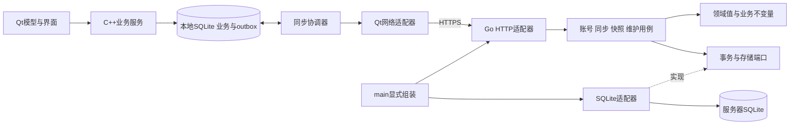
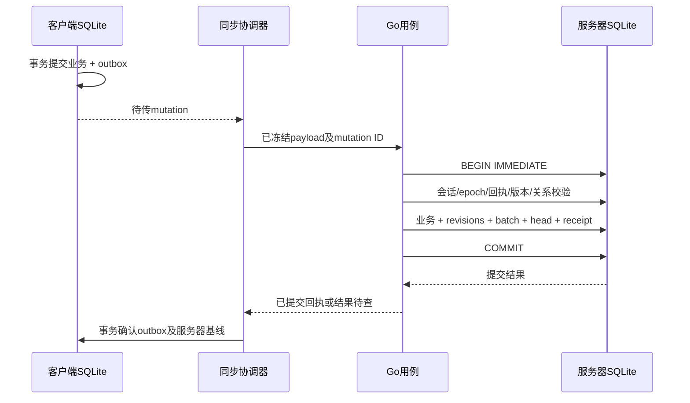

# Daymark账号与同步服务：工程架构设计

日期：2026-10-28。本文为供实施评审的详细设计，不表示功能已实现或可靠性已验证。产品方向见FR-042和[ADR-026](../ADR/026-go-sqlite-sync-service.md)；需求及产品取舍见[账号与同步总览](account-and-sync-service.md)；网络字段和错误契约以[v1协议草案](../api/sync-v1.md)为唯一详细来源；当前状态及真实证据只见[PROGRESS](../PROGRESS.md)。

具体开发契约与模块方法、输入输出、状态/事务/错误、UT/CT和集成步骤见[模块详细设计入口](sync-modules/README.md)。本文维护架构关系和AR目标，细粒度字段/算法以对应模块文档及DDL为准；不在架构页复制第二份接口定义。

## 1. 架构结论与边界

采用**本地优先客户端 + 模块化Go单体 + 服务器SQLite**。一个Go进程、一个服务端数据库文件，账号、会话、业务事实和同步日志同库事务；HTTPS入口可复用已有网关。保持一套业务提交路径，扩展主要通过明确模块及存储/平台端口完成。

- 未登录只本地存储；登录自动同步，断网继续本地编辑；退出停止网络、保留资料；账号切换不串传。
- 首期单机单实例，不引入消息中间件、Redis、微服务或通用插件系统；服务器与桌面SQLite彼此独立，传输业务协议而不是数据库文件。
- 服务器可靠性目标是正确提交、可重试、可恢复、可诊断；单机单盘有故障域，**不将本设计称为多节点高可用或零灾难数据损失**。客户端的离线可用不等于服务器在线可用。
- 不提供另一套Today/Upcoming过滤；C++ QueryService保持视图语义归属。服务器必须对上传内容和关系执行独立安全校验，通过共享样本保持业务不变量一致。
- 账号/密码与随机可撤销会话沿用总览中的轻量候选；公开注册、E2EE和全设备提醒一次等未接受的产品取舍不因架构设计自动转为需求。

## 2. 质量目标与必须守住的不变量

以下是实施验收目标，不是当前能力声明。资源和耗时初值在真实部署硬件上复测后才能用于容量承诺。

| ID | 约束/目标 | 验收证据 |
|---|---|---|
| AR-01 | 已成功本地提交的业务修改与outbox同生共灭 | 在事务各边界杀进程/注入错误，重启后数据与队列一致 |
| AR-02 | 服务端业务、实体版本、变更批次、head、幂等回执原子提交 | 相同mutation重复/并发/丢响应只产生一次业务效果 |
| AR-03 | 已应用游标只在完整拉取批次及冲突记录落库后推进 | 分页、中断、磁盘满时不漏事务；push返回head不能跳过pull |
| AR-04 | 远端拉取和推送确认不能覆盖较新的本地修改或草稿 | 发送后继续编辑、自己的变更回声、冲突并存的双端测试 |
| AR-05 | 所有读写、外键、游标、快照和导出均按实际账号/资料限定 | 伪造ID、owner、device_id及跨账号引用均不能越权 |
| AR-06 | 父子、分类、循环和排序以完整业务组裁决 | 并发新增成员不绕过版本检查，无半棵树提交 |
| AR-07 | 失败不删库、不清队列、不伪装同步成功 | BUSY、I/O错误、磁盘满、认证失效、协议不兼容有稳定错误和恢复路径 |
| AR-08 | 恢复后旧游标/令牌失效，已有删除凭据及本地修改必须对账，灾备损失窗口显式报告 | 轮换data/auth epoch、重新认证/重建基线，不用旧快照覆盖本地删除 |
| AR-09 | 所有可增长工作有数量/时间/空间边界 | 写队列、KDF、导入、快照、日志保留及重试退避均经压力测试 |
| AR-10 | 升级失败保留原库及可恢复快照 | 迁移断电/校验失败停在维护态，旧程序不打开过新schema |

建议私人试用的灾备目标为**异机备份年龄≤1小时、RTO≤2小时**，以可用备份实际时间及恢复演练计量；异机目标未配置时不声称达标。进程重启与健康磁盘上的提交恢复单独验证，不能推导物理磁盘损坏时RPO=0。普通在线同步的测量目标为本地提交后2秒内尝试推送、活跃设备30秒轮询兜底；失败/限流/大组操作不承诺此延迟。

## 3. 系统及依赖关系



实线说明调用/组装关系，虚线说明适配器实现应用层定义的接口。领域层不依赖HTTP/JSON/SQL/Qt；应用层不导入SQLite驱动；适配器不能反向调用界面。领域对象、wire DTO、SQL行模型分开，避免新增一个数据库字段就改变网络兼容性。

建议目录是实施时的职责地图，不在设计轮预建空文件：

```text
server/
  cmd/daymark-server/       # serve及受控维护命令，显式组装
  internal/domain/         # task/catalog/recurrence/identity等纯值与规则
  internal/application/    # Auth/Sync/Snapshot/Maintenance用例和所需端口
  internal/protocol/v1/    # wire DTO、版本/字段校验、错误映射
  internal/transport/httpapi/ # 路由、鉴权接线、body/并发限制
  internal/storage/sqlite/ # 唯一服务端SQL、事务、迁移、备份实现
  internal/platform/      # 文件权限、进程锁、信号等宿主薄适配
  migrations/             # 服务器独立schema，追加且有checksum
  testdata/               # 合成协议/领域兼容样本
docs/api/                  # 跨语言协议来源
```

初期domain/application按职责拆文件，规模增长后再拆包；不为每个实体生成controller/service/repository空壳，不引入全局service locator。Go包依赖固定为`transport/storage → application → domain`，`protocol/v1`只依赖基础值/领域枚举，`cmd`可组装所有层；运行CI检查循环依赖和驱动越层导入。

## 4. 模块责任和事务端口

| 模块 | 负责 | 不能承担 |
|---|---|---|
| AuthService | 账号认证、口令版本、令牌轮换、设备会话撤销 | 任务筛选、直接调用SQLite API、在日志记录凭据 |
| SyncService | 作用域、幂等、版本/read set、命令组提交、拉取游标 | 任意表CRUD接口、绕过领域校验、只写日志再异步改任务 |
| WorkspacePolicy | 候选业务图、时间/层级/关系/循环不变量和派生结果 | 网络、SQL、设备投递历史、Today视图副本 |
| SnapshotService | 一致截点、不可变分块、校验、首次合并的暂存发布 | 将整个多用户数据库发给某个用户、读当前表拼历史分页 |
| MaintenanceService | schema迁移、备份、恢复、保留清理及作业状态 | 擅自覆盖运行库、无限重试、另起未受控写进程 |
| SQLiteStore | 连接、参数化SQL、事务、索引和完整性检查 | 产品文案、隐式局部commit、凭据校验策略 |
| HTTP适配器 | 传输解析、鉴权上下文、限制、状态/错误转换 | 业务状态转换、SQL、将所有异常改成HTTP 200 |

端口以真实用例为边界，建议由application定义`AccountStore`、`SyncReader`和`UnitOfWork`；`UnitOfWork.Write(ctx, fn)`向回调提供绑定**同一事务**的会话检查、实体、日志/回执操作。具体方法在对应切片新增，不设计通用`Repository<T>`或把任意SQL执行器暴露给用例。

时间由可替换Clock传入应用/领域，持续时间/取消使用context及单调期限；领域代码不自行读系统今天。随机会话由生产安全随机源生成，测试注入只在测试组装路径可用。维护调度使用有界worker及持久jobs状态，进程重启后扫描可恢复作业，不为每个账号创建永久goroutine/计时器。

整个push只有SyncService拥有提交决定；各实体Repository不再自行开启并提交独立事务。回调返回错误即回滚，外层成功Commit后才能返回成功响应。写事务内全部查询/更新使用同一个`sql.Tx`；不能误用`sql.DB`绕开事务。SQLite适配器须通过所选驱动已验证的IMMEDIATE事务配置获得`sql.Tx`，不在连接池上发孤立`BEGIN`再用其他连接继续操作。[Go事务规范](https://go.dev/doc/database/execute-transactions)

外部扩展以具体新端口进入：通知发送若以后成为真实需求，应新增同库持久作业/outbox及幂等投递；SSE只承担变更提示。首期同步成功路径不依赖邮件、队列、对象存储或第三方身份服务在线。

## 5. 数据模型与版本语义

| 数据组 | 逻辑表/内容 | 关键约束 |
|---|---|---|
| 服务元数据 | service_state、schema_migrations | server_instance、auth_epoch、schema/checksum，拒绝未知新schema |
| 身份 | users、sessions、refresh_history | 稳定user_id；登录名规范化唯一；token摘要唯一；会话族/过期/撤销可查 |
| 资料 | datasets | 不可变owner、data_epoch、head_seq、retained_after_seq |
| 业务 | tasks、categories、tags、recurrence_rules | `(dataset_id,id)`复合身份、server_revision、软删字段；列化核心事实 |
| 组件/关系 | task_schedules、task_tags、task_links | 同dataset复合外键，不重复存任务标题/状态 |
| 结构与顺序 | structure_versions、ordering_scopes、order_entries | 集合独立版本，发现并发新增/移出，排序不膨胀成全部任务内容冲突 |
| 同步 | change_batches、mutation_receipts、device_progress | `(dataset_id,seq)`唯一；mutation全局于资料内去重；回执含规范请求摘要/结果 |
| 作业/暂存 | jobs、snapshot_manifests、import_sessions/chunks | 有状态、配额、租期和重试信息；成功前不公开半套导入资料 |

首期无附件，不引入对象存储。规范化表保存事实，JSON仅用于版本化变更payload、回执和受约束模板；不以“任意JSON实体仓库”绕过外键与数据迁移。change_batches是可压缩的复制日志，业务表是当前状态；不采用全量事件溯源，也不承诺从无限历史重建业务库。

`server_revision`、`head_seq`、本地`rowVersion`和`local_seq`互不替代：前者是实体CAS，head是资料内已提交批次序号，本地rowVersion保护编辑会话，local_seq只给本机outbox排序。客户端时间只表达用户事件/日期，不能决定覆盖顺序；整数在线路上以十进制字符串表示，避免未来JS客户端的64位精度问题。

每次成功命令组产生一个seq，同组涉及各实体独立递增revision；无业务变化的已满足命令可返回no_op，不新造日志。业务软删除保留恢复所需内容及分组；复制日志压缩和业务永久清除是不同操作，后者首期没有日常入口。

延迟外键可用于“创建任务及引用它的循环规则”这类同组互引，但最终图必须在Commit前完整合法；持久组内恢复/完成身份随业务同步。新任务树仍为两层；历史更深资料按现有兼容契约保留，不因同步导入被静默截断，也不允许以兼容为由继续加深。

必须索引：账号/资料归属、实体ID与revision、关系外键、循环周期唯一身份、批次seq、mutation ID、活跃会话token摘要及过期作业。索引以查询计划和基准证明，不提前建立全文检索/多租户分片。

## 6. SQLite运行、并发与背压

首期仅一个Go进程拥有数据库写入权，启动取得数据目录进程锁；迁移/恢复CLI不能同时成为另一个writer。SQLite自身锁仍是最后保护，不能只依赖进程内mutex。数据库必须在本机持久文件系统，不用NFS/SMB共享文件冒充多实例部署。

写连接池上限1，所有写用例经过有界准入；小型只读池使用独立连接、`query_only`和短读事务，避免复用写连接或未关闭Rows耗尽连接。writer的等待、执行和提交都计入请求期限。密码KDF、JSON解析、压缩、外部备份传输均在写事务外；最终会话状态、配额和版本在写事务内重查，不能把锁外预检当成授权结论。

启动设置并**读回核验**WAL、`synchronous=FULL`、每连接外键和busy timeout；不以PRAGMA执行未报错视为已生效。禁用read_uncommitted，不用shared cache。SQLite的串行写与WAL快照语义见[隔离说明](https://sqlite.org/isolation.html)，FULL的持久性边界见[官方PRAGMA](https://sqlite.org/pragma.html#pragma_synchronous)；仍依赖宿主磁盘正确完成同步写。

建议配置初值如下，均非已验证容量：

| 配置 | 初值/策略 | 达到上限时 |
|---|---|---|
| writer等待队列 | 32个，按请求期限取消 | 503 busy + Retry-After，不无限堆积 |
| 同时口令KDF | 1～2个，按内存校准 | 429或短等待；不占writer |
| HTTP请求体 | 普通push 1MiB | 413，不先落部分数据 |
| 普通命令组 | ≤64命令且≤512受影响实体 | 使用有界暂存大组或明确拒绝，不拆业务事务 |
| 快照/大型作业 | 每资料1个、全局小并发 | 复用现有作业或返回忙碌 |
| 请求期限 | 普通API 10秒；body/header及空闲另限 | 明确超时；提交不确定按mutation恢复 |
| 存储空间 | 可配置低水位与作业空间预算 | 先拒绝新导入/快照，危险低水位进入写保护 |

服务器发布capabilities告知实际限制，客户端不能把限制写死为产品业务上限。有界大组上传只暂存不可变命令payload，按账号/epoch/总字节配额封存，再由普通push引用并**一次事务**校验/应用；若超过服务支持的最大原子规模，保留本地待传状态并给出可操作错误，绝不能显示全量同步成功。

checkpoint由受控维护任务进行，观察WAL大小/读事务年龄和checkpoint进度；繁忙时不强制阻塞所有写入去TRUNCATE。大WAL首先检查长读事务和失控快照。SQLite引擎及驱动补丁按总览锁定并实测，不通过降低synchronous掩盖延迟问题。

## 7. 提交链路：唯一成功边界



服务端步骤顺序为：

1. HTTP层完成TLS、认证初查、大小/类型和协议校验；构建不可变账号/资料Scope，所有后续Store访问必须带Scope。
2. 在有界writer准入后开启事务，再检查用户/会话撤销、data/auth epoch及资料归属。
3. 查询mutation回执。已存在且规范内容摘要相同，返回原结果；摘要不同拒绝。查重先于base revision校验，避免重试已成功请求被误判成冲突。
4. 读取当前业务候选、expected revisions、结构read set和配额，领域策略统一计算结果。缺少关联成员及未知字段不能静默接受；client_seq用于本机依赖/诊断，不单凭它推断命令已经提交或丢弃旧离线操作。
5. 业务、实体revision、事务seq、复制日志和成功回执同库写入，Commit成功后才发布成功。回执至少包含确认实体/结构版本及业务结果引用。
6. Commit失败/连接中断不能把“返回错误”直接解释为“肯定没写入”；适配器尽可能重连查回执，否则返回commit_result_unknown，客户端保留原mutation并查询/重试。

同一个mutation代表冻结后的同一次命令。409修正、用户解决冲突或更改payload必须生成新mutation ID；重试500/网络错误则沿用原ID。事务确定回滚时不留下成功回执；确定的业务拒绝不消费业务seq。

复制日志是提交结果，不是先接收命令的队列；服务端不会先返回“成功”再异步应用。将来邮件/通知等外部副作用进入同事务outbox，由后台幂等投递，不能夹在数据库Commit之前。

## 8. 客户端接入与本地状态机

| 客户端职责 | 接入位置/边界 |
|---|---|
| SyncCoordinator | 新的C++服务，认证/触发/单在途/退避/资料代次；AppRuntime只组装和管理生命周期 |
| HttpSyncTransport | Qt Network异步请求，DTO转换、TLS、期限；不持有SQLite连接 |
| SyncRepository | DB worker内负责base/outbox/conflict/cursor事务，不让QML或网络线程执行SQL |
| 业务变更收集 | 现有Task/Catalog/Recurrence/DataTransfer写命令的最外层事务，记录命令意图和实际影响集合 |
| 远端应用器 | worker内按服务端完整结果更新事实、增加本机rowVersion、维护投影；抑制再次入outbox及通知副作用 |
| 同步状态模型 | GUI线程只显示状态与命令结果；保留现有草稿/CAS和增量模型通知 |
| 安全凭据端口 | src/platform内的Windows/macOS实现；与业务备份分离 |

网络结果带`profile_generation`；退出、切账号或换库时增加代次，旧响应不得写入新资料。所有SQL连接仍在创建它的worker线程使用，不能借同步引入第二个Qt写连接。

outbox状态为`pending → in_flight → acknowledged`，异常可进入`retry_wait / blocked_conflict / blocked_validation`。进程退出不会依赖内存里的in_flight标记；重启查回执或同ID重传。只有已经成功应用确认事务的记录才可清理，崩溃后不能因“发送过”删除队列。

acknowledged内容压缩后，至少保留mutation ID与对应batch seq，直到applied cursor跨过该批次，供识别自己的拉取回声；no_op无日志可提前压缩。尚未跨过的确认身份不能随成功提示立即删除，避免再次拉取时把自己的变更误判为远端冲突。

连续离线编辑同一实体时，本地记录依赖链及服务器基线。尚未发送的后继在前序确认且相关完整echo已落base后绑定新revision（no_op不等echo）；**第一次发送起payload不可变**。receipt只给版本，先记录确认义务；完整echo更新基线时保留本地更晚版本，不整行用旧回执覆盖当前值。逐批after_cursor及类型接口见[强类型契约](sync-contracts/README.md)。

拉取处理分三类：

- 无本地待传修改：应用远端实体，并在同事务更新base、冲突状态和applied cursor。
- 自己的mutation回声：按origin mutation ID识别确认，不能把它当成另一设备冲突；后继本地修改仍覆盖在该基线上。
- 其他设备修改与本地待传相交：保存base/local/remote及依赖关系，推进已安全记录的游标，阻塞相关命令；首期不擅自字段自动合并。远端删除保持主视图删除，本地修改保存在冲突中心。

冲突解决后以最新服务器revision发新mutation；若再次竞争，继续冲突。批次内若关系子集冲突，必须保留整个关联命令组的可恢复候选，不能只替换父项而保留不合法子项。未提交编辑草稿保留在现有编辑会话，远端落库导致rowVersion变化时按现有CAS处理，不能改写输入框文本。

验收必须盘点所有本地写入口：新增/编辑/完成/树批操作、分类/标签删除和移动、排序、循环生成/替换/停止、导入/恢复及提醒维护。提醒执行进度先与配置分开，本机投递历史不入复制；任何漏记路径都阻止真实资料同步交付。固定循环、AFTER_DAYS与旧实例身份专项见总览第8节，不在两份文档维护第二套算法。

## 9. 拉取、快照、首次合并与保留策略

普通pull在一个短读快照中读取日志保留底线、资料head和完整批次；分页固定`through_seq`，不能用不同时间读取的数据/元数据拼页。每批包含提交时不可变payload、origin mutation和实体/结构版本；客户端完整应用或完整记录冲突后才推进applied cursor。

大批次可分块传输，但游标只能停在整个组之后。分块暂存在本地并校验总大小/摘要/顺序，未完成前不影响业务事实。每页/分块身份、过期和大小规则见协议；服务器可提示更高head，不能要求客户端直接跳游标。

快照用SQLite一致读事务确定cutoff并导出有界的**该资料**数据，或从受控一致快照文件生成分块；head必须来自同一个快照视图，不在备份开始前猜cutoff。产物生成到临时位置，摘要/manifest校验及原子改名后才标ready；超时/重启时building作业可取消重建，不公开半文件。

创建快照时先登记日志保留pin，固定快照后将pin与cutoff绑定；清理任务和pin登记通过writer串行仲裁。在快照过期或客户端确认基线前，保留cutoff之后所需日志，不能一边生成快照一边把补齐增量删掉。长时间客户端会话有租期，过期重新快照；配额阻止无限pin。

首次登录对未绑定本地资料自动合并并先做本地一致备份。服务端import分块仅暂存，seal时验证ID/引用/版本与全部配额，发布时再检查当前head/read set；若期间远端变化则重算/冲突，不能按旧预览替换新资料。客户端在临时资料验证并保存后续本地编辑队列，切换成功前保留原资料；属于另一账号的资料不自动接入。

复制日志建议保留90天并受活跃pin保护；这是协议重放窗口，不是备份期限。幂等回执首期不随日志一起删除，在低体量下保留本epoch最小去重记录；若确需回收，必须先建立可拒绝老请求的序号/epoch门槛。删除凭据也不随复制日志消失。设备上报的进度只参与保留优化，不作为账号授权或其他设备已收到的证明。

游标过期：保留outbox及冲突，下载新快照，再按实体revision/删除凭据和原mutation回执重放；不能将全部旧离线内容当作新create。服务端恢复旧备份时轮换epoch，按第12节处理，避免用原seq掩盖服务器已丢失的提交。

## 10. 安全与权限模型

账号身份来自已验证服务端会话；HTTP层给用例传不可变Principal/Scope，业务层复查账号及资料归属。Repository查询必须提供作用域，外键以dataset组成，关联目标与当前账号一致；对不存在和无权访问的对象避免返回不同的私密存在性信息。文件路径由服务端生成，用户只提供对象ID，不能提供备份/导出实际路径。

账号不存在与口令不符使用统一错误及受限dummy哈希路径，避免轻易通过响应差异枚举账号；该计算也受KDF并发/频率预算约束。可审计的管理员操作只记录动作及脱敏身份，不记录口令或恢复令牌。

集成认证候选使用Argon2id哈希口令、独立盐、版本化参数和常量时间比较，安全随机token仅存摘要；会话过期、撤销、刷新代次及auth_epoch都可查询。KDF校准及限流不依赖Redis；受信代理列表决定能否采信转发IP，不能让任意X-Forwarded-For绕过限制。首期管理员建号/恢复可使用受控维护命令，公开注册与SMTP不默认开放。

刷新token串行轮换并记录旧摘要以检测重放；刷新结果不确定时允许重新认证，保留业务队列。**凭据响应不能进入普通mutation回执、HTTP访问日志或业务复制日志**。退出/撤销后每个新请求都检查会话状态；入队已久的写入在事务中重新鉴权。数据恢复时失效全部旧会话，防止备份中的已撤销令牌再有效。

令牌在Windows/macOS系统安全存储，经平台端口注入；不可用时仅本次会话或要求重新认证。业务备份、诊断包、截图自动化fixture均不包含真实凭据。密码找回、账号删除、跨账号迁移及真实上传的产品确认边界沿用总览，不能由服务器管理脚本自行扩大授权。

生产只接受HTTPS、正确证书链和明确服务器身份；API body有类型、数量、长度、压缩解码后大小与时间限制。同步接口不用浏览器cookie认证，默认无跨站调用授权；若新增Web客户端，须另定cookie/CSRF/CORS及token存储方案，不能照搬桌面凭据策略。

普通SQLite文件不自动加密；主机权限、受保护磁盘和加密备份是部署职责。当前可信服务器模型允许运营者读取正文，E2EE仍为上传前须明确的产品取舍，不能把TLS或磁盘加密称为端到端加密。

## 11. 故障语义与恢复矩阵

| 故障点 | 系统处理 | 恢复及不可丢弃的内容 |
|---|---|---|
| 本地事务写业务后outbox失败 | 整体回滚，不发成功 | 保留原业务、草稿，可重试 |
| 本地提交后网络断开/客户端崩溃 | outbox持久保留 | 重启查回执或同mutation重发 |
| 服务端Commit前错误 | 回滚，不发布seq/成功回执 | 客户端原队列保留，按错误类型处理 |
| 服务端Commit后响应丢失 | 已提交记录仍可查 | 回执查询/同ID重试，无重复创建 |
| Commit结果无法确定 | result_unknown，不显示已同步 | 原ID和冻结payload保留，禁止另造ID赌重试 |
| 拉取半个业务组/磁盘满 | 暂存组丢弃或续传，事实/游标不变 | 完整校验后再次应用 |
| 单个实体冲突 | 持久化三方内容，阻塞依赖命令 | 其他实体继续同步，用户解决后发新mutation |
| writer饱和/SQLITE_BUSY | 有限等待后503 + Retry-After | 客户端退避并加抖动，不清outbox |
| SQLite FULL/IOERR/CORRUPT | 停止危险写入、ready降级并告警 | 保留库与日志，不自动建空库；检查/恢复 |
| 认证过期/设备撤销 | 暂停网络，保留本地 | 同账号重新登录；不能自动换owner |
| 快照/导入中断 | 非ready产物不发布，作业可恢复/重建 | 原资料及离线队列保留，暂存按租期清理 |
| 进程panic/强制停止 | 未提交回滚，已提交查回执 | supervisor有界退避重启，避免无限崩溃循环 |
| 备份传输失败 | 保留已校验的本地备份，标目标未达 | 重传、监测异机备份年龄，不能只记“备份成功” |
| 恢复较旧备份 | 轮换data/auth epoch | 客户端重认证、重建基线，缺失提交必须可报告 |

重试分类：连接错误/408/429/可恢复5xx采用上限退避和抖动；401单次串行刷新，失败提示认证；403撤销、409冲突、410快照/游标过期、422校验及426升级分别处理。普通重试不改变mutation；冲突修订一定产生新mutation。

服务器成功确认过但在整机灾难中丢失的变更，可能也已从客户端已确认队列压缩，不能假定另一台设备总能补回。因此RPO依赖异机备份；恢复对账显示缺失区间和客户端可提供的待传/当前资料，保留本地副本，不伪称所有灾难均可无损自动重放。

## 12. 生命周期、备份与发布运行手册

### 启动和停止

启动依次为：校验配置/受保护目录→取得实例锁→打开SQLite并核验引擎与PRAGMA→检查schema/checksum→需要时创建已校验快照并迁移→外键/quick_check→初始化会话/资料epoch→启动有界维护调度→开放业务ready。任一必需步骤失败均停止可写业务，保留原库及可操作错误。

自动迁移仅应用已随程序交付且允许自动执行的追加migration；破坏性升级需维护命令和明确恢复计划，不在请求中升级。与桌面migration001～009完全分开编号。旧程序拒绝新schema；备份失败阻止迁移。

停止时先ready=false、停止新作业和接收新写入，再用Go `http.Server.Shutdown`等待已接受请求，随后停止维护worker、关闭连接并释放锁；超过总期限时让未确认客户端按回执恢复，不能在HTTP已返回成功后取消其尚未Commit的事务。[Go HTTP Shutdown](https://pkg.go.dev/net/http#Server.Shutdown)

### 备份和恢复

建议每30分钟生成一致快照并完成异机传输，以“异机最近可恢复快照年龄≤1小时”为目标；默认保留最近24个小时槽和30个每日槽，可按实际体量调整。告警初值为45分钟无新异机备份预警、超过60分钟目标违约；不因服务正在响应请求而忽略灾备失败。

步骤：创建临时一致快照→`integrity_check`及`foreign_key_check`→记录schema/实例/截点/文件摘要→加密→原子封存→传输到独立故障域→核对目标摘要→标作业成功→轮换。密钥不与备份文件置于同一公开目录；临时明文只在受保护目录，生命周期受控。Online Backup/VACUUM INTO具体适配须真实驱动验证，禁止运行中仅复制主db。[SQLite备份API](https://sqlite.org/backup.html)

恢复命令只在停服下写入**新目录/新文件**，先校验清单、摘要、schema和完整性；轮换服务认证代次/资料data_epoch，撤销旧会话，重建必要本地作业状态，验证后显式切换。保留原文件，不自动覆盖已有用户库。备份快照/恢复含内部凭据哈希，不能作为个人导出下载。

恢复涉及删除的账号/资料时，必须重放不受该旧备份回滚影响的删除清单。清单作为受保护运维账本备份到独立故障域；删除任务先持久化pending，再写清单并在DB完成；任何中间失败保持账号禁用并重试，不能将未完成删除记成功。恢复未拿到完整删除账本时保持维护态，不开放可能复活的账号。这一运维账本不参与普通任务提交事务，也不能冒称跨文件原子事务。

每次发布或至少每月在隔离环境做恢复演练，测量目标机恢复时间、账号/实体/外键/软删/回执一致性、旧token失效与旧游标拒绝。演练只使用合成测试或明确授权的备份，记录实际PASS/FAIL，不把“生成过文件”当成可恢复。

### 运行与升级

命令职责建议为`serve / migrate / verify / backup / restore / user`；维护命令与运行实例共享锁/控制路径。前台执行/单服务管理器或单容器都可，数据卷与程序目录分离，默认非管理员运行，管理/指标接口仅内网或本机。配置使用文件/环境，secret不放命令行、不输出完整DSN。

发布前生成不可变版本、源码revision、Go/SQLite版本、migration checksum及依赖/SBOM。升级在备份核验后停止旧进程并启动新版本，兼容性通过再ready。单实例允许短维护窗口；二进制回滚仅在schema兼容时直接进行，恢复旧库前须处理升级后新增数据，不能静默倒退用户写入。

## 13. 可观测性、故障预算与资源监测

结构化日志仅含请求ID、操作类型、状态/错误码、耗时、实体数量、版本及安全脱敏标识；不记录正文、口令、token、完整请求/响应、游标明文或用户绝对路径。错误使用稳定机器码加本地化文案，不泄露SQL或私密账号存在性。[HTTP错误结构依据RFC 9457](https://www.rfc-editor.org/rfc/rfc9457.html)

最小指标集合：请求成功率/延迟、writer队列长度/等待、事务耗时与回滚、BUSY/FULL/IOERR、WAL大小/长读事务、每类持久作业年龄/失败、异机备份年龄、磁盘剩余、schema/协议版本。指标标签不用user_id/task_id/mutation_id，避免隐私与高基数。客户端不默认上传行为遥测，服务器不能从未上报的客户端推断其队列已清空。

`/health/live`只证明进程活着；`/health/ready`证明当前能安全提供已声明业务（schema正确、存储/关键worker正常）。写保护、迁移、恢复期间ready=false；单次备份上传失败先告警与标degraded，不无理由把正常CRUD一并停掉。同步失败和登录失败分别统计；冲突属于需要解决的业务结果，不全部计作服务器崩溃。

普通push数据库提交延迟P95≤500ms、10k任务/1k待传变更的重连测量仅作初始性能验收目标，须注明硬件、正文大小、关联数、并发/索引和网络，不以过度放宽预算替代修复。高可靠优先级是AR不变量与恢复演练，不是堆高并发数字或声称99.99%可用。

## 14. 扩展和演进的边界

| 需求变化 | 扩展位置 | 应保持的契约 |
|---|---|---|
| 更换PostgreSQL | 新存储适配器、迁移工具、真实DB契约测试 | ID、revision、组事务、回执、epoch和协议语义 |
| 新增Web/移动端 | v1协议及新客户端适配器 | 同一业务提交路径，独立完成平台安全/通知策略 |
| 服务器变更提示 | HTTP SSE或WebSocket适配器 | 提示可丢，补齐靠持久日志；不能把提示当作已应用 |
| 第三方登录 | AuthService身份验证端口与外部映射 | 内部user_id不变，不按相同邮箱自动绑定账号 |
| 服务端提醒/邮件 | 明确需求后新增持久作业与投递端口 | 提交后幂等投递、失败可观察，不阻塞业务Commit |
| 附件/对象存储 | 新实体、存储端口及可恢复上传状态 | 配额、引用原子性、清理和权限另行设计 |
| 多实例/高可用 | 先迁移支持并发/故障切换的存储，再外置实例间协调 | 不把多个Go实例指向共享SQLite文件 |
| E2EE | 新密钥/加密协议及数据校验设计 | 上传前明确密钥恢复与信任边界，非简单功能开关 |

数据库升级先看真实锁等待、队列/写延迟、备份/恢复窗口和多实例需要，优先优化索引和事务长度。迁移用短停写窗口，一致导出/转换后核对内容摘要/外键/版本/回执/删除凭据；切换失败保留原库。将来换存储可以不改客户端协议，仍须进行真实迁移与兼容测试，不能预先承诺零停机或自动升级。

## 15. 工程质量门禁与交付切片

| 层次 | 必须覆盖的风险 | 执行依据 |
|---|---|---|
| 领域测试 | 日期/时区/DST、两层与历史树、状态/恢复、分类、循环身份 | C++/Go共享合成输入与期望结果，差异明确裁决 |
| SQLite集成 | 真文件、WAL、复合FK、并发BUSY、事务回滚、回执、分页保留 | Go临时目录，查询真实PRAGMA/引擎版本；不用Mock证明存储 |
| 协议契约 | 严格DTO、三态patch、未知版本/字段、十进制版本、摘要 | 同一JSON fixtures分别被Qt与Go解析/往返 |
| 双端状态机 | 连续离线编辑、自己的回声、冲突/删除、账号切换、失效游标 | 两份临时资料和可控网络代理，断线/乱序/重启 |
| 故障注入 | 本地commit各边界、服务端commit前后、丢响应、满盘、强制杀进程 | 独立子进程测试，测试钩子不进入生产公开API |
| 安全测试 | owner伪造、跨账号外键/快照/游标、刷新重放、撤销、限流 | 不存在/无权限响应和凭据日志守卫 |
| 运维测试 | 迁移失败、备份中断/损坏、恢复旧备份、删除账本、epoch | 实际恢复到隔离目录，测RPO/RTO和旧token失效 |
| 性能/资源 | 10k业务、关联/长备注、1k离线写、慢客户端、KDF/快照并发 | 记录资源、队列、P95及WAL，不改变数据正确性断言 |
| 平台接入 | Qt线程、GUI响应、Windows/macOS安全存储及退出/托盘 | QTemporaryDir；真实OS能力和offscreen证据分开 |

服务工程建立后的CI至少运行格式检查、`go vet ./...`、真实SQLite测试、`go test -race ./...`（使用支持race的实际runner/工具链）、协议兼容和依赖漏洞检查；记录无法运行的平台为UNVERIFIED。Linux服务二进制在目标Linux上构建/测试，Windows客户端通过原脚本验证；Go在某平台能编译不等于该平台服务交付通过。

Windows客户端验证仍为`./scripts/build-windows.ps1 -Preset windows-release`及`./scripts/test-windows.ps1 -Preset windows-release -Suite fast`，完整交付再跑full；macOS用`bash scripts/build-macos.sh`与相应CTest preset。Go工程建立后，Windows PowerShell与macOS/Linux shell均在`server/`执行`go vet ./...`、`go test ./...`和适用的race测试；路径/环境注入而不提交本地SDK位置。设计轮不因尚无Go工程而伪报Go检查通过。

交付顺序：

1. **ARCH-1 契约基线**：本架构、v1协议、AR风险矩阵；评审未决产品取舍，锁定具体依赖/引擎与许可。
2. **ARCH-2 最小可靠存储**：Go入口/配置/锁、migration、事务端口、真实SQLite与Commit故障测试；不先创建全部业务空接口。
3. **ARCH-3 账号和资料**：会话轮换/撤销、安全存储接入、跨账号集成测试；首期合成资料。
4. **ARCH-4 一条同步纵片**：任务创建/编辑/完成、双端outbox/push/pull/回执及断线重启，不接入真实全量库。
5. **ARCH-5 完整业务**：树/分类/标签/排序/循环/提醒、完整冲突、首次合并/大组和快照/日志压缩。
6. **ARCH-6 可恢复交付**：异机备份、epoch恢复/删除账本、故障注入、真实平台与资源门禁、运行手册。

每片沿既有工程纪律构建、验证和记录；只有该片验收全部有证据才完成，不把设计文档、Mock或单项成功当成服务可发布。2026-10-29实现入口及运维限制见[server](../../server/README.md)，用户已授权实现、测试、完善CI及推送源码；部署、真实账号/私人资料上传仍不在该授权内。
