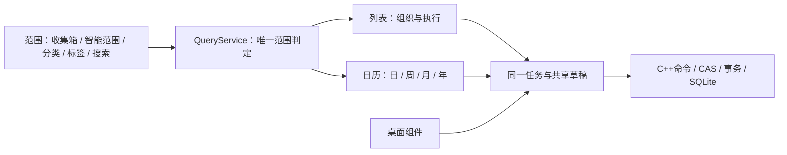

# Daymark 全产品体验评估与优化方案（UX-34）

日期：2026-10-25。评估基线：e1e2ff6、UI-33及当前源码。本文是设计评审和后续实施方案，不是新功能交付报告；实际状态只维护在[PROGRESS](../PROGRESS.md)。日历新定义另见[日历视图 v2](calendar-workspace-v2.md)，用户后续提出的默认详情小窗见[就近任务面板](contextual-task-inspector.md)。两者作为FR-034/035目标提案记录于[ADR-020](../ADR/020-contextual-task-workspace.md)。

## 1. 结论与取舍

Daymark的核心概念已经收敛，问题主要在于**同一概念还没有贯穿所有界面和操作链**：任务统一了，日历仍丢失列表范围；起止统一了，列表仍沿用截止旗标；有就近编辑，选择器却仍叠出多层窗口；有父子规则，子任务摘要、入口与实际呈现还不完全一致。继续逐处缩字号、减少留白，会掩盖这些问题。

目标应是：**一套任务事实，列表负责组织与执行，日历负责查看和调整时间；默认轻，深入后能力完整。** 先修上下文和操作结果，再调整信息层级，最后统一视觉状态。不是再增加一套“日程管理”，也不是把每个界面照着Apple截图等比例复刻。

应保留：顶部六个入口、收集箱独立于分类、两级文件夹分类与平级标签、正常任务两层关系、父任务完成/删除/分类移动联动、单草稿、软删/恢复/CAS/备份。现有“简易离开保存、完整页显式保存”作为当前基线；用户后续提出详情小窗，目标推荐面板及展开形态统一离开前保存，必须完成迁移/失败测试后才改变行为。应减少：重复时间表达、无效上下文命令、常驻解释、嵌套弹层、过多字段边框、与当前内容无关的工具。

本次未发现可由现有证据确认的P0数据损坏问题；下表P1为语义/操作链/验证可靠性问题，P2为理解与效率问题，P3为可延后增强。优先级不是故障发生概率或UI评分。

## 2. 评估方法与证据边界

- **S：源码事实**，可在下方证据索引复查；不等于真实指针、读屏或OS行为已经通过。
- **V：已有最终截图所见**，来自UI-33临时库原生合成运行，只证明截图状态。
- **U：需补验**，存在覆盖缺口或可疑呈现，尚不能定性为用户环境必现故障。
- **D：设计判断**，为推荐方案，不能写成Apple硬性数值要求或已经实现。

覆盖全部61份QML界面/控件，以及范围查询、任务树命令、日历投影、时间/循环/提醒、工作区与探针入口。既审视正常路径，也检查空态、无效输入、草稿、失败、焦点、缩放和恢复。审视源码不等于所有控件都经过人工操作。

本轮Release增量构建成功（无待编译内容），CTest **17/17 PASS，56.05秒**，其中QML启动43.55秒，日志为忽略目录内的`build/ux34-baseline-{build,tests}.log`。这是既有实现的回归基线，不证明本方案通过或体验问题不存在。没有操作真实用户库，没有修改运行功能。

本次复看截图：`compact-child-list`、`task-direct-context`、`shared-task-time-light`、`calendar-event-bands`，路径均为`build/ui33-completed-native/main.png.<名称>.png`。截图中的任务为自动测试数据，不作为产品默认内容。

### Apple HIG的适用映射

| 依据 | Daymark规则 | 对应UX目标 |
|---|---|---|
| [macOS设计](https://developer.apple.com/design/human-interface-guidelines/designing-for-macos/)与[布局](https://developer.apple.com/design/human-interface-guidelines/layout) | 内容优先、舒适密度、稳定层级；平台窗口和键盘按运行平台表达 | UX-01/02/05/09/14 |
| [工具栏](https://developer.apple.com/design/human-interface-guidelines/toolbars) | 少量直接命令，按范围/视图/动作分组，宽度变化不改变主要入口位置 | UX-01/02/09 |
| [小面板](https://developer.apple.com/design/human-interface-guidelines/popovers/) | 锚定来源、同一时刻一层小面板；非模态退出保护已编辑内容 | UX-04/05/07/11 |
| [上下文菜单](https://developer.apple.com/design/human-interface-guidelines/context-menus) | 只列相关动作，隐藏无意义项，最多一层子菜单，危险动作末尾；保留键盘路径 | UX-04/07/11/14 |
| [设置](https://developer.apple.com/design/human-interface-guidelines/settings) | 合理默认、任务选项就近、尊重系统偏好；macOS提供应用菜单设置及标准快捷键 | UX-01/09/11/14 |
| [反馈](https://developer.apple.com/design/human-interface-guidelines/feedback)、[文字](https://developer.apple.com/design/human-interface-guidelines/writing)与[可访问性](https://developer.apple.com/design/human-interface-guidelines/accessibility) | 结果明确、错误可恢复；不只靠颜色或运动传达；浅深/大字/键盘/读屏分别验收 | UX-06/07/09～14 |

Apple《提醒事项》的[智能列表说明](https://support.apple.com/en-asia/guide/reminders/remnfec66479/mac)和[排序说明](https://support.apple.com/en-sa/guide/reminders/remn922d0b42/mac)用来核对“自动范围不改变原归属”“日期排序与手工排序不同”。用户已明确父子联动、两级任务和分类规则，以这些裁决为准，不继续反复询问。用户日历截图提供日/周/月/年的结构参考；截图没有说明的时间算法不能当作Apple事实。

### 源码证据索引

| 证据 | 位置与复查重点 |
|---|---|
| E01 | [TaskService.cpp](../../src/services/TaskService.cpp) L15～108：日期、Today时段、范围、搜索及排序 |
| E02 | [TaskWorkspace.cpp](../../src/models/TaskWorkspace.cpp) L212起、L585起、L917起：模型/数量、全量日历投影、重排前提 |
| E03 | [Main.qml](../../src/ui/Main.qml) L331～339、L630～727：返回位置、视图切换、标题/筛选/新建 |
| E04 | [Main.qml](../../src/ui/Main.qml) L926起、L952～998、L1203起：完整详情、子列表、删除/分类菜单 |
| E05 | [TaskRow.qml](../../src/ui/TaskRow.qml) L104～175、L221起：菜单、指针、DropArea与摘要 |
| E06 | [TaskQuickEditor.qml](../../src/ui/TaskQuickEditor.qml)：单草稿、备注、快捷键说明和快捷入口 |
| E07 | [TaskTimingFields.qml](../../src/ui/TaskTimingFields.qml)：全天、时间/时区、提醒偏移与重复 |
| E08 | [TaskDetailsFields.qml](../../src/ui/TaskDetailsFields.qml)：分类、标签、父项及标记 |
| E09 | [DateField.qml](../../src/ui/DateField.qml)、[CalendarPicker.qml](../../src/ui/CalendarPicker.qml)：手工输入、弹层、日期键盘 |
| E10 | [ReminderField.qml](../../src/ui/ReminderField.qml)、[TimeField.qml](../../src/ui/TimeField.qml)、[InlineClock.qml](../../src/ui/InlineClock.qml)：弹层嵌套、定位、应用动作 |
| E11 | [CalendarPanel.qml](../../src/ui/CalendarPanel.qml) L73～89、L188起、L275起、L395起：浏览焦点、工具栏、横条和未排期 |
| E12 | [CalendarService.cpp](../../src/services/CalendarService.cpp)、[TaskTime.cpp](../../src/services/TaskTime.cpp)：范围、跨日投影与统一时间 |
| E13 | [NavRow.qml](../../src/ui/NavRow.qml)、[NavSection.qml](../../src/ui/NavSection.qml)、[SmartViewTile.qml](../../src/ui/SmartViewTile.qml)：缩进、命中、拖放与计数 |
| E14 | [CatalogEditPopup.qml](../../src/ui/CatalogEditPopup.qml)、[CatalogCreateDialog.qml](../../src/ui/CatalogCreateDialog.qml)、[CatalogPicker.qml](../../src/ui/CatalogPicker.qml)、[OrganizationPage.qml](../../src/ui/OrganizationPage.qml)：创建/选择/管理 |
| E15 | [CatalogService.cpp](../../src/services/CatalogService.cpp)、[CatalogRepository.cpp](../../src/persistence/CatalogRepository.cpp)：两级、CAS、排序与安全删除 |
| E16 | [SettingsDialog.qml](../../src/ui/SettingsDialog.qml)、[DataToolsDialog.qml](../../src/ui/DataToolsDialog.qml) L50起：偏好、通知与备份说明 |
| E17 | [BatchTaskDialog.qml](../../src/ui/BatchTaskDialog.qml)、[ReminderPage.qml](../../src/ui/ReminderPage.qml)、[DiscardChangesDialog.qml](../../src/ui/DiscardChangesDialog.qml)：批量、提醒记录与离开保护 |
| E18 | [WidgetWindow.qml](../../src/ui/WidgetWindow.qml)、[WidgetViewModel.cpp](../../src/models/WidgetViewModel.cpp)：组件列表/完成与Mini |
| E19 | [DesktopCalendarWindow.qml](../../src/ui/DesktopCalendarWindow.qml)、[DesktopTray.cpp](../../src/platform/common/DesktopTray.cpp)：独立日历、恢复与平台入口 |
| E20 | [Theme.qml](../../src/ui/Theme.qml)、[DesignTokens.qml](../../src/ui/style/DesignTokens.qml)、[AppIcon.qml](../../src/ui/AppIcon.qml)：字号/密度/图形 |
| E21 | [MenuItem.qml](../../src/ui/style/MenuItem.qml)、[Menu.qml](../../src/ui/style/Menu.qml)：文字颜色、子菜单提示、菜单高度 |
| E22 | [FieldSurface.qml](../../src/ui/style/FieldSurface.qml)、[TextField.qml](../../src/ui/style/TextField.qml)、[TextArea.qml](../../src/ui/style/TextArea.qml)、[ScrollBar.qml](../../src/ui/style/ScrollBar.qml)：状态、输入与滚动命中 |
| E23 | [StyleGallery.qml](../../src/ui/StyleGallery.qml)与style目录：控件全部状态覆盖 |
| E24 | [AppRuntime.cpp](../../src/app/AppRuntime.cpp) L98～103、L1364～1394及[CMakeLists.txt](../../CMakeLists.txt) L170：436阶段、节拍与内外超时 |
| E25 | [TaskTreeCommands.cpp](../../src/services/TaskTreeCommands.cpp)、[RecurrenceService.cpp](../../src/services/RecurrenceService.cpp)、[ReminderSchedule.cpp](../../src/services/ReminderSchedule.cpp)：联动、实例与提醒 |
| E26 | [产品哲学](../product-philosophy.md)、[UI基准](ui-baseline.md)、[验收](ui-acceptance.md)、[ADR-017](../ADR/017-reminders-views-and-task-trees.md)～[019](../ADR/019-shared-task-time.md)：当前裁决与历史叠加 |

## 3. 按界面与操作链逐项评估

下列每项均为待实施或待补验事项，不将推荐方案冒充现有行为。编号用于实施追踪，不创建72个独立工程任务。

### A. 产品含义与范围

| ID/优先级 | 现状与影响 | 优化及可观察验收 |
|---|---|---|
| 01 P1 | S/E02、E03：日历从全量cache投影，分类/标签/搜索切过去失去范围；违背“侧栏选择范围” | 分离scope与presentation；分类A切日历、编辑、切回始终同范围/同ID；选择全部才扩大范围 |
| 02 P1 | S/E01、E03：搜索默认全局，切导航不退出搜索，筛选又可继续叠加；选中分类可能与结果含义不同 | 明示“搜索全部任务”及生效筛选；点击目的地退出搜索并清理临时筛选，清除搜索回搜索前上下文；草稿失败不切换 |
| 03 P2 | S/E01：Today含手动关注、已到开始日期、逾期；只写“今天”难解释为何一直留下 | 摘要按需显示“已逾期/开始于/今天关注”，保留已接受范围算法；移出手动今天但仍命中日期时说明实际结果 |
| 04 P2 | S/E01：计划同日按置顶/基础顺序，没有具体起始时分排序 | 推荐同日日期任务在前、定时任务按时刻；置顶只在同组内生效，说明自动排序；QueryService唯一判定并测试 |
| 05 P2 | S/E01：全部按旧分类名称字符串排序，与侧栏手工顺序不同 | 使用规范分类树rank和路径组织分组；重命名不导致无关组跳位；无分类有明确位置，旧资料不丢 |
| 06 P1 | S/V E05：开始/结束已同一安排，结束仍是旗标，和特别关注混淆 | 日期范围一条摘要，结束仅用“结束”语义；旗标专用于特别关注；同日去重、跨年显示年份 |
| 07 P2 | S/E01、E25：循环实例按已有生成范围显示，打开更远月份不代表全年已完整 | 明确已生成实例边界；年首版只导航，不报伪完整负荷；未来预测走C++只读投影契约 |
| 08 P1 | S/E26：当前覆盖段落和旧正文并存，旧领域/项目、双时间、周无小时轴仍容易被后续实现读到 | 建立一个当前契约入口，旧目标明确标历史；新日历目标与真实交付分开；不改历史迁移/ADR事实 |

### B. 导航、工具栏与返回

| ID/优先级 | 现状与影响 | 优化及可观察验收 |
|---|---|---|
| 09 P2 | S/V E13、E20：六卡结构已清楚，但卡片/标题/数字/图标仍比来源行更抢眼 | 保留六卡和颜色识别，控制计数权重、统一对齐；缩减重复垂直间距，不全局缩字或减小命中区域 |
| 10 P2 | S/V E13：二级分类长名称易截断；仅hover完整路径不利键盘定位 | 二级保持一个缩进步长，当前分类显示完整路径摘要；焦点也能查看完整名称，200%自然增高 |
| 11 P1 | S/E03：保存currentIndex及contentY，刷新插入/删除后同索引可能已是另一任务 | 改taskId＋相对滚动锚点；原任务删除选邻项；返回不突然选中新插入任务，折叠状态保留 |
| 12 P2 | S/E03：筛选分类来自旧project平表，只有title，存在重名和兼容分类遗漏风险 | 全部选择入口共用categoryTree，显示路径/层级；同名二级、旧一级、归档边界逐一验证 |
| 13 P2 | S/E03：新建行在logbook仍显示但禁用；过滤无结果与真正空列表缺少清楚区分 | 历史页面不显示无用新建；过滤空态给“清除筛选”，真正空态给录入；加载未完成不闪空成功态 |
| 14 P2 | S/V E03、E11：主标题、日历工具串、月份标题三层竞争；铃铛跨页面常驻 | 主工具栏稳定，日历只加一行时间导航；提醒记录作为次要工具；必要入口有名称且窄窗不换位 |
| 15 P1 | S/U E03、E19：未见完整应用菜单；设置快捷键受文本焦点条件限制，Control-click未明确覆盖 | macOS应用菜单提供设置/Cmd+,及适用常用命令；Windows用原生键习惯；编辑中设置可达且保护草稿，Control-click物理补验 |
| 16 P2 | S/E02～04：业务busy会禁用多处浏览/动作，不能简单当作所有内容不可用 | 按命令区分读取/写入与受影响对象，尽量保留滚动/查看；仍串行化冲突写；失败/重试不丢焦点或输入 |

### C. 列表与快速编辑

| ID/优先级 | 现状与影响 | 优化及可观察验收 |
|---|---|---|
| 17 P2 | S/V E05：分类、全部标签、今天、标记、子项数、两日期可同时换行，行高失控 | 标题为主，次行按日期/时分、必要归属、子项排列；标签限量＋余数入口；完整信息在就近详情，不隐藏关键时刻 |
| 18 P1 | S/E05、E12：列表摘要偏日期，定时任务的实际时段不够清楚 | 同日“09:00–10:00”，跨日带日期；本地显示与详情原时区有明确关系；与日/周块一致 |
| 19 P2 | S/E05、E02：手工排序/拖到导航不是同一能力；拒绝重排可只返回false，界面先接受drop | C++提供可否放下及原因，QML只画预览；非法分组无接受高亮；自动排序仍可拖去安排，Esc/失败原位 |
| 20 P2 | S/E05、E21：无提醒、不能上移/下移仍占上下文菜单；移到子菜单无明显箭头 | 只列当前相关动作，子菜单有指示，删除在分隔末尾；完整命令另有键盘/菜单入口；菜单不堆满屏 |
| 21 P2 | S/V E21：自定义MenuItem文本忽略palette覆盖，删除颜色设置未生效 | 共享显式危险角色/快捷键/子菜单样式；浅深选中/禁用/焦点完整，文字含义不能只靠红色 |
| 22 P2 | S/E06：单行备注可直接改，多行变为只读首行；切换行为需要用户猜 | 默认单行摘要，点击展开就近多行编辑或明确完整详情；hover和键盘均可读全，纯文本且不误解析HTML |
| 23 P2 | S/E06、E10：提醒“完成并保存”会提交当前整个快速草稿；与其他选项只改草稿不同 | 统一局部选择只回写共享草稿，退出快速编辑再原子保存；若保留立即命令需清楚说明影响并测失败 |
| 24 P2 | S/V/U E06、E11：已有退出保存机制应保留；截图有离开日历后残留范围tooltip | tooltip随owner隐藏/视图切换/拖动关闭；原行→面板承接同草稿，双击不重复写；保存失败保留，不因刷新重开 |

### D. 完整详情与父子任务

| ID/优先级 | 现状与影响 | 优化及可观察验收 |
|---|---|---|
| 25 P1 | S/V E04、E07、E08：独立详情跳页、大卡和字段边框使小修改成本高；用户追加就近小窗建议 | 默认就近任务面板，标题/备注＋时间＋归属渐进展开；长内容展开同一编辑器；共享全部属性，不删循环、时区或关系 |
| 26 P1 | S/E04：查看详情即聚焦标题，保存按钮未修改时也可用；小窗关闭不能沿用无保护的自动消失 | 新面板离开前保存，失败保留并阻止目的动作；展开/收起不换草稿或保存规则，显式放弃才丢修改；现有页规则迁移前保持 |
| 27 P1/U | V截图子列表仅见标题，S/E04已有完成/信息控件；源码和截图证据不吻合 | 先复现绘制/布局/命中，不直接判定控件缺失；截图像素＋可见命中＋键盘证明圆形完成/直达详情；不新建孙任务入口 |
| 28 P2 | S/E04、E08：父列表、子详情、根标题和返回层级叠加，父项选择又可占完整一组 | 面板保留详情/子任务tab，打开子项在同一面板切换并返回父列表，子项无下级tab；不再叠任务popover，草稿返回不丢 |
| 29 P2 | S/E02、E05：链接数量是未完成子项数，文字像总数，全完成后入口可能不明显 | “已完成/总数”或明确“待办N项”；只要有子项就有访问路径；智能列表不补不匹配子项，普通列表按开关展开 |
| 30 P2 | S/E03、E04：取消任务入口和取消记录恢复较隐蔽，与完成易混淆 | 完成页显示切换完成/已取消的明确次级入口；取消不叫删除；恢复保留同组联动规则，终态时间可查看 |
| 31 P2 | S/E04、E17：编辑记录已有能力，需与提醒记录、撤销区分；父子联动实际影响不总在操作附近 | 编辑记录继续按需打开，展示字段前后/时间/联动来源；删除前给子项数，撤销/恢复作用组清楚，不承诺任意历史回滚 |
| 32 P1 | S/E08、E25：子项改分类可能清父项，字段变动同时改变关系；父项类别移动又影响整树 | 在选择时预览“将移出父任务”或“同时移动N个子任务”；提交后同ID/CAS，取消/失败零修改；日期/标签仍不继承 |

### E. 日期、时间、提醒与循环

| ID/优先级 | 现状与影响 | 优化及可观察验收 |
|---|---|---|
| 33 P1 | S/E07：无日期时“全天”默认开；关开关反而补日期，初学者难理解 | 无日期显示“添加日期”；有日期后用“指定时间”正向展开，含时间再展示全天转换；不改变底层统一起止事实 |
| 34 P2 | S/V E07：开始/结束日期和开始/结束时间分两排，中间有提醒/开关，读起来仍像两套 | 每个端点的日期与时分相邻，同组时间类型/范围；窄窗按端点纵排；提醒位于范围之后，原值无损往返 |
| 35 P1 | S/E07、E12：相对提醒偏移被加载保留但缺少明确选择，改期行为与绝对提醒不同 | 提醒表达“开始前10分钟/指定时刻”；改期预览说明将变化者；未改时间的备注保存不动提醒 |
| 36 P1 | S/E09、E10：提醒popup再打开DateField popup，时间弹层仅向下定位 | 一个锚定面板内切换日期/时间/循环；根据视口上下避让，200%/底部行可达；Esc逐层语义不丢草稿 |
| 37 P2 | S/E09：日期输入框TapHandler整框开日历，可能与手工选择文字冲突 | 图标直开日历，文本允许编辑/选中；Alt+Down、方向键跨月、PageUp/Down路径明确；非法日期原处可修复 |
| 38 P2 | S/E10、E25：提醒循环与任务循环都是“重复”，未设置提醒时默认今天09:00可已过去 | 分别称“重复提醒此任务”和“循环生成任务”；展示下一次有效提醒，过去时间保留纠错；完成/暂停停止规则可读 |
| 39 P2 | S/V E07、E12：IANA时区文本常驻；日期改期与实际时间平移的时长/DST含义不同 | 默认系统显示，时区高级展开；先写统一时间命令ADR，再实现小时轴拖动；23/25小时日、重复/缺失时刻拒绝或显式选择 |
| 40 P2 | S/E07、E25：循环频率/间隔/周几/后续属性覆盖技术项较多，实例与后续影响不直观 | 显示人可读循环摘要和下次日期，详细项按频率出现；编辑范围“仅本次/后续未修改实例”明确；月底跳过既定规则不静默改 |

### F. 分类、标签与管理

| ID/优先级 | 现状与影响 | 优化及可观察验收 |
|---|---|---|
| 41 P2 | S/E04、E14：右键重命名/编辑共用同一完整小面板，动作差别弱 | 重命名只聚焦选中名称；属性面板渐进显示说明/归档/层级；共用保存实现，避免两套修改协议 |
| 42 P2 | S/E08、E14：导航、新建、筛选、移动等入口的树/路径表达不完全一致 | 一个分类选择组件贯通所有入口，含收集箱目的地但不把它建成分类；重名/归档/历史兼容路径一致 |
| 43 P2 | S/E13、E15：已有上下缘排序/中央移入，命中结果对新用户仍有学习成本 | 插入线只表达重排，中央显示“移入：完整名称”；悬停揭示折叠一级；非法三级有原因，文件夹图形不变 |
| 44 P2 | S/E14、E15：归档恢复主要藏在分区右键，用户可能当分类消失 | 分类分区菜单明确“显示已归档”；查看归档有状态/恢复动作；恢复父子路径不重复创建或暗中激活任务 |
| 45 P2 | S/E08、E14：任务草稿中新建分类/标签可先独立落库，放弃任务不会同时回滚 | 明确它是独立创建，完成后立即可见可重用；不提示任务已保存；避免空白孤立条目，保留取消创建零新增 |
| 46 P2 | S/E14：分类/标签选择、局部编辑、完整表单的确定/保存/取消边界不完全同形 | 选择只回写草稿，创建/管理保存独立对象；每面板只一个主动作，失败保留字段；点击外部遵守该对象草稿契约 |
| 47 P1 | S/E15：删除分类保留任务、二级提升一级，影响比“删除名称”多 | 确认写实际迁出任务/提升分类数和目的地；不级联删除任务；事务失败树/数量/选中均保持，恢复旧资料不丢元数据 |
| 48 P2 | S/V E08：所有标签checkbox平铺详情，标签多时迅速撑高 | 已选标签chips＋搜索选择器＋就近新建；千标签不全量创建可视控件；标签仍多选平级，不新增层级概念 |

### G. 日历工作方式

| ID/优先级 | 现状与影响 | 优化及可观察验收 |
|---|---|---|
| 49 P1 | S/E11、E12：当前周仍是日期格，无小时轴；不能支持用户期望的具体时间规划 | 按v2分片：先范围/工具，再月、周小时轴、日、年导航；未完成不放空按钮；日周日期任务栏与定时块分开 |
| 50 P2 | S/V E11：蓝/绿来自旧task/event投影来源，统一后无产品含义 | 同一任务采用同一套语义色；时间文字/位置区分日期和定时，重要/完成/焦点另有形状；不靠颜色区分实体 |
| 51 P1 | S/V E11：月格多只显示标题，议程才见时刻；周也未按时长布局 | 月格带起始时分，跨日条保持连续；周/日按实际起止布局，并行重叠可展开，短任务仍有命中与键盘入口 |
| 52 P2 | S/E11：showAgenda无条件聚焦新建输入，浏览日期会转入录入 | 选择日期只选日/显示内容；只有新增命令聚焦输入；日期方向键不被新建框吞掉，关闭议程不跳周 |
| 53 P2 | S/E11、E12：已有泳道/溢出应保留，但范围条和定时条菜单/键盘行为不同 | 共用同ID完成/详情/菜单；+N包括被占泳道任务且不重不漏；跨周/月/午夜续条测试，不能用减小字藏溢出 |
| 54 P2 | S/E11：“未排期”是模态列表，只能点开详情，无法顺手拖入日期 | 改按需非模态未安排抽屉，尊重当前范围；拖入日期/小时轴有预览和Esc，完成一次后焦点返回来源 |
| 55 P1 | D/E12、E25：日/周拖动和年浏览会新增时间/实例边界，不能只补布局 | Whole-block移动/边缘改时长分命令，UTC/DST/CAS/相对提醒测试先行；年导航不生成全年实例；详见v2第7节 |
| 56 P2 | S/U E11、E19：独立桌面日历需独立浏览状态和可恢复几何，不能跟主窗抢日期/焦点 | 共享任务不共享浏览位置；两窗同ID同步，屏外可重置、键盘可操作；窄窗200%及实际多屏分别验证 |

### H. 设置、数据、反馈与安全

| ID/优先级 | 现状与影响 | 优化及可观察验收 |
|---|---|---|
| 57 P2 | S/V E16：设置已分三类，但仍是较重模态大窗；即时保存边界不够明确 | macOS采用适当大小可独立操作的设置窗口及标准入口，Windows沿平台；记忆上次pane；短状态说明已保存/失败，非每项加解释 |
| 58 P2 | S/E16、E20：主题可跟系统，减少动态/高对比未见系统偏好合并 | 默认尊重OS可获取偏好，显式覆盖清楚；不支持的平台如实说明；减少动效不减少完成/错误信息 |
| 59 P1 | S/E16：备份设置1/7/30天，数据窗仍固定写“每日首次启动”，承诺可能不实 | 说明取当前配置；显示上次成功与打开位置/立即备份，失败不显示成功；WAL一致快照门禁保留 |
| 60 P2 | S/E16：导入替换两次确认是安全要求，但通用OK不说明阶段和影响 | 保留双确认/备份，使用“预览导入/备份并替换”等具体动词；文件/影响/失败零修改清楚，不因简约删确认 |
| 61 P1 | S/E17、E25：批量选择数不一定等于整树实际影响；“替换标签”可能被理解为追加 | 显示选中数和联动后实际数，标签动作明确替换；祖先优先去重、事务/CAS/注入失败回滚不变 |
| 62 P2 | S/E02～04、E14：共用errorText/infoText可带到别的操作/页面，成功归属不清楚 | 结果绑定命令/对象；字段错误就近，系统错误有重试；超时不冒充保存，非阻塞成功短时呈现；保护已修复的editorSaving隔离 |
| 63 P2 | S/U E16、E17：提醒记录是触发记录而非OS送达凭据，设置只有系统通知开关 | 分别表达已设定/应用已触发/系统通道状态；无送达回执不叫已送达；无权限与应用未运行边界在相关位置说明 |
| 64 P2 | S/E17：提醒记录仍用旧“任务或日历日程”措辞，已删除任务点击可能无法打开 | 全部称任务，记录保留身份/时间；存在则直达，删除/不存在则只读摘要或明确不可编辑原因，不能静默无反应 |

### I. 桌面组件、平台、控件与验证

| ID/优先级 | 现状与影响 | 优化及可观察验收 |
|---|---|---|
| 65 P2 | S/E18：组件标题主要为Label，完成可点但任务详情路径弱 | 标题/信息可打开主窗同一taskId；同名子项可知父路径；穿透时仍保留托盘/主窗解除，不增加不可恢复手势 |
| 66 P2 | S/U E18、E19：组件空态/Mini展开与背景可读性依赖场景，token对比不等于壁纸实测 | 一个直接展开/打开入口；浅深/花纹壁纸、穿透/锁定、置顶实测，必要时实底；保持背景alpha与文字alpha分离 |
| 67 P2 | S/U E05、E06、E03：菜单键已覆盖，但Mac Control-click和IME物理路径未证明；提示仍可写Ctrl+Enter | 使用平台快捷键显示，测试Control-click、二级点按、Menu/Shift-F10；中文预编辑Enter/Space/Esc不误命令 |
| 68 P2 | S/V/U E20～23：字段hover未使用，边框普遍偏重；子列表图标截图需核对绘制而非只看几何 | 统一idle/hover/pressed/selected/focus/disabled/pending/error样式；quiet字段仍可辨认，Canvas图形首帧/主题切换截图与命中一致 |
| 69 P2 | S/U E20、E22：文字会放大，图标/间距不全同比；8宽滚动条视觉可读但命中需审视 | 以任务和读序决定尺寸，不一律等比；细视觉条可扩命中，键盘滚动可替代；100/125/150/200%文本与DPI分开测 |
| 70 P1 | S/E24：smoke已到436阶段，内部watchdog却在phase>=398时跳过；末段不是完整受限 | 用显式“全部场景完成/进入soak”状态结束watchdog；末段注入卡住必须非零退出；CTest外层60秒只证明有外层保护 |
| 71 P2 | S/E24：436阶段共用大量状态，90/60ms节拍接近普通45秒预算，失败容易互相污染 | 拆独立临时fixture/命名场景，等待实际条件/呈现而非固定睡眠；保留断言和既定预算，不靠延时/删测过关 |
| 72 P1/U | E26及当前证据：原生合成/短跑无法证明物理键鼠、读屏、Windows、通知、睡眠、多屏/8h | 建立逐平台证据矩阵；每条写环境/步骤/结果/截图；未执行标UNVERIFIED，不能用“符合HIG”或17/17替代 |

## 4. 优化后的产品和界面关系

分类仅回答归属，标签仅回答横向筛选，父子仅回答拆解；三者并列但不互相替代。特别关注是任务属性，置顶是同组显示顺序。收集箱是未分类范围，不是分类。时间属性不改变归属；循环提醒提示同一个任务，循环任务生成后继实例。

范围与查看方式分离后，侧栏保持一份。所有日期入口、分类选择器、任务摘要和命令菜单使用共享契约；不能因为同一任务在另一个页面出现就重新写一次业务过滤。Qt/C++兼容层的旧名称可保留，不让它们继续进入界面；不为清理名词做无收益的大规模schema重写。

### 各视图必须有的差异

| 范围 | 默认内容/组织 | 子任务 | 新增与排序 |
|---|---|---|---|
| 收集箱 | 未分类的开放任务，已安排日期仍可在这里 | 普通树，显示开关/逐父折叠 | 无前置归属，合法同父/置顶组手工排序 |
| 今天 | 已接受Today规则，按日期任务/上午/下午/晚上组织 | 只列独立匹配项；父项保留全部子项访问 | 新增关注今天；时刻任务按时刻，不能拖动暗改时间 |
| 计划 | 有安排的开放任务，按日期/月 | 同上 | 新增默认日期可见；自动排序，拖日期是改期 |
| 全部 | 开放任务按侧栏分类树顺序分组 | 普通树 | 组内合法手工排序，不因重命名换组顺序 |
| 特别关注 | important任务 | 独立匹配，保留关系入口 | 属性筛选，不另建优先级实体 |
| 完成/已取消 | 终态任务按处理时间，次级切换状态 | 独立匹配，整组恢复规则清楚 | 无新建；查看/恢复/软删按各自状态 |
| 分类 | 一级汇总两层，二级只自己 | 普通树，不自动改变父子归属 | 新增预填当前归属，按树/分组排序 |
| 标签 | 具有该标签的任务，标签不会改分类 | 普通树只显示合法上下文；搜索/匹配子项不被折叠隐藏 | 新增加该标签；基础rank共享，不能声称独立视图排序 |
| 搜索 | 明示全局及生效过滤条件，结束回原上下文 | 匹配子项不依赖显示偏好 | 不手工排序，文字输入优先 |
| 最近删除 | 删除组/时间与父子结构 | 展开同次删除组 | 只恢复等有效动作，无新建/日历入口 |

上表排序中的时刻次序为本轮推荐修订，尚非当前事实。切换日历保持同一范围；完成可按完成时间回顾还是按原安排查看需清楚区分：首片只支持“按原安排显示已完成”，完成记录本身保留列表，不伪造完成时段。

### 全部操作的保存/退出边界

| 操作 | 提交/退出 | 失败/恢复 |
|---|---|---|
| 连续录入任务 | Enter成功后继续，不把空白行建库 | 原输入保留，错误就近 |
| 原行/就近任务面板（目标） | 离开先保存，同一任务一份草稿 | 提交失败不关闭/不导航；明确放弃才丢草稿；Esc结束编辑不误触完成 |
| 展开任务面板（目标） | 与就近形态同一会话/保存规则，不另开业务页面 | 保留字段/版本/焦点/子项返回；当前旧完整页仍显式保存，迁移后退场 |
| 选择日期/分类/标签 | 回写当前草稿；不擅自保存其余字段 | 取消不变，键盘回来源 |
| 独立创建分类/标签 | 保存该对象，与任务草稿生命周期分开 | 失败留输入，任务不假成功 |
| 完成/删除/移动分类 | 单次命令含已接受子树影响 | 整树原子/CAS，撤销/恢复不误改此前独立成员 |
| 排序/改期拖动 | 预览、释放后才提交 | Esc/非法区域零写，失败回原序/原时段 |
| 设置 | 即时保存的偏好与任务草稿分开 | 写失败还原/重试可见，不留假状态 |
| 导入替换/恢复备份 | 预览、备份、明确确认后提交 | 任意失败零替换，原库保留 |

## 5. 视觉规范的具体修订方向

不再把“整体缩小10%”当方案。默认正文14、列表标题13、辅助12及页面标题24为现有Daymark token，不是HIG规定。第一轮保留基础可读字号，优先减少大卡、重复标题、空字段和强边框；用截图比较相同混合任务的可见数量与操作可达性，再决定局部数值。

- 侧栏：六卡保持两列；分类/标签与底部工具形成明确三层；一级/二级用同一文件夹，缩进不随是否可展开漂移。长标题完整值有焦点可达路径。
- 列表：完成圆、标题、行尾详情固定列；子项统一步长和L线，展开快速编辑不回根列。无元信息行自然变短，复杂行允许增高，不裁掉日期/时分。
- 详情：默认就近任务面板，一份编辑器按需展开；端点日期/时间相邻。常用信息直见，循环/时区/父项逐步展开。根任务详情/子任务两个tab，子项同面板访问与返回；标记/置顶属于任务操作，不塞入归属概念。
- 小面板：就近、有限宽、单层内容、一个主要动作。日期和时间使用相同避让/关闭/焦点规则；不能用嵌套模态窗解决空间不足。
- 菜单：相关命令、适量分组、子菜单箭头、平台快捷键、危险语义与不止颜色的清楚文字。
- 日历：细网格/轻周末、日期任务栏、定时块、单一时间导航；选择/今日/焦点/逾期各自表达。具体职责见v2，不照搬重复小月历或空详情列。
- 设置/数据：设置偏好与文件操作保持区分；相同表单标签和值对齐、固定操作尾部、缩放后正文滚动，安全影响说明留在动作前。

每个共享控件必须列出idle、hover、pressed、selected、keyboard focus、disabled、pending、error；页面另有loading、empty、filtered-empty、success。不是要求所有状态画一种外框，而是每个状态的意义及转移有设计。

## 6. 单切片实施顺序

这是一份依赖顺序，不是工期承诺。当前任务只形成方案。后续每轮取一个纵向闭环，先契约/必要ADR、业务与失败测试，再QML、构建、实际截图；不得一次重写整套界面。

| 切片 | 包含问题 | 可审查交付/门禁 |
|---|---|---|
| R0 可信基线 | 08、27、70～72 | 纠正watchdog完成条件、复现子列表绘制、当前契约入口；卡在末段必超时非零；保留现有436阶段能力；平台缺口仍标未验 |
| R1 范围与返回 | 01、02、05、11～13；v2 C0 | scope与presentation分离，QueryService共用，ID锚点、统一分类筛选；分类/标签/搜索→日历→详情→返回完整闭环 |
| R2 统一任务表达 | 03、04、06、17、18、25、28～32 | 摘要/排序/关系影响一致；普通树与智能匹配不混淆；改分类/完成/删除及恢复临时库原子回归 |
| R3 就近编辑闭环 | 19～26、28、33～38、41、42、46；FR-035 | 先共享会话/提交关闭门，再列表就近面板及展开、子项/日历/组件接入；单层选择、菜单与拖放预检；失败阻止关闭、双击零重复写、880/200%/IME |
| R4 月历工作区 | 49～54及v2 C1 | 现有月/周格范围、工具栏、时分/色条/溢出、非模态未安排、浏览不抢焦点；独立窗共用呈现契约 |
| R5 小时轴核心 | 39、40、49、51、55及v2 C2/C3 | 先时间命令ADR和DST/重叠投影，再周小时轴→日复用→拖动/边缘调整；同ID详情、失败/CAS/相对提醒与实际输入 |
| R6 全窗口收束 | 09、10、14～16、26、43～48、56～69 | 导航/设置/数据/批量/提醒记录/组件及平台入口统一；当前备份文案事实修复可先于该片单独交付；不为视觉重排安全协议 |
| R7 年与完整验收 | 07、55、69、72及v2 C4 | 可靠十二小月导航、零全年写库；真实Mac/Windows键鼠/读屏/通知/睡眠/多屏/8h各自证据；全年预测另案 |

R6范围较广，实施时按“设置”“数据”“组件”“平台入口”拆连续小片，不能把它当一次大提交。P1文案或验证修正可在不打断依赖的前提下提前独立修复。

### 实施前必须定清楚的接口

1. 范围与排序：QueryService产生canonical selection及顺序/分组原因，CalendarService只投影；UI不再复制Today或子任务匹配规则。
2. 日期/时间：按日改期、移动整个时段、调整单边分别定义原时区/显示时区、UTC时长、DST、提醒和系列范围，先追加ADR，不覆盖UI-33旧资料保护。
3. 命令与编辑会话：带taskId/rowVersion、草稿、待离开动作和操作序号；原行/就近/展开只有一份。失败不消费其他任务草稿，不依赖一条全局成功字符串决定退出。
4. 视觉：共享token/控件一次修改覆盖所有使用处；绘制、可见性、命中和焦点是四项证据，不能只检查width>0。

## 7. 可执行验收矩阵

| 主路径 | 必测数据/操作 | 成功及失败标准 |
|---|---|---|
| 捕获→安排→执行 | 20项中文/长题/多行备注，单日、跨日、定时、未分类 | Enter连续输入；日期不改分类；完成同ID同步；失败仍可编辑 |
| 范围→列表/日历→面板→返回 | 一级/二级同名、标签、搜索、筛选空态、双击/信息/键盘、展开/收起 | 范围明示、无全量泄漏；同会话/零重复写；返回taskId/锚点稳定；离开失败不切中图标，源行消失不丢草稿 |
| 父子→完成/删除/移动→恢复 | 两层、旧深层、此前已完成/单独删子项、循环子项 | 只联动约定成员，事务/CAS/注入失败零修改；恢复不误恢复其他组 |
| 时间→改期→提醒 | 仅结束、同日、跨周/月/年、午夜、23/25小时日、异地时区 | 端点与视图同一事实；绝对/相对提醒有区别；非法时刻保留输入 |
| 日/周/月/年 | 重叠、极短块、100条同日、泳道溢出、年定位 | 可点到每个任务，+N无重复遗漏；年导航零物化；拖动仅释放提交 |
| 分类→创建/改名/升降/归档/删除 | 同名二级、带子分类一级、删除含任务、CAS冲突 | 文件夹不变；上下排序与中央移入区别明确；失败树与任务不变 |
| 设置→数据导入/恢复 | 写入失败、备份周期变化、损坏文件、WAL活动 | 偏好不假成功，文案与配置一致；替换前快照，导入失败零修改 |
| 组件→主窗→独立日历 | Mini、穿透/锁定/置顶、屏外、多屏、睡眠 | 详情同ID；恢复通路常在；位置/浏览独立；通知触发不当送达 |
| 视觉/输入 | light/dark，880×580/1120×720，100/125/150/200%文字与DPI | 无关键裁切；命中可达；中英IME、二级点按、仅键盘、VoiceOver/Narrator分别记录 |

自动层：Qt6.10.2 Debug/Release、相关Qt Test/CTest、两项QML lint、真实token对比、Markdown链接/diff。场景需QTemporaryDir，性能复用10k基准，不以QML高频扫描全表换便利。新增测试优先跨视图、失败、关系、时间边界，不为每个静态排版写镜像测试。

原生层：Cocoa/Windows分别截图＋真实指针/键盘，辅助技术及中文输入法独立；实际OS通知/穿透/多屏/睡眠/8h另记。短跑、合成点击与统计颜色不能替代这些项。每片保存“目标、实际、缺口”，不能仅追加一串AUTO-PASS。

## 8. 组件覆盖清单

同名均位于`src/ui/`，style项位于`src/ui/style/`。清单用于防遗漏，不表示它们全部存在故障。业务/状态源码见E01～26。

| 范围 | 已审视文件 | 关联问题 |
|---|---|---|
| 主壳/导航 | Main、NavRow、NavSection、SmartViewTile、EmptyState | 01～16、25～32 |
| 任务 | TaskRow、TaskQuickEditor、TaskDetailsFields、TaskTimingFields、BatchTaskDialog、DiscardChangesDialog | 17～40、61、62 |
| 选择/整理 | DateField、DatePickerDialog、CalendarPicker、ReminderField、TimeField、InlineClock、CatalogCreateDialog、CatalogEditPopup、CatalogPicker、CatalogColors、OrganizationPage | 33～48、64 |
| 日历/窗口/偏好 | CalendarPanel、DesktopCalendarWindow、SettingsDialog、DataToolsDialog、ReminderPage、WidgetWindow | 49～67 |
| 布局/动作/token | ActionBar、ActionButton、AppIcon、DetailSection、FormGroup、FormRow、IconToolButton、SectionLabel、SegmentedPicker、SettingSwitch、Theme、WidgetAction、StyleGallery | 09、14、20、21、25、68、69 |
| 基础style | Button、CheckBox、ComboBox、DesignTokens、Dialog、DialogButtonBox、FieldSurface、ItemDelegate、Menu、MenuItem、MenuSeparator、ScrollBar、ScrollPhysics、ScrollView、Slider、SpinBox、TextArea、TextField、ToolButton、ToolTip | 20～24、36、46、57、58、68～71 |

不列入本方案：云同步、账号、移动端、AI、日历订阅/邀请、Apple专有资源、通用插件框架。保留Qt6.10.2、本地优先和现有公开许可资源。先把用户已经需要的能力连成完整工作流，再考虑扩展。
