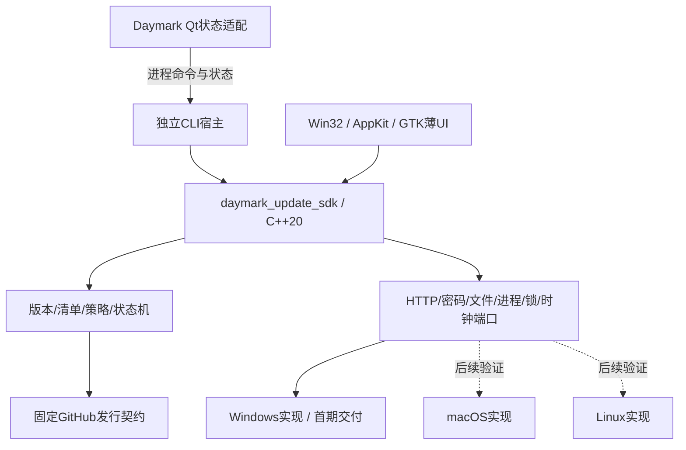

# 架构与恢复事务

设计基线：**可嵌入的C++更新SDK + 平台适配 + 薄UI/CLI**。SDK不是常驻服务，不是远端RPC，也不要求安装动态库；首期内部静态链接，同源码构建，不承诺外部分发的C++二进制ABI。

## 1. 分层和目标



模块目录与构建目标（具体类及同步SDK/独立进程适配见[实现操作](implementation.md)）：

```text
src/update/sdk/                 DTO、状态机、策略、协调、错误、严格JSON
src/update/platform/windows/    WinHTTP/CNG/文件/进程/租约/管道
src/update/platform/macos/      后续端口，不能用空实现返回成功
src/update/platform/linux/      后续端口
src/update/frontends/win32/     原生小窗口，只接状态和意图
src/update/frontends/appkit/    Objective-C++薄UI，后续
src/update/frontends/gtk/       GTK薄UI，可选依赖，后续
src/update/cli/                 参数、JSONL输出、退出码
src/update/qt/                  主应用适配器，不被SDK反向依赖
src/app/StartupUpdateGate.*     Qt应用受限启动/正常运行放行
```

目标为`daymark_update_sdk`、`daymark_update_windows`、`daymark-bootstrap`、GUI宿主`daymark-updater`、控制台宿主`daymark-update-cli`。GUI与CLI静态链接同SDK，不各写下载/安装逻辑；进程互斥保证同一任务只有一个执行者，另一宿主只查询/订阅或返回Busy。主应用链接规则/客户端适配部分，不在主进程执行解包/切换。

Windows保留独立console-subsystem CLI，避免用GUI-subsystem exe伪装命令行导致脚本等待/输出语义不稳。自动后台准备优先调用CLI宿主的内部handoff模式，不打开控制台；需要显示独立进度时原生GUI宿主订阅同一任务。GUI关闭不杀已独立接手的apply；prepare取消仍由显式意图决定。无人值守任务完成即退出，不变成系统服务。

## 2. 运行目录和写入者

```text
Daymark/
  daymark.exe                       # 稳定启动器
  daymark-updater.exe               # Win32 GUI宿主
  daymark-update-cli.exe            # 同SDK的CLI/后台执行宿主
  bootstrap-release.json + .sig     # 根引导层与初始payload的信任描述
  FILES.json                       # 初装索引
  versions/<version-source12>/     # 各版本主程序+Qt DLL/插件/许可
  current.json
  update-state/
    tools/<version-key>/           # 版本原生工具及已签名seed/索引；随current选择
    locks/                         # prepare / launch / runtime / state
    preferences.json
    prepared-update.json           # 最多一个Ready
    journal.json
    current.last-good.json
    releases/<version-key>/         # 清单/签名/索引
    cleanup/<transaction-id>.json
  .staging/<transaction-id>/
```

下载缓存与worker私有副本放当前用户私有缓存，实际路径由平台端获得，不写死用户目录。跨卷缓存与安装暂存分别预检空间；最终版本目录提交始终在安装卷。UPD-09将[原生工具链](../update-toolchain-and-settings.md)与payload一同暂存：根入口保留为固定信任/分派内核，当前CLI/GUI从current对应的tools版本读取，先验签seed/索引及工具散列，不原地替换运行中的EXE。旧根尚无分派能力的3.0.2首次接入需完整安装一次；后续兼容工具变更可在线更新。内核协议/签名算法或数据schema/读写ABI破坏性升级仍须独立兼容桥接/迁移设计，不能借自更新绕过保护。

| 数据 | 唯一写入者/串行规则 |
|---|---|
| 偏好/调度、取消冷却 | SDK StateStore经短时state锁合并，revision CAS；UI不直接写JSON |
| `.part`/下载收据/staging/Ready | 持prepare锁的执行宿主；Ready写入前校验目标/期望generation |
| current/journal/last-good | 持launch gate的apply或恢复者；prepare与UI无权限改指向 |
| 清理收据/文件 | 单一Cleaner，持cleanup/prepare互斥，禁止与新prepare并行 |
| DB/账号资料/用户备份 | 既有资料/Repository所有者；SDK没有SQL写入口 |

安装身份取规范化根的卷/文件ID加当前用户身份；installId只是本地随机标记，不上报。目录复制/移动后重建运行身份，不能因复制了installId而锁住另一个安装。所有锁使用实际同一根下锁文件，验证锁路径非链接且物理身份一致。

## 3. 租约协议，防止新旧并行

Windows使用分离的文件范围锁，各有独立文件句柄：prepare独占、launch gate独占、runtime共享/独占。state锁短时使用，不在网络/等待进程时持有。统一顺序：prepare → launch → runtime；state修改不持有后再反向申请长锁。普通启动不申请prepare。

普通启动持launch gate发现Ready需要转apply时，先释放gate，再按prepare→launch顺序取得锁并重读generation/Ready；若状态已变则重新裁决，禁止持launch反向等prepare。apply始终保留gate直到受控新进程完成交接或恢复；取消/异常用RAII释放，不能留下仅靠PID文件的假锁。

1. 正常启动取得launch gate，检查/恢复持久状态；无apply时启动子应用，子应用取得runtime共享租约并回复LAUNCHED，启动器释放gate。payload直接启动也先走同样注册门，不接受一个未认证`--skip-lock`。
2. 后台prepare只持prepare锁，不碰runtime，旧程序继续运行。apply申请prepare后取得launch gate，阻止外部新启动；检查是否有其他资料实例，存在则结束此次apply并要求先关闭。
3. apply与当前应用建立真实进程句柄接手，旧应用保存退出。全部旧runtime共享租约释放后，apply短暂取得runtime独占，确认无旧进程可用。
4. **启动受控新进程前释放runtime独占，但继续持launch gate**。新进程经已继承受限通道验证本次apply身份、nonce和映像，取得runtime共享租约；普通外部启动仍被gate阻挡。不能一边持独占一边等待新进程拿共享。
5. 新进程受限启动→提交→RUNNING；apply释放gate，后续外部启动只激活新进程。apply中途死亡会释放gate；下一启动先读journal并处理存活候选，不直接按目录启动旧版。

管道断开/候选父进程死亡时，候选必须裁决持久current：未提交本事务则保持零写并退出；已提交同事务则可按提交规则继续初始化，绝不默默退回旧程序。恢复者如需处理未提交候选，只可等待/终止已验证为本事务、尚未获写权限的进程，不能按复用PID误杀用户程序。

## 4. 受限启动与正常启动分离

首次引导和正常启动的launch门允许最多10秒单调时钟等待，只重试实际`ERROR_LOCK_VIOLATION`；prepare/apply/runtime等安全互斥保持立即拒绝。共享模式/权限/路径/IO失败不重试，也不报为已有实例。锁错误保留Win32数值、open/acquire阶段与固定锁名，原生启动器写脱敏本地日志并按错误给出恢复建议；不输出用户目录，不建议删除数据库或锁文件。启动门超时只代表短时间内不能取得门，不足以证明后台应用仍活着。

源码事实：`SqliteDatabase::open`包含目录创建、迁移快照、MigrationManager、WAL配置、检查和每日快照；`AppRuntime::start`会启动工作区/同步。因此不能先调用正常start再“临时关同步”。

新增`StartupMode::Normal / RestrictedUpdate / SyntheticPreflight`，模式只能由验证过的本地handoff进入；生产不能靠环境变量跳过验证。构造阶段不启动任何副作用对象。

RestrictedUpdate顺序：验证handoff/进程身份 → 持有资料SingleInstance锁且不激活旧程序 → 只读解析资料索引 → 所有已登记资料存在的DB以独立只读连接读取schema/兼容信息，活动资料做有界必要查询 → 加载QML/插件/首个实际帧但编辑锁定 → 发READY。未创建的新空资料记录为Absent，不能为了探测而创建库；损坏/锁定资料拒绝自动切换。只读SQLite允许必要的读取协调，不承诺操作系统临时锁文件字节绝对不变；保证无迁移/用户业务/偏好/outbox写入。

COMMIT前禁止正常`SqliteDatabase::open`、重复任务物化、提醒展示写回、同步、备份、资料切换和设置持久化。UI禁用只是一层，Repository启动写门也必须拒绝命令；写门缺失不能声称RestrictedUpdate完成。

获持久提交许可后才进入正常资料初始化；成功挂接正常命令、同步生命周期并完成帧呈现发RUNNING。生产初始化失败仍保留旧程序文件，但由于提交已发生不自动降级/恢复DB；显示新版修复路径。SyntheticPreflight永远QTemporaryDir、禁账号网络，仅证明资源/依赖可用，不替代用户资料READY/RUNNING。

## 5. 三个不同提交点

| 记录/点 | 含义 | 允许动作 |
|---|---|---|
| Prepared/Ready | 新文件完整安装，旧程序仍current | 提醒重启；不可删旧版/放行新资料写 |
| current committed | 新版本成为本安装权威入口，写权限的线性化点 | 新进程核对事务/签名描述后开始生产初始化；旧版不再自动恢复 |
| RUNNING→CleanupEligible | 正常初始化成功，新进程仍存活，收据已持久化 | Cleaner可删旧程序；没有RUNNING不清理 |

协议为READY → 落盘current(committed,txn,generation) → 发送COMMIT → 新进程核对持久提交并初始化 → RUNNING → 落盘CleanupEligible。COMMIT丢失时新进程读到同事务已提交记录可恢复；没有提交记录即使收到了伪造/旧COMMIT也不能写。提交后的超时/worker崩溃不能走“恢复旧指向”。

SDK快照中的`committed`不等于“更新完成”；前端只有Prepared才能说待重启，RUNNING才说新版已运行，清理有独立状态。每个不可逆步骤前写journal意图，成功后写结果；状态文件有限尺寸、带revision和正文校验（只防损坏，不当签名）。

## 6. 恢复与清理

| 崩溃点 | 恢复裁决 |
|---|---|
| 下载/暂存/未写Ready | 旧current不变，安全续传或回收本事务 |
| Ready后未退出 | 旧版继续；下次启动复验Ready应用 |
| 写切换意图后、current未提交 | 终止/等待未授权候选后恢复签名有效的旧current |
| current已提交、COMMIT/RUNNING丢失 | 绝不自动退旧；核对存活新进程或重新启动同一已提交版本，旧文件保留 |
| RUNNING已落盘、清理尚未开始 | 验新进程/当前状态满足后启动清理 |
| 部分删除旧文件 | CleanupStarted是不可回退标记，last-good已经新版；按清理收据继续，不能启动残缺旧目录 |
| current和备份/日志都坏 | 不猜最高版本目录；保留文件并提供修复/手动引导入口 |

CleanupStarted前把last-good写为当前新版并落盘，验证旧进程均退出；只删旧索引中路径/散列匹配的程序文件。不删用户追加/修改文件，不覆盖DB；只移除空目录。文件占用/拒写记PendingCleanup，下次启动有界尝试一次，不循环重试/提权/强杀。current.previous最终置null，签名旧描述在清理完成后回收；诊断只留无隐私摘要。

正常启动验证签名描述和入口身份，不对整个Qt负载同步全量哈希；prepare/apply/回退/清理按对应文件索引完整验证。兼容Qt运行库的用户合法替换不被正常启动器一律拒跑；若当前负载被用户修改导致不能保证自动回退，提示手动升级而不覆盖修改文件。性能和Qt可替换性不能靠运行时强制所有DLL永远原样解决。

## 7. 三端扩展的边界

共享SDK规则/契约/CLI命令和状态，不把Windows安装算法当跨平台实现。macOS AppKit只是薄UI，安装端还需.app完整签名/公证、可写位置、LaunchServices/重启身份及bundle级替换；不得修改已签名bundle内容后称签名仍有效。Linux GTK只是可选薄UI，安装策略区分用户可写归档与deb/rpm/AppImage；不能绕过系统包管理直接覆盖其文件。尚无受支持平台安装后端时GUI/CLI报告UnsupportedPlatform或手动下载，不返回假成功。
