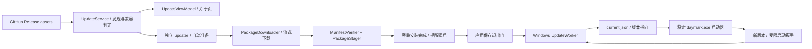

# Windows 优先在线更新设计

状态：Windows实现与验证切片进行中（2026-11-05）；实际证据见[PROGRESS](../PROGRESS.md)，开发入口为[设计包](update/README.md)及[实现操作](update/implementation.md)。本期只投入Windows流水线，macOS/Linux不增加实施；正式GitHub签名发布与干净机门禁独立。UPD编号是更新子系统任务，不改写原PRD历史需求。

## 1. 推荐结论与范围

使用 **GitHub Releases 托管完整 Windows 便携 ZIP + 发布者签名更新清单**。按用户最新要求：应用启动后异步检查，发现合格新版自动启动独立 `daymark-updater.exe`，后台下载、验签并安装到独立版本目录，完成后提醒“更新已安装，重启后生效”。当前版本继续运行；用户重启或下次正常启动时切换，新版健康确认后清理旧程序。不逐个覆盖运行中的 Qt DLL。

首期仅支持 Windows x64、稳定频道、当前用户可写的本地 NTFS 目录。默认开启“启动时自动检查并准备更新”；首个主窗口可用后异步检查，发现新版自动启动更新器，不再要求先点击下载。保留“设置 → 关于 → 版本与更新”手动入口和关闭自动更新开关；仅重启时机由用户选择。不依赖 Daymark 登录或同步服务器，不发送账号、任务、设备 ID 或数据库。

首期不做差分包、强制中断使用或重启、管理员提权、安装器/MSI 更新、预发行频道、任意镜像或自定义更新 URL。macOS 先保留发布页手动下载；后续通过平台安装端口接入，不能把 Windows 文件切换照搬为 macOS 已验证能力。

已有版本没有更新器，必须手动安装一次首个带更新器的便携版。建议在下一个独立递增版本交付；本文的 `2.1.0` 仅为示例，不代表已决定改版号或已经发布。现有任务数据目录保持不变。

### 1.1 独立更新器与服务边界

- 应用内 `UpdateService` 是逻辑模块，负责检查、策略、状态和启动更新器，不是 Windows 服务。
- 用户补充后采用SDK分层：C++20更新SDK统一业务，GUI与CLI为薄宿主。Windows独立控制台daymark-update-cli.exe执行后台任务，daymark-updater.exe为原生UI/观察入口；后续AppKit/GTK接同SDK，主程序Qt不变，详见[轻量UI](update/native-ui.md)。本文worker指执行角色，不限定一定由GUI进程执行。
- 本机 `daymark-updater.exe` 是当前用户身份、按需启动的独立进程。prepare 模式下载/校验/旁路安装，落盘 Ready 后退出；重启时 apply 模式切换/恢复/清理，不为等待用户重启一直常驻。
- GitHub Releases 提供服务器侧资源和签名清单，不新增云端更新服务，不依赖账号服务器。不注册 Windows Service 或系统开机后台任务，不要求管理员权限。

安装准备与重启生效分开。下载时用户正常退出 Daymark，更新器取消网络并保存有效断点后退出；父进程意外退出也有界收尾，下次启动继续。apply 模式需要跨越旧应用退出，运行到新版本提交或恢复及本次清理结束。

## 2. 仓库现状及约束

| 已核对事实 | 对设计的影响 |
|---|---|
| 当前源码版本 2.0.0、schema 10；多份本地构建曾共用版本号 | 自动更新严格比较 SemVer；不同源码不可反复发布同一个版本，也不自动安装同版本重打包 |
| 已提交的标签打包脚本生成 `Daymark-{version}-windows-x64.zip`、同名 `.sha256` 和汇总校验文件 | 首期复用 ZIP 资源；没有依据把现有资源当成 `.exe` 安装器 |
| ZIP 含一层同名顶级目录，正式标签脚本记录 `BUILD-INFO.json` | 解包按明确布局协议处理，禁止猜测 ZIP 第一项就是应用目录 |
| 源码 Release 和二进制构建为不同作业 | Release 存在不等于 Windows 可更新；匹配的清单和签名必须最后发布 |
| 标签 Windows 构建是 MSVC 2022，本地包使用 MinGW；标签包说明需要 VC++ 运行库 | 清单必须描述运行时与构建来源，禁止按文件名盲选；首个引导包必须统一运行时契约 |
| 当前包没有已建立的更新签名机制；签名/干净机门禁存在未验收项 | 当前资源不能仅因有 SHA256 就直接列为自动安装候选 |
| `SingleInstance` 按资料目录互斥，IPC 目前仅 `activate` | 同一安装可以有不同资料进程，必须另设安装级锁和进程登记 |
| 主窗关闭可能进入托盘；草稿和后台命令有既有退出路径 | 更新必须通过真正退出和保存门，不能简单调用 `close()` 后开始换文件 |
| 默认资料目录来自固定 Daymark 组织/应用名的 `QStandardPaths` | 版本化程序路径不能改变应用身份、默认 DB、账号密钥服务名或设置命名空间 |

依据为已提交的 `release-build.yml`、两个 Windows 打包入口、`SettingsAboutPage.qml`、`Main.qml`、`SingleInstance`、`AppRuntime`；工作区两份 CI 既有修改不属于本方案实现。远端 Releases 网页/API 本轮请求未成功，**实际已上传资产库存 UNVERIFIED**。本方案不宣称远端已存在更新清单或可自动安装包。

## 3. 用户操作链与 HIG 映射

沿用 UX-09/11/13 和 P-13～21：清晰层级、用户控制、可恢复操作、渐进呈现及可访问性；HIG 是原则依据，下面的时间、尺寸和默认值是 Daymark 自主设计。

关于页在现有品牌/版本之后增加一个“版本与更新”分组；不放到任务工具栏或悬浮小窗。显示当前版本、检查结果/时间和一个主要动作。版本说明独立展开或通过“查看发布说明”打开 GitHub，正文按纯文本或严格无远程资源的安全子集渲染。不能执行 Release 正文 HTML、脚本或任意链接协议。

| 状态 | 可见内容与动作 | 退出/恢复 |
|---|---|---|
| Idle | 当前版本；“检查更新”；“启动时自动检查并准备更新”开关 | 未检查过不能显示“已是最新” |
| Checking | “正在检查更新…”；取消 | 不阻塞任务窗口；取消结果不算失败 |
| UpToDate | “已是最新可安装版本”；上次成功检查时间 | 仅在完整完成本次发现后使用 |
| Available | 新旧版本、下载大小、“正在启动更新器…”；兼容通过后自动进入下载 | 可以取消本次准备，不重复启动第二个更新器 |
| Downloading | 字节进度/总量、取消；网络慢时保留真实状态 | 总量未知用不定进度，不伪造百分比；取消保留合格断点 |
| Verifying / Staging | “正在验证更新”/“正在准备更新” | 安装指向未改，安全取消并清理本次暂存 |
| Ready | “更新已安装，重启后生效”；“立即重启”“稍后” | 关闭关于页不丢失 Ready，下次正常启动也应用更新；提供取消待应用更新入口 |
| PreparingExit | 保存草稿并停止接收新命令 | 保存失败留在旧程序，允许继续编辑；不强制杀进程 |
| Applying / Starting | 独立启动提示“正在完成更新” | 短暂关键切换期间禁止中断按钮，崩溃由事务恢复 |
| Error / RolledBack | 可操作原因；“重试”“查看发布页”；回退时说明仍使用旧版 | 更新失败不影响本地任务使用，不把网络失败显示为最新 |
| ManualRequired | 包尚未就绪、运行时/数据/引导器不兼容或目录不可写等具体原因 | 提供发布页与手动更新说明，禁止绕过校验 |

后台准备期间在关于页展示进度，不弹窗打断使用；旁路安装完成后主窗口显示一次“更新已安装，重启后生效”，提供“立即重启”“稍后”。主窗隐藏时使用支持的系统通知，不主动打开主窗或改变悬浮球/小窗状态。关闭提示保留 Ready，稍后正常退出后的下一次启动也会应用更新。关闭关于页不取消准备；取消本次准备后，本会话及其后24小时不自动重启同一候选下载，手动重试可解除。关闭自动更新取消正在进行的准备，但已 Ready 项保留并提供“取消待应用更新”。账户窗口、独立日历和小窗均进入同一保存退出协调。

键盘 Tab 顺序为主要动作、次要动作、发布说明、自动检查开关；Space/Enter 触发焦点控件，Esc 关闭详情或取消可取消阶段，不能隐式安装。按钮有可访问名称，进度按阶段/节流值播报；不用颜色单独表达失败。沿用 `SettingsGroup/SettingsRow` 和 Theme 字体/间距，不新增一套更新页视觉。浅深主题、窄窗、100%/200%文字时按钮可换行，正文单轴滚动，进度和操作不覆盖文字。减少动态时不做连续装饰动画。

## 4. 总体架构与职责



| 模块/建议位置 | 责任、输入输出 | 不承担的职责 |
|---|---|---|
| `src/update/ReleaseClient` | Qt Network 获取固定仓库公开 Release/资产，缓存 ETag；异步返回原始有界响应和请求代次 | 不判定可执行性、不使用同步服务 token |
| `UpdatePolicy` | 纯函数：版本、频道、目标、runtime、布局、schema/数据 ABI、引导协议兼容判定，返回候选或原因 | 不发网络、不读 QML 状态 |
| `ManifestVerifier` | 验证原始字节签名，严格解析和验证清单；只输出可信 `VerifiedRelease` | 不接受正文里的下载/命令指令 |
| `PackageDownloader`（更新器内） | 原生网络分块写 `.part`、断点元数据、限速/取消/超时/最终 SHA256 | 不把整个 ZIP 常驻内存、不切换当前版本 |
| `PackageStager`（更新器内） | 解压前审核全部目录项，写新目录、逐文件核验、核对版本/资源/许可证及预检 | 不触碰资料、当前版本目录 |
| `UpdateService` | 单一状态机及 operationId；编排上述模块、持久化更新状态 | 不直接操作 Windows 窗口和 Repository SQL |
| `UpdateViewModel` | 只读属性和用户意图，映射稳定错误为可操作中文 | QML 不计算 SemVer、不比较哈希、不启动 shell |
| `ApplicationExitCoordinator` | 复用草稿保存、资料命令排空、同步安全停止、实际退出；失败取消安装 | 不用强制结束代替保存 |
| `src/platform/windows/update/Bootstrap` | 小型稳定原生启动器：安装级互斥、恢复事务、验证启动目标并启动 Qt 程序 | 不访问账号/DB、不长期联网、首期不自更新 |
| `WindowsUpdateWorker` | 同一原生 updater 的 apply 模式：复验 Ready、等待旧进程退出、切换指向、新进程握手、回退/清理；prepare 模式负责下载与旁路安装 | 不执行远程脚本、不接收任意启动参数 |
| `StartupUpdateGate` | 新版本正常入口中的受限启动阶段；在允许写入前完成资料只读兼容检查和就绪握手 | 不把 synthetic smoke 成功冒充用户资料启动成功 |

主程序 QObject 元数据网络在所属线程；独立更新器使用原生网络与有界工作队列执行下载、哈希、ZIP 和逐文件核验，进度经受限 IPC 回报。进度通知最多每 100ms 一次，末次/阶段变化立即送达。只有当前 operationId 的回调能改状态；取消、重试、关窗或新请求后过期回调全部丢弃。正常运行不轮询扫描版本目录，只在检查、启动恢复和清理时访问。

## 5. GitHub 发现与可更新资格

固定公开仓库 `downdone/daymark`，REST 入口 `GET /repos/downdone/daymark/releases`，不嵌入 PAT。请求使用官方 JSON Accept、固定经验证的 API version、`User-Agent: Daymark-Updater/{version}`；API version 在实现时锁定并测试，不使用随主站文档自动漂移的值。

`/releases/latest` 可以作为优化提示，**不是版本排序或资源完备的依据**。GitHub 文档的 latest 语义不等价于最高 SemVer；由客户端解析、筛选并比较版本。[GitHub Releases API](https://docs.github.com/en/rest/releases/releases#get-the-latest-release)

首期发现算法：

1. 列出每页 30 个 Release，最多 3 页；按 Link 分页读取，不假定 API 返回 SemVer 顺序。只考虑非草稿、非 prerelease、格式为 `vMAJOR.MINOR.PATCH` 的稳定版本，拒绝前导零和数字溢出；按数值比较，`2.10.0 > 2.9.0`。
2. 只检查大于本机版本的条目，按版本降序。最多验证 3 个完整候选；每次检查最多 12 个元数据/清单/签名请求，不含按需 ZIP 下载。超过分页/请求预算且无法证明结果完整时返回 `DiscoveryIncomplete`，不宣称最新。
3. 一个 Windows 候选必须同时具有唯一的 ZIP、`update-windows-x64.json` 和 `.json.sig`，签名有效、身份和兼容条件满足。只缺文件说明“Windows 更新资源尚未就绪”；重复同名资产或验签失败按发布异常处理，禁止静默选择其他文件继续安装。
4. 清单绑定仓库、tag、Release ID、ZIP asset ID/名称/字节数/SHA256、目标平台/运行时和版本目录。由 GitHub 资产表核对所属 Release 和资源状态，拒绝 HTML 错误页、源码 zipball 和同名其他架构文件。
5. 可提示较低但可用的新版本，同时说明更高版本资源待就绪/需手动更新；签名异常不能被这种回退隐藏。结果用“可安装更新”语义，不声称已经知道所有平台最新版本。
6. 正式版本不自动降级、不安装同版本替换、不按 `published_at` 或字符串大小排序。清理/崩溃回退属于本地已验证事务，与远端降级是两个入口。

元数据与签名清单按 URL/ETag 缓存，304 只能在本地缓存完整且重新验签通过时使用。默认真正创建应用进程、首窗可用后约3秒后台检查；重复激活已有进程不重复检查。同安装启动检查至少间隔10分钟，避免反复开关软件耗尽限额；不设全天常驻检查器。关闭自动更新时仅手动检查。手动检查冷却60秒；受 GitHub 限流时遵守 `Retry-After`/reset，自动检查失败下次至少一小时后且不早于服务端时限。一次检查不循环重试；用户可在条件解除后重试。GitHub 匿名 API 限额按公网 IP 共享，通常60次/小时；**不假定匿名304免费**。[限流说明](https://docs.github.com/en/rest/using-the-rest-api/rate-limits-for-the-rest-api)

GitHub 不可达时给出原因和可复制的正式发布页链接，允许继续离线使用。账号退出、同步错误或官方地址调整不改变更新源。首期不自动切换不受信任的下载代理。

## 6. 资源与签名契约

每个可更新的正式 Release 在既有 ZIP / `.sha256` / `SHA256SUMS.txt` 外增加两个很小的资源：

```text
Daymark-2.1.0-windows-x64.zip       # 同时可供浏览器手动下载
Daymark-2.1.0-windows-x64.zip.sha256
SHA256SUMS.txt
update-windows-x64.json
update-windows-x64.json.sig        # 成对清单最后附加；两者齐全才表示就绪
```

清单示例是**协议示意、无效示例散列/ID，不可发布**。字段必须来自打包后的实际字节与 GitHub 上传结果，而非手填测试通过结论：

```json
{
  "format": 1,
  "repository": "downdone/daymark",
  "channel": "stable",
  "version": "2.1.0",
  "tag": "v2.1.0",
  "release_id": "123456789",
  "source_revision": "0000000000000000000000000000000000000000",
  "published_at": "2026-11-05T00:00:00Z",
  "target": {
    "os": "windows",
    "arch": "x86_64",
    "runtime_family": "msvc143",
    "runtime_min": "<tested-runtime-version>",
    "minimum_windows_build": 19045
  },
  "bootstrap_protocol": { "min": 1, "max": 1 },
  "package": {
    "asset_id": "234567890",
    "name": "Daymark-2.1.0-windows-x64.zip",
    "size": 40000000,
    "sha256": "0000000000000000000000000000000000000000000000000000000000000000",
    "layout": "portable-managed-v1",
    "archive_root": "Daymark-2.1.0-windows-x64",
    "payload_dir": "versions/2.1.0-000000000000",
    "entry": "daymark.exe",
    "unpacked_size": 180000000,
    "file_count": 400,
    "files_index": "FILES.json",
    "files_index_sha256": "0000000000000000000000000000000000000000000000000000000000000000"
  },
  "data": {
    "schema": 10,
    "read_write_compatibility": "task-store-v10-rw1"
  }
}
```

GitHub 数字 ID 在协议中使用十进制字符串，避免经 QML/JSON double 丢精度。大小/计数限制在精确可表示且受上限保护的整数范围。`minimum_windows_build` 是发布资格声明，必须经真实目标系统验证；示例不是 Qt/Daymark 已验证 Windows 10 的证据。首个发布包的最低系统及 VC++ 运行库版本在实施门禁中实测后冻结，不把占位字段带入正式清单。

`FILES.json` 是排序的 `{format:1, files:[{path,size,sha256}]}`，路径相对 ZIP 顶级目录。覆盖启动器、payload、许可证、BUILD-INFO 等不可变内容；明确排除它自身及 `bootstrap-release.json`/`.sig`，由签名描述绑定索引 SHA256，避免“索引包含描述、描述包含索引散列”的循环。排除项只有这三个固定信任元数据名称，不接受清单扩展任意免检文件；它们分别按严格解析/签名验证。运行后生成的 `current.json`、安装 ID、缓存和日志不进入 ZIP。

资产 ID 在上传后才确定，因此外部更新清单不嵌入自身 ZIP。手动初装使用 ZIP 内单独附带的签名种子描述（固定 format/domain、版本、source SHA、入口、文件索引散列，不含未来资产 ID），由稳定启动器内置公钥离线验证。种子描述的签名域为 `Daymark.BootstrapPayload.v1`，不可拿普通更新清单签名混用。先生成文件索引，再签种子描述，再压 ZIP/上传，最后生成并签外部清单；四步的哈希依赖单向。

每次自动安装把已验证外部清单、签名与文件索引保存到 `update-state/releases/<version-key>/`，与目标版本目录一起完成提交前持久化；旧版本的信任描述也保留。启动器恢复时按描述验证对应版本，不能只根据本地 current 中的路径/版本字符串信任可执行文件。下载包中的新根启动器及种子描述只用于该包手动初装；自动更新仅取新 payload 和验证元数据，保留本安装稳定启动器。

### 签名与信任边界

HTTPS + ZIP SHA256 用于传输完整性；同一 Release 里的 ZIP 与 `.sha256` 同时被替换时，二者不能独立证明发布者身份。在线安装必须再验证内置公钥签名，不提供“忽略验证继续安装”。GitHub 资产 `digest` 如存在要交叉核对，但它不能替代发布者签名。[GitHub 资源 digest](https://github.blog/changelog/2025-06-03-releases-now-expose-digests-for-release-assets/)

建议使用 ECDSA P-256/SHA256，Windows 通过 CNG `BCryptVerifySignature` 验证；无需为验签引入一套通用密码库。签名输入为 UTF-8 域分隔串 `Daymark.UpdateManifest.v1`、一个 NUL 字节和清单**原始 UTF-8 字节**拼接后的 SHA256；拒绝 BOM/非法 UTF-8。签名封套为 `{format:1,key_id,algorithm:"ecdsa-p256-sha256-p1363",signature:<base64>}`，固定 P1363 `r || s` 共 64 字节；发布工具与 Windows 必须用真实交叉向量证明编码一致。验签成功再解析清单，不能重排 JSON 后验签。[Windows CNG](https://learn.microsoft.com/en-us/windows/win32/api/bcrypt/nf-bcrypt-bcryptverifysignature)

公钥和允许 key_id 编译进启动器/客户端；清单上限 64KiB、签名封套 4KiB。严格解析器拒绝重复 key、错误类型、无效数字、未知 format/必要能力和路径歧义；普通可选扩展字段可忽略。Qt JSON 的默认覆盖重复 key 行为不能作为严格验证。不可控 Release 正文不属于可信安装契约。

签名私钥在独立受保护发布环境或离线签名环节中使用，不能进入源码、ZIP、开发日志或普通 PR 作业。首次启用前建立公钥指纹、备份和轮换规程。信任新 key 需由已有可信版本明确带入或由旧 key 签名授权；key 泄露时不能声称“继续用已泄露 key 签名”就能修复信任，需人工信任恢复/新的可信引导包。

发布者清单签名与 Windows Authenticode 是不同机制。清单验签不能消除 SmartScreen，也不代表 EXE 已获系统发行者签名；正式二进制仍遵守现有签名、干净机、许可和平台门禁。本方案防未授权替换和自动降级，**不承诺在 GitHub 账号/发布密钥都失陷或信息被长期阻断时证明“远端一定最新”**；首期不另建在线可信时间/撤销服务器。

## 7. 下载与解压边界

主程序元数据检查使用独立 `QNetworkAccessManager`；原生更新器下载使用 WinHTTP，避免依赖正在管理的 Qt DLL。二者共享 URL/重定向/限额策略和测试向量，使用系统 TLS 信任；WinHTTP 显式适配当前用户代理/PAC，不能假定自动继承 Qt/浏览器代理。代理认证失败显示错误，不保存浏览器凭据。[WinHTTP 官方说明](https://learn.microsoft.com/en-us/windows/win32/winhttp/about-winhttp)

只请求固定 GitHub API/Release 路径，资源 ID 从核验后的 Release 解析；手动审核重定向，始终 HTTPS、443、无 URL userinfo，最多 5 次。首期只准明确的 `api.github.com`、`github.com`、`release-assets.githubusercontent.com`、`objects.githubusercontent.com`；真实发布资源若使用其他 CDN 主机，需验证并更新受控列表，不能退化为任意 `*.githubusercontent.com` 或放行全网。跨主机不传凭据。失败不关闭证书验证、不退 HTTP、不记录 CDN 临时签名查询串。

网络参数是首期有界默认值：元数据单请求 15 秒、整次检查总预算 90 秒；下载无进展 30 秒、整包总预算 30 分钟，不用元数据短超时限制整个 40MB 包。超时返回明确错误并保留有效断点，由用户续传；不反复重跑测试或网络请求掩盖超时。

下载按块写当前用户私有缓存，记录 `assetId + size + sha256 + strongETag + receivedBytes`。不缓存临时 CDN URL。当且仅当身份、强 ETag 和本地文件长度一致时发送 Range/If-Range；新响应必须为匹配偏移的 206 且总长正确。返回 200 重新从零写，禁止拼接；416 仅在文件已经达到预期大小并最终哈希通过时当完成，否则清除坏断点。没有稳定强 ETag 时首期从零下载；不承诺 GitHub 必定支持续传。

完整下载后重新流式 SHA256 并比较签名清单，失败删除损坏包、保留旧程序；不靠下载过程中累计值绕过对磁盘最终文件的验证。已验证包在应用重启、worker 接手时再次检查，以防暂存变化。缓存以用户 ACL 限制访问，日志只记录阶段、错误 key、版本及资源 ID。

解包前执行全量目录审核，拒绝：绝对路径、盘符/UNC、`..`/`.` 路径段、反斜杠歧义、NTFS ADS、尾随点/空格、Windows 保留名称、大小写/规范化重名、重复文件、符号/硬链接及 reparse point。仅接受预期单层根目录和声明布局；新 staging 目录不得预存在或含链接，操作前后核对最终路径仍在安装根下。所有路径处理使用原生句柄/受限目录策略，防检查后被换成 junction。

本地硬上限：ZIP 512MiB、解压 2GiB、10,000 文件、单项 512MiB；同时不得超过签名声明的精确计数/字节和文件索引。仅支持 store/deflate，无加密、多卷包或未支持的 ZIP 扩展。解压流式累计真实字节，不能只信中央目录大小；对超限、截断、CRC/逐文件 SHA 不符都零切换。磁盘预检按缓存卷与安装卷分别计算剩余下载量、完整新版本暂存量和各自 128MiB 余量；旧版已占空间无需再复制，但不可删除它腾空间。仍要处理检查后磁盘被耗尽的写入失败。

Qt 公共 API 缺少满足这些约束的通用 ZIP 提取器。建议 vendoring **miniz 3.1.2（MIT）** 的必要 ZIP/解压源码，锁完整 commit 与来源散列、保留许可和 SBOM，不在用户机器调用 PowerShell/7-Zip。版本/许可证/替代方案见 ADR-033；真正引入前做依赖审核与畸形包测试，不能把选库当安全审核已经通过。

## 8. Windows 安装布局与启动约束

```text
Daymark/                               # 用户解压选定；不需要管理员权限
  daymark.exe                          # 稳定原生启动器，图标/版本信息保留
  daymark-updater.exe                  # 固定更新入口，按需进程；不注册服务
  bootstrap-release.json + .sig        # 手动初装种子 payload 描述
  versions/
    2.1.0-<source12>/daymark.exe        # Qt 主程序及全部本版本依赖
    2.1.1-<source12>/daymark.exe        # 下载后增加；不混用两版 DLL
  current.json                         # 原子更新：当前/上一已提交版本
  update-state/                        # journal、受控 IPC/安装状态
  .staging/<transactionId>/            # 同卷暂存，成功后改为最终版本目录
```

这对应用户所述的“根目录启动器 + version 1 文件夹 + version 2 文件夹 + 更新器”。示例把版本文件夹集中在 `versions/`，只为让受管版本与用户文件更容易区分；版本文件夹直接并列放根目录在机制上也成立。根目录 `daymark.exe` 始终是外部入口，根据 `current.json` 启动实际版本；根更新器是独立 exe，不必常驻。正常完成清理后 `versions/` 只剩当前版本，准备/切换期间新旧共存。用户资料不跟随版本文件夹存放。

根启动器与根更新器组成稳定引导层，首期在线更新只替换版本 payload，二者自身更新需要手动引导包。目标声明更高 bootstrap protocol 时进入手动升级，不能覆盖正在运行的更新器。prepare/apply 实际从根更新器复制出的私有事务副本运行，根文件仍保持稳定可供恢复。

这是对下一版便携分发的布局变更，现有 flat ZIP 不直接原地自动改造。初次手动解压到新目录、退出旧程序再从根启动器进入；仍读取原默认 AppData。若用户显式配置自定义资料目录，保留同一参数/入口并校验；不得因换目录创建空资料冒充成功。资料若在旧应用目录里面，只提示用户按备份/迁移说明处理，禁止更新器自动搬迁或删除。

启动器和 worker 使用 C++20/Win32、CNG，静态链接自身 CRT，不依赖正在被管理的 Qt DLL。worker 接手前复制到当前用户私有的本次事务目录，重新核对发布描述中的文件散列后从该副本执行，不依赖将来可能被清理的 payload 路径。`CreateProcessW` 使用明确程序路径、正确 Windows 参数编码和限定工作目录，限制 DLL 搜索路径；只允许本地配置中已验证的资料参数，拒绝清单附带命令行、脚本或环境变量指令。子程序进程名仍是 Daymark，版本路径不改变组织/应用名。任务栏图标、AppUserModelID、快捷方式、托盘“打开”、开机启动和文件入口都必须指向根启动器，并在实际 Windows 验收，不能只测双击 payload。

安装根依据启动器自身位置与本地生成的 installId 建立，不信任远端绝对路径。读取 current/journal 后只允许启动根下已验证版本。未知协议、损坏指向/日志不猜测“最新文件夹”，只恢复已记录且校验通过的上一提交；两份均无效则显示修复/手动重装入口。启动器首期不在线自换；目标要求更高 bootstrap protocol 时走手动引导包升级，不能留一个无法安全替换自身的隐藏更新分支。

当前官方标签选择 MSVC 路线，首个支持更新的官方引导包建议沿此保持 `msvc143`；实际运行库最低版本必须由干净 Windows 验证后冻结并预检。缺失时提示从微软官方下载并手动安装，不在更新中隐式提权。MinGW 本地开发包、预览包与正式 MSVC 包不互相自动升级；需手动安装统一引导包，之后再沿相同运行时轨道更新。首次集成时重新核对这项选择与 CI Kit，不把当前本地成功包当 MSVC 干净机证据。

## 9. 安装事务、退出、恢复

prepare/apply 是同一个更新器的两种受控模式。prepare 以本安装准备锁互斥，但不排斥旧版正常运行；更新器对候选重新验签，下载/解包/预检后将新 payload 写入独立目录，落盘 `prepared-update.json`（事务ID、候选身份、相对路径、签名描述散列），回报 Ready 后退出。此时完成旁路安装，不改 current、不接触实际用户资料写入。发现父进程退出则有界收尾并保存断点，不继续无限后台下载。

用户点击重启或稍后正常退出后再次启动，根启动器读取 Ready 收据，重新验证文件/兼容性，再启动 apply；条件变化或文件损坏取消切换，旧版正常启动并显示原因。apply 独立于旧主进程存活到提交/恢复及本次清理结束，不注册常驻系统服务。

### 9.1 安装级互斥与退出

安装范围是规范化安装根，而非资料目录。所有经启动器进入的应用持有安装级共享运行租约，并登记 PID、进程创建时间和受限 IPC；worker 申请独占更新租约时阻止新启动。现有每资料 `SingleInstance` 继续独立负责防双开/激活，不用于判断所有安装进程已退出。绕过启动器直接启动 payload 时也必须执行租约检查。

用户点击安装前若检测同安装其他资料进程，先报告“另一个 Daymark 窗口正在使用此版本，请先关闭”，首期不替其他资料/用户做退出决定。不同安装目录共用同一资料时，在资料锁仍被占用的情况下取消本次安装，不夺锁。进入更新后来自快捷方式的启动请求由启动器提示正在更新或排队激活，不得启动半提交版本。

当前进程按顺序完成：所有窗口草稿保存 → 停接收新写命令 → 已受理命令排空/结果成功 → 同步停止并保留持久化 outbox（无需等服务器在线）→ 保存窗口/设置 → 建立 worker 且收到接手确认 → 真正退出。任一保存/排空/worker 创建失败恢复可用的旧应用并报错。复用既有保存冲突/失败交互，不走关闭到托盘。

worker 持有真实旧进程 HANDLE，并验证创建时间/映像路径；等待进程句柄 signaled，而不是循环按 PID 猜测。等待 30 秒仍未退出则不切换、不 TerminateProcess，提示旧版仍在关闭并允许稍后重试。句柄传递仅限明确 handle list；IPC 使用当前用户 ACL、随机事务 nonce 和双方进程身份校验，nonce 不进通用日志。

### 9.2 持久化状态机

```text
Prepared → WaitingForExit → SwitchPending → StartingNew → Committed
                                                          ↓
                  Cleaned ← Cleaning ← CleanupEligible ← Running
提交前失败：Aborted / RolledBack；提交后失败：新版恢复，绝不自动退旧。
```

`journal.json` 包含协议、随机 transactionId、installId、旧/新版本相对路径、已验证清单散列、当前 phase、旧进程身份和结果 key；不包含密码/token/任务。`current.last-good.json` 保存切换前已提交指向及 generation，直到新提交确认前不覆盖；对应版本描述与索引必须先持久化。每个不可逆步骤前先落 journal，再执行，再记录结果。临时文件、日志和 `current.json` 使用禁止 direct-write fallback 的安全写入，检查 write/flush/commit 全部返回值。

关键数据先完整写到同卷再替换。SDK原生状态持久化使用临时文件、FlushFileBuffers和受检原生替换/备份，不依赖QSaveFile；主应用既有Qt业务设置仍可使用QSaveFile。**原子指向替换不等于整次更新在任意掉电和硬件故障下绝对原子**；损坏状态由校验、双份已提交记录与确定性恢复处理，详见[架构](update/architecture.md)。

| 阶段 | 执行动作 | 崩溃/失败恢复 |
|---|---|---|
| Prepared | 新目录完整校验，临时资料预检通过，记录计划 | 当前仍旧版；孤立 staging 可按本地 journal 清理 |
| WaitingForExit | 取得安装独占门、等待旧进程退出 | 未退出即放弃切换；重启读取旧 current |
| SwitchPending | 暂存改为唯一新目录；current仍保持旧committed；pending只写journal | 启动器先恢复事务，不能把Ready/journal目标当已提交 |
| StartingNew | 从新目录启动受限入口，等待带 nonce 的就绪回执 | 新程序退出/超时/资料占用则恢复旧指向；只终止本次未放行、无用户写入的新进程，不终止用户旧进程 |
| Committed | 落盘current后发送COMMIT；新进程核对同事务持久提交，再生产初始化并回RUNNING | COMMIT丢失以持久提交裁决，已提交不自动退旧；无RUNNING不清理 |
| Cleaned | 新版健康确认且提交后清理旧版本程序和本次缓存/暂存 | 清理失败记 PendingCleanup，下次启动再处理，不影响新版运行 |

启动器/worker 在恢复时逐项重新验证受管文件；不按单一 phase 字段就直接执行删除。事务执行须可重复：新目录已经存在且身份一致则复验继续，身份不一致报冲突；current 已正确提交则不重复提交或重启；journal 损坏且无法确定写入是否放行时停止自动处理，保留所有数据并给出修复入口。

新程序首帧、资源/插件、只读资料/schema/ABI检查通过后发READY；不得先调用有迁移/WAL/备份副作用的正常SqliteDatabase::open。受限启动冻结全部写源，以StartupUpdateGate与Repository写门约束。持久化current提交后才允许生产初始化，成功回RUNNING才允许清理。握手30秒无进展/90秒总预算；提交前过慢可取消恢复旧版，提交后过慢只保留旧文件并走新版恢复，不自动退旧。业务零写保证不等于SQLite必要读取协调的临时锁文件绝对无变化。详见[架构](update/architecture.md)。

就绪回执应包含 transactionId、随机 challenge、实际映像路径、编译版本/源码 SHA、数据 ABI、完成阶段；worker 验证自身启动的进程、协议及内容。没有回执不是更新成功。新目录临时库 preflight 只证明静态资源能启动；用户资料就绪回执和真实 Windows 运行测试是另外两道门。

### 9.3 数据兼容与回退限制

首期自动安装要求目标 schema **等于当前 schema 10**，且 `read_write_compatibility` 与本机编译常量完全相同；两项都满足才支持自动二进制回退。仅 schema 相同不足以推断语义兼容，这个数据 ABI 的变更必须经过旧版读写兼容测试。受限启动在打开写连接/执行任何迁移前检查实际数据库版本；禁止对未来 schema 降级打开。

schema 或数据 ABI 不同、引导协议过旧等进入 ManualRequired，链接到有迁移/备份说明的版本；第二阶段再设计一致性备份、迁移提交点与读者兼容窗口。账号资料可能有多个 DB，不能只检查默认本地库。更新器永不自动恢复旧 DB 覆盖新数据；即使留有备份也不能隐式丢弃用户更新后的修改。

旧版本在提交前作为自动失败回退资源，提交后仍保留到新版RUNNING确认，但不再自动退旧；确认后按用户要求清理，不提供提交后的本地回退菜单。删除前再次检查新进程存活、current已提交及RUNNING收据。开始删除后不能再恢复到该目录；普通后续应用崩溃沿现有恢复，不自动恢复数据库。坏候选在本安装隔离记录，自动检查不反复安装同一坏包；手动重试需明确操作，记录不上报。

清理仅删除带本安装所有权、路径及文件索引均匹配的旧受管程序文件，保留当前新版。发现用户追加文件只删除索引内且散列仍匹配的受管文件，未知文件保留，不能递归删除含用户内容的目录。清理前确认旧版进程/租约释放；被占用或拒写记 PendingCleanup，下次启动重试一次，不强杀或提权。清理开始前持久化不可回退标记并将 last-good 改为当前已提交版，完成后把 current.previous 置空；部分删除按每文件记录幂等恢复。AppData、自定义 DB、备份、凭据、本地配置、未知文件和其他安装目录都不在清理范围。下载缓存正常7天可过期，Ready包保留到用户取消/成功替换；清理事件触发，不设常驻扫描器。

## 10. SDK模块接口与本地数据结构

评审发现早期Qt类型接口无法用于无Qt依赖的原生更新器，本节原草案已被[模块详细契约](update/modules.md)取代，不再维护第二套C++声明。SDK使用C++20标准类型与显式Outcome；主应用Qt适配器才转换QString/既有Result，SDK不能反向依赖Qt。

底层为可静态链接更新SDK，独立CLI与原生薄UI复用同一实现；Windows根目录增加daymark-update-cli.exe，自动任务优先由控制台宿主无可见控制台运行，GUI订阅状态。宏观分层、目录/写入者、安装租约与StartupUpdateGate见[架构](update/architecture.md)，命令/退出码、IPC消息及所有持久字段见[模块](update/modules.md)。

本地更新偏好/交易状态不写业务SQLite，不跨账号同步。current是持久提交指向，prepared-update只表示旁路安装完成，RUNNING收据才允许CleanupEligible；previous在成功清理后为null。清理开始前记录不可回退标记并将last-good改为当前新版，禁止恢复到部分删除目录。完整UI状态/默认值见[功能定义](update/functional-spec.md)。

### 错误契约

| Error.key | 含义与用户动作 | 自动行为 |
|---|---|---|
| `update.network_unavailable` / `timeout` | “无法连接 GitHub，稍后重试或查看发布页” | 保留旧版；按既定间隔而非紧循环 |
| `update.rate_limited` | 显示最早可检查时间 | 遵守服务器冷却，不重复打 API |
| `update.discovery_incomplete` / `assets_pending` | 本次无法确认/Windows 包待就绪 | 不显示“已是最新” |
| `update.signature_invalid` / `hash_mismatch` | “更新验证失败，已停止安装” | 隔离候选；不可绕过 |
| `update.incompatible_runtime` / `data_compatibility` / `bootstrap_too_old` | 具体手动升级说明 | 不自动跨轨、不迁移/还原用户库 |
| `update.archive_unsafe` / `unsupported_layout` | 资源格式不符合更新要求 | 删除本次受管 staging，保留旧版 |
| `update.insufficient_space` / `directory_read_only` | 释放空间/解压到可写目录后再试 | 不删旧版、不自动 runas |
| `update.instance_busy` / `save_failed` / `exit_timeout` | 关闭其他窗口或处理未保存内容 | 停止切换，保留输入和旧程序 |
| `update.start_failed` / `health_timeout` | 新版未完成启动，已恢复旧版 | 只有证实恢复后显示 RolledBack |
| `update.recovery_required` | 无法安全确定安装状态，请手动修复 | 保留证据/版本，不猜测删除 |
| `update.cancelled` | 用户取消 | 结束本次 operation，不当成功/错误告警 |

## 11. 发布流程改造设计

本节是后续实施计划，**本轮没有改动 CI**。遵守[发布规则](../release-policy.md)和现有完整测试/许可门槛，不把自动更新当降低发布标准的通路。

服务端无需另外开发。GitHub已有公开Release查询、资源元数据、文件下载和发布说明能力；它不替客户端做版本比较、旁路安装、重启或本地删除。缺少的发布者更新清单由仓库发布工具生成/签名后作为Release附件上传即可；这是一段CI/发布工具工作，不是新增需要运维的HTTP服务。只有未来需要灰度策略、渠道控制、私有分发或独立镜像/带宽时，再评估服务端，当前不预建。

1. 固定新 SemVer/tag/source SHA、Windows runtime/架构与布局协议，独立完成源代码与版本守卫。不同 source/flavor 的公开交付不能复用同名资产。
2. 构建 Qt payload、稳定 bootstrap 和原生 worker；生成实际文件索引、种子 payload 签名、BUILD-INFO/许可/SBOM，打包托管布局。开发私有地址文件仍不进入仓库/ZIP；官方构建所需地址通过既有编译配置通路注入，不借更新清单公开私有配置文件。
3. 完整 CTest/QML lint、原生更新故障矩阵、无 SDK 依赖审计及符合发布规则的干净机/签名门禁通过后产出 ZIP；本地预览、已知失败或 UNVERIFIED 正式门禁不得被清单声称通过。
4. 上传 ZIP 和人类可读校验文件；通过 API 读取 assetId/实际字节/digest，核对产物 SHA 和固定 Release 身份。任一不一致停止，不覆盖已有同名资源。
5. 生成最终外部更新清单，由受保护签名环节验证候选身份和门禁证据后签名；最后附加清单及签名。两个文件的上传本身不原子，客户端按“两者均完整有效”判断就绪。
6. 发布后用真实匿名 API 下载路径做检查/下载校验，再在 Windows 临时安装目录完成一次 N→N+1 更新。报告实际结果；没通过就不把该资产纳入可更新发行，不移动 tag/覆盖已发布文件。错误清单或包进入下个版本纠正。

平台独立发布资格：Windows 就绪清单仅证明 Windows，不等待一个未通过的 macOS 资源并声称全平台成功；若现有汇总上传作业因其他平台失败阻止 Windows 附加资源，后续应把“Windows 完整门禁 + 上传 + 就绪清单”作为独立受控链，其他平台结果保留。发布工具的新命名/资产白名单和恢复流程须同步测试；只允许缺失资源的幂等补齐，拒绝不一致同名资源。

不额外建设更新 API、数据库或文件服务器；GitHub 的可达性与 API/CDN 流量仍是外部依赖。国内网络不稳定时保留手动下载通路，未来需要镜像时继续强制发布者签名和相同包散列，不把镜像视作新的签名信任根。

## 12. 验证矩阵与开发切片

所有自动化用 `QTemporaryDir`/合成任务库及隔离安装目录；不得指向开发者真实 AppData 或现有安装。测试运行状态和实现状态分开，未完成真实 Windows 测试不能称“支持安全自更新”。

| 层级 | 必测场景 | 有效证据 |
|---|---|---|
| 纯单元 | SemVer 数值/溢出、稳定频道、分页/候选不完整、runtime/schema/ABI/协议、状态非法操作/取消/过期代次、错误映射 | Qt Test，无网络和真实资料 |
| 验签/包 | 发布工具↔CNG 已知正确向量；改一字节/错 key/错 r,s 编码/重复 JSON key；CRC/哈希错、ZipSlip/ADS/链接/重名/炸弹/截断 | 真实 CNG 与真实提取库；只有 Mock verifier 不算 |
| 网络集成 | 200/304+坏缓存、403/429冷却、5xx/断网/慢包、取消、恶意/循环/HTTP重定向、Range 200/206/416、ETag变化/错 Content-Range | 受控本地 HTTP/TLS 夹具；仅夹具注入信任，不降低产品 TLS |
| 文件事务 | 每个 journal 写前后/目录提交/指向切换/READY/COMMIT 边界注入进程终止；磁盘满、拒写、杀毒占用、损坏 current/journal、清理有用户文件 | 独立子进程实际文件操作，重启恢复后文件全集一致；不只调用模拟 rename |
| 生命周期/数据 | 多资料/双安装竞争、草稿保存失败、托盘退出、outbox未同步、受限启动写源被拒、schema变化拒绝、旧版读取升级写入后的合成库 | 临时 DB 行数/内容/完整性与写审计；既有保存/同步/迁移测试保留 |
| Windows 原生 | 实际已加载 EXE/Qt DLL 的 N→N+1、旧进程 HANDLE等待、启动期间双击、真实进程崩溃和二进制回退、任务栏/托盘/开机入口 | 无 SDK Windows 实际进程/模块来源/截图/结果，不能 offscreen 冒充 |
| 自动准备与清理 | 首窗不等待网络、发现后只启动一个prepare进程、后台安装完成后进程退出、稍后正常启动应用Ready、健康确认前旧版零删除/成功后清理、删除占用延期、取消不立即重下、根入口稳定 | 隔离Windows实际进程/文件证据及完整状态链；确认失败不标成功、不删用户内容 |
| UI | 全状态、Tab/Enter/Esc、主窗隐藏、浅深/200%/窄窗、进度取消与焦点恢复、辅助技术播报 | Qt 实际输入/帧 + Windows 物理 DPI/读屏分别记证据 |
| 外部/干净机 | 真 GitHub 资源分批上传、匿名限流、CDN重定向、全新 Windows VC++运行库缺失/具备两种情况 | 真实平台单次有界检查；失败保留，不循环重试到通过 |

故障注入只在测试目标/受控测试构建中启用，正式程序不能通过任意环境变量跳过签名、改安装根或提前放行写操作。性能验收：检查/下载不阻塞任务输入，常态无后台扫描定时器；最大允许包验证时内存不随包总量增长，比较下载前后私有提交/峰值与 UI 响应，同配置记录实际数字。

按以下顺序单切片开发，每片都构建/测试，失败不进入下一片：

1. **U1 契约与发现**：严格版本/清单/验签、公钥与签名工具向量、固定仓库请求、兼容策略；先只做检查与手动发布页入口。
2. **U2 便携布局与引导器**：稳定 native bootstrap、安装租约、签名种子描述/索引、固定资料身份、正常启动/损坏恢复；发布流程改造先在本地隔离打包验证。
3. **U3 独立更新器后台准备**：按需prepare进程、原生WinHTTP当前用户代理、受限IPC进度/取消、真实ZIP路径守卫、流式校验/续传、磁盘/清理边界，输出不可变PreparedUpdate；Ready落盘后退出。
4. **U4 保存退出与更新事务**：实际进程 handoff、StartupUpdateGate、写门、current/journal、READY/COMMIT 与安全回退；以隔离双版本包跑故障矩阵。
5. **U5 完整 UI 接线**：启动后自动检查/准备、Ready提醒重启/下次启动自动应用、健康提交后清旧版、关于页全状态/偏好/取消/错误恢复、键盘/缩放；不动任务/小窗菜单结构。
6. **U6 发行验证**：与既有 CI 修改协调后接门禁和发布最后清单；完成无 SDK/干净 Windows、真实 GitHub 资源与用户升级说明。用户明确授权发布时才推送/tag/上传首个引导版本。

每片最小命令为 Windows `scripts/build-windows.ps1`、`scripts/test-windows.ps1` 的对应目标/分层入口；平台无关模块需追加 macOS `bash scripts/build-macos.sh` 和对应 CTest，缺环境记录 UNVERIFIED。只改本设计文档这一轮运行文档链接与 diff 检查，不反复构建/跑无变化的产品测试；真正实现时遵守完整门禁。

## 13. 评审要点与尚未验证项

按用户最新澄清：Windows x64便携版优先；启动后自动检查并启动独立更新器后台下载/旁路安装；完成提醒重启，用户选择重启时机；下次正常启动同样生效；新版健康确认/提交后清理旧版。GitHub完整包、发布者签名强制、旧版手动引导一次、数据契约变化先手动更新。GitHub已有查询/托管能力，不新增服务端更新程序。

代价是后台准备到重启健康确认期间新旧版共存的临时空间、完整包下载，以及增加小型原生启动器/按需更新器和ZIP依赖；成功后回收旧版空间。换取不覆盖已加载DLL、不混版、提交前可恢复和离线使用不受更新影响。稳定引导层自身升级首期仍需手动，不把这个边界隐藏为自然兼容。

当前只完成设计审查和本地文档检查。在线更新代码、签名 key、ZIP 新布局、运行时最低版本、受限启动写门、Windows 崩溃/掉电恢复、干净机、GitHub 实际资源/发布链及 macOS 均未实施/验证。批准方案后依 U1～U6 逐片建立证据，不根据文档宣布 RELEASE-READY。

## 14. 官方依据

以下于 2026-11-05 查阅；官方行为与 Daymark 策略应分开理解。

- [GitHub Releases API](https://docs.github.com/en/rest/releases/releases)：公开 Release 查询、分页、latest 语义、资产身份。
- [GitHub Release assets API](https://docs.github.com/en/rest/releases/assets#get-a-release-asset)：资源元数据和下载接口。
- [GitHub API 限流](https://docs.github.com/en/rest/using-the-rest-api/rate-limits-for-the-rest-api)：匿名限流按来源 IP，不给每用户嵌入 token。
- [GitHub SHA256 digest](https://github.blog/changelog/2025-06-03-releases-now-expose-digests-for-release-assets/)：GitHub 上传资源摘要，不代替独立发布者签名。
- [Microsoft 文件移动/替换](https://learn.microsoft.com/en-us/windows/win32/fileio/moving-and-replacing-files)：Windows 文件共享/替换约束，不能由单文件操作推导整个目录事务。
- [Microsoft CNG 验签](https://learn.microsoft.com/en-us/windows/win32/api/bcrypt/nf-bcrypt-bcryptverifysignature)：采用原生密码验证端口。
- [Qt 6.10 QSaveFile](https://doc.qt.io/qt-6.10/qsavefile.html)：临时文件、commit 与禁用 direct-write fallback；实现固定 Qt 6.10.2，不使用较新版本新增 API。
- [Qt 6.10 QNetworkRequest](https://doc.qt.io/qt-6.10/qnetworkrequest.html)：显式重定向/请求超时策略。
- [miniz 3.1.2](https://github.com/richgel999/miniz/releases/tag/3.1.2) / [MIT 许可](https://github.com/richgel999/miniz/blob/3.1.2/LICENSE)：建议锁定的 ZIP 读取依赖，仍需实施期审计。
- [Apple HIG](https://developer.apple.com/design/human-interface-guidelines) / [进度指示](https://developer.apple.com/design/human-interface-guidelines/progress-indicators)：结合项目已归档的 [HIG 调研](ui-research.md) 映射清晰反馈/可取消/可访问性。本轮 HIG 页面仅返回 JS 入口，未将其动态正文当已读取事实，也不声称 Apple 认证。
