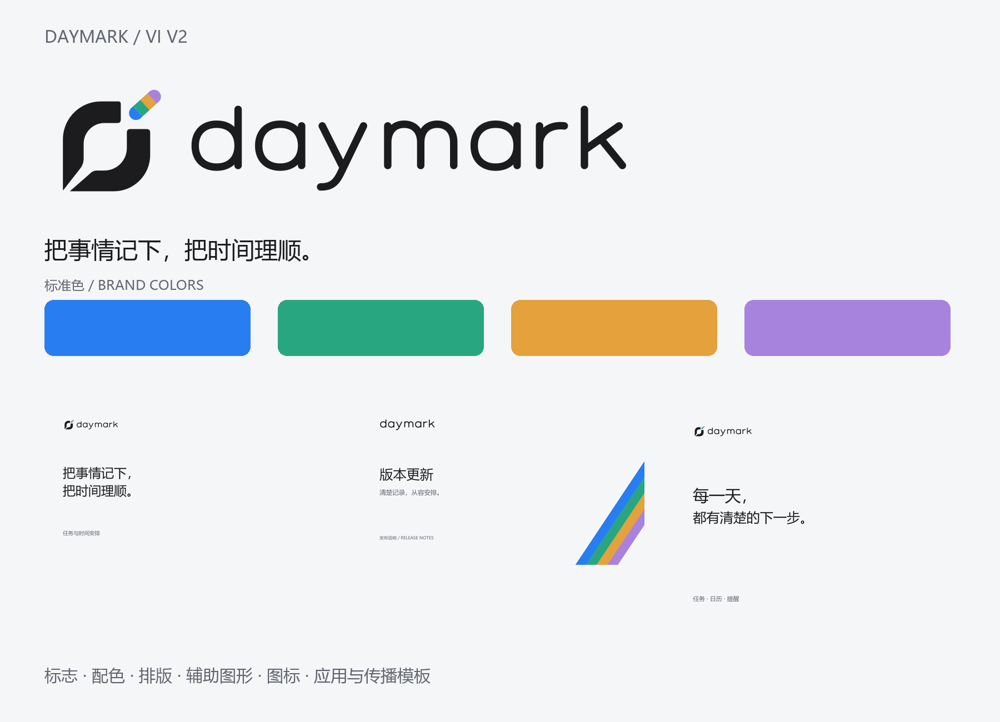

# Daymark VI V2 · 批准 A

现行版本：A-20261103。以用户确认的主体、留白、短笔与间距整体比例为准，沿用炭黑、蓝绿橙紫及原创小写字标。软件接入的实际测试记录见[PROGRESS](../../docs/PROGRESS.md)，平台未验证项不能由手册预览代替。

- [16页中文手册](output/pdf/Daymark-VI-V2.pdf)：品牌调性、标志、保护区、配色、字体、版式、小号、软件映射与传播模板。
- [使用规范](VI-Specification.md) · [产品接入契约](../../docs/design/brand-identity-integration.md) · [唯一生产母版](../../assets/brand/current/README.md)。
- `assets/`：标准浅深/单色矢量、16/20/24微型、应用载体、托盘模板和辅助图形。
- `exports/`：含sRGB的PNG；`templates/`：4组可编辑SVG与PNG预览。
- `tokens/`：品牌色参数及产品功能色参考，二者职责分开。
- `source/`：手册生成器、版本锁定、来源和校验；`manifest.json`为文件散列。
- `reference/main-ui-current.png`：临时合成资料下的Windows Qt原生界面截图，未贴图替换标志。

重建：Windows准备Python及Cairo原生库后，安装source/requirements.txt，运行 `python assets/brand/current/source/build_identity.py --runtime`，再运行 `python resource/VI/source/build_vi.py`。手册作者工具当前使用Windows本机微软雅黑/Segoe子集；macOS普通软件构建直接消费已提交资源，若重建中文手册须配置可嵌入字体并重新检查换行。没有分发独立字体、Qt SDK、用户任务或凭据。

旧日出/单拱等过程方案不属于现行VI；上游参考只用于形状研究。形状与颜色并不构成已完成商标检索或用户识别测试的声明。
